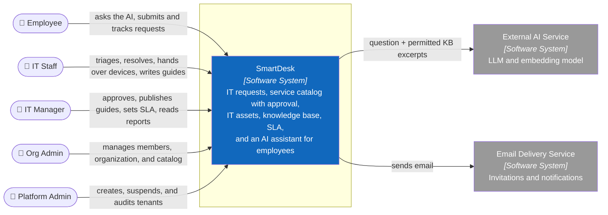
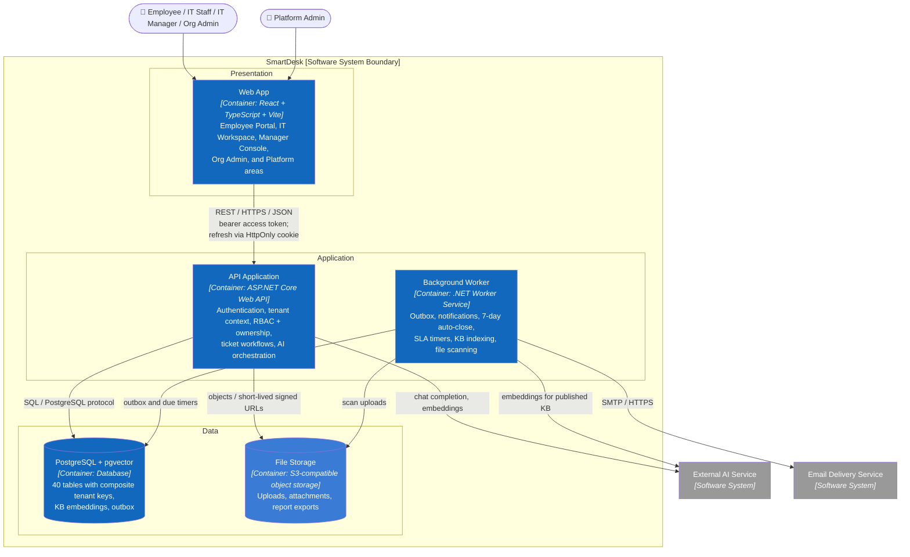
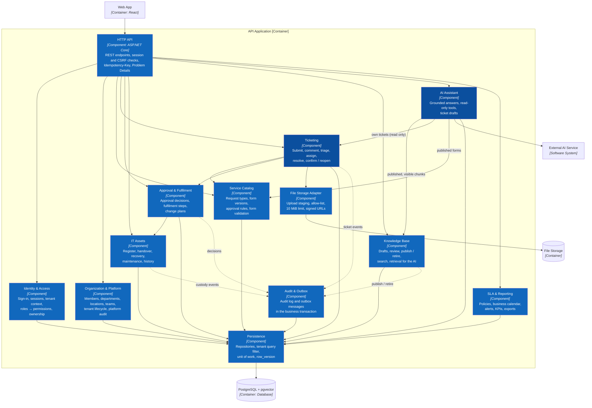
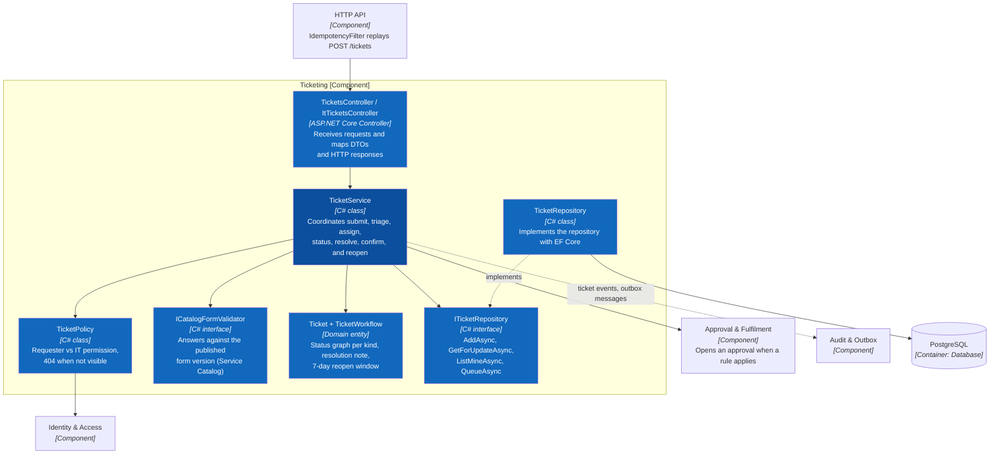
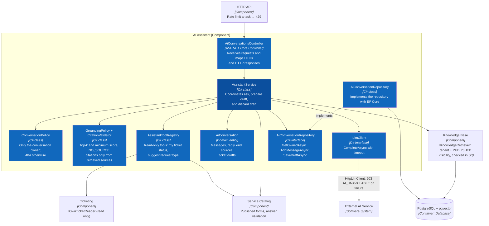

# SmartDesk

SmartDesk is a multi-tenant SaaS that gives companies one place to request IT help, track IT assets and share internal how-to guides. An AI assistant answers questions from the company's own published articles, shows its sources and turns a conversation into a ticket draft, only the employee can submit it, and only people can triage, approve or hand over devices.

## 1. Problem Analysis

The problem is decomposed top-down: why the product is needed, who uses it, which services it covers, how a request flows end to end, where the AI fits, which rules are non-negotiable, what ships in which release, how the product is positioned against the market and how success is measured.

### 1.1 Mind map


Editable XMind source: [`docs/mindmap/smartdesk.xmind`](docs/mindmap/smartdesk.xmind) (sheet 1: top-down analysis, sheet 2: feature map).

### 1.2 Feature map


### 1.3 Key findings

| Area | Summary |
|---|---|
| Problem | 	IT requests are scattered across chat and email; employees struggle to identify appropriate request types; recurring incidents lack centralized guidance; device handovers lack clear approval and audit trails; SLA visibility is limited. |
| Users | Five primary user roles: Employee, IT Staff, IT Manager, Org Admin, and Platform Admin. External AI Service acts as a secondary actor.|
| Services & Modules | IT request types include Incident (VPN, Wi-Fi, printer,...), Service Request (VPN access, laptop,...), and Change (office ISP change, Phase 2,..). Supporting modules include IT Asset Management and Knowledge Base. |
| Market evidence | Jira Service Management and Freshservice Freddy AI demonstrate established ITSM and AI self-service capabilities. Willingness to pay for SmartDesk is still in investigation. |
| Scope | Release 1 (MVP): 22 P0 user stories covering core IT support, ticket management, asset handover, knowledge base, and AI assistance. Release 2: 18 P1 stories. Phase 2: 3 P2 stories. |

Full analysis: [Top-down research](docs/01-top-down-research.md).

## 2. Requirements - Use Cases and INVEST User Stories

### 2.1 Use case diagrams

Three views cover all 43 use cases and all actors.


### 2.2 Roles and permissions

| Capability | Employee | IT Staff | IT Manager | Org Admin | Platform Admin |
|---|---|---|---|---|---|
| Catalog, requests, my tickets, AI assistant, KB | ✓ | ✓ | ✓ | ✓ | |
| Queue, triage, update, resolve tickets | | ✓ | ✓ | | |
| Fulfilment, device handover, asset register | | ✓ | read | | |
| KB drafts / publish | | drafts | publish | | |
| Approvals, approval rules, SLA, reports | | | ✓ | | |
| Organization, members, catalog builder | | | | ✓ | |
| Tenant activate / suspend | | | | | ✓ |

The API enforces role, tenant and ownership; hiding controls in the UI is only for usability.

### 2.3 INVEST backlog

The backlog has 43 user stories, one per use case. Each story lists its dependencies, links to an `AC-UCxx` acceptance block and has a per-story INVEST review. Every use case is specified with actor, preconditions, main flow, alternatives, permission and result.

| Criterion | Meaning in SmartDesk |
|---|---|
| **Independent** | Each story can be prioritized, developed, and tested with minimal dependencies on other stories. Unavoidable dependencies are explicitly identified. |
| **Negotiable** | Implementation details, UI design, and technical approaches can be discussed and refined with stakeholders while preserving agreed business requirements. |
| **Valuable** | Each story delivers clear value to its user role or the business by addressing a specific need or problem. |
| **Estimable** | Each story has a sufficiently clear scope, expected behavior, business rules, and dependencies for the development team to estimate its effort. |
| **Small** | Each story is small enough to be completed within one iteration. Large stories, such as the service catalog builder, are split into smaller, independently valuable stories. |
| **Testable** | Each story has clear, observable, and verifiable acceptance criteria covering successful behavior and relevant error or boundary conditions. |

```text
US01–US05   Identity and tenant           US23–US27   Catalog, approval, fulfilment
US06–US11   Employee self-service         US28–US32   IT assets
US12–US15   AI assistant                  US33–US35   Knowledge base
US16–US22   Ticket management             US36–US38   SLA and reporting
```

Details: [Use cases and specifications](docs/02-use-cases.md) · [INVEST requirements](docs/03-invest-requirements.md) · [Acceptance criteria](docs/06-acceptance-criteria.md).

## 3. Information Architecture 

The IA uses this convention: every page is a card listing its **functional sections**. 30 pages in 5 role-based areas; every use case has at least one entry screen.


### Employee Portal


### IT Workspace


Manager Console, Admin and shared pages, the full screen inventory and the use-case-to-screen mapping are in [Information architecture](docs/04-information-architecture.md).

## 4. UI/UX

Principles, flows, screen states and 40 prototype screenshots grouped by role (`common/`, `employee/`, `it-staff/`, `it-manager/`) are in [UI/UX](docs/05-ui-ux.md). The prototype is a single file: [`prototype/index.html`](prototype/index.html).

### Sign in


### Employee - AI assistant and ticket draft


### IT Staff - ticket with an IT-only note


### IT Manager - rejecting needs a reason


## 5. C4 Architecture

This README presents only C1–C3. C4 Level 4 and detailed UML are maintained in the architecture documentation directory.

### C1 — System Context



### C2 — Container



### C3 — Component



Complete documentation: [C4 Architecture](docs/architecture/c4/README.md).

## 6. Database Diagrams and OpenAPI 3.1 Contract

The database design is the persistence contract, and the OpenAPI document is the HTTP contract between the future React client and the ASP.NET Core backend.

### 6.1 Database diagrams

Core tables with keys and state columns (tenant edges hidden; every table except `tenants` and `users` carries `tenant_id`):

```mermaid
erDiagram
    USERS {
        uuid id PK
        varchar email
        user_status status
    }
    MEMBERSHIPS {
        uuid id PK
        uuid user_id FK
        uuid department_id FK "nullable"
        uuid location_id FK "nullable"
        membership_status status
        uuid invited_by_membership_id FK "nullable"
        text invite_token_hash UK
    }
    MEMBERSHIP_ROLES {
        uuid membership_id PK, FK
        role_code role PK
    }
    IT_TEAMS {
        uuid id PK
    }
    CATALOG_ITEMS {
        uuid id PK
        varchar code
        ticket_kind kind
    }
    CATALOG_VERSIONS {
        uuid id PK
        uuid catalog_item_id FK
        ticket_kind kind FK
        int version_no
        uuid routing_team_id FK "nullable"
        catalog_version_status status
        uuid created_by_membership_id FK
        uuid published_by_membership_id FK "nullable"
    }
    APPROVAL_RULES {
        uuid id PK
        uuid catalog_item_id FK
        uuid approver_membership_id FK "nullable"
        uuid created_by_membership_id FK
    }
    TICKETS {
        uuid id PK
        varchar ticket_no
        ticket_kind kind FK
        uuid requester_membership_id FK
        uuid catalog_version_id FK
        ticket_priority priority
        ticket_status status
        uuid assigned_team_id FK "nullable"
        uuid assigned_membership_id FK "nullable"
    }
    TICKET_COMMENTS {
        uuid id PK
        uuid ticket_id FK
        uuid author_membership_id FK
        comment_visibility visibility
    }
    TICKET_EVENTS {
        uuid id PK
        uuid ticket_id FK
        uuid actor_membership_id FK "nullable"
    }
    TICKET_APPROVALS {
        uuid id PK
        uuid ticket_id FK
        uuid approval_rule_id FK "nullable"
        uuid approver_membership_id FK "nullable"
        approval_status status
    }
    TICKET_ASSETS {
        uuid ticket_id PK, FK
        uuid asset_id PK, FK
        uuid linked_by_membership_id FK
    }
    FULFILMENT_STEPS {
        uuid id PK
        uuid ticket_id FK
        ticket_kind ticket_kind FK
        fulfilment_step_status status
        uuid completed_by_membership_id FK "nullable"
    }
    ASSETS {
        uuid id PK
        varchar asset_tag
        asset_status status
    }
    ASSET_ASSIGNMENTS {
        uuid id PK
        uuid asset_id FK
        uuid holder_membership_id FK
        uuid ticket_id FK "nullable"
        uuid handed_over_by_membership_id FK
        uuid returned_by_membership_id FK "nullable"
    }
    KB_ARTICLES {
        uuid id PK
        varchar slug
        kb_visibility visibility
        uuid created_by_membership_id FK
    }
    KB_ARTICLE_VERSIONS {
        uuid id PK
        uuid article_id FK
        int version_no
        kb_version_status status
        uuid created_by_membership_id FK
        uuid reviewed_by_membership_id FK "nullable"
        uuid published_by_membership_id FK "nullable"
    }
    AI_CONVERSATIONS {
        uuid id PK
        uuid membership_id FK
    }
    AI_MESSAGES {
        uuid id PK
        uuid conversation_id FK
    }
    AI_TICKET_DRAFTS {
        uuid id PK
        uuid conversation_id FK
        uuid created_by_membership_id FK
        uuid source_message_id FK "nullable"
        uuid catalog_version_id FK
        ai_draft_status status
        uuid submitted_ticket_id FK, UK "nullable"
    }
    SLA_POLICIES {
        uuid id PK
        uuid catalog_item_id FK "nullable"
        ticket_priority priority
        uuid created_by_membership_id FK
    }
    TICKET_SLA {
        uuid ticket_id PK, FK
        uuid sla_policy_id FK
    }
    USERS ||--o{ MEMBERSHIPS : "member as"
    MEMBERSHIPS |o--o{ MEMBERSHIPS : "invited by"
    MEMBERSHIPS ||--o{ MEMBERSHIP_ROLES : "has"
    CATALOG_ITEMS ||--o{ CATALOG_VERSIONS : "has"
    IT_TEAMS |o--o{ CATALOG_VERSIONS : "routing team"
    CATALOG_ITEMS ||--o{ APPROVAL_RULES : "has"
    MEMBERSHIPS |o--o{ APPROVAL_RULES : "approver"
    CATALOG_VERSIONS ||--o{ TICKETS : "form for"
    MEMBERSHIPS ||--o{ TICKETS : "requester"
    IT_TEAMS |o--o{ TICKETS : "assigned team"
    MEMBERSHIPS |o--o{ TICKETS : "assigned"
    TICKETS ||--o{ TICKET_COMMENTS : "has"
    MEMBERSHIPS ||--o{ TICKET_COMMENTS : "author"
    TICKETS ||--o{ TICKET_EVENTS : "has"
    TICKETS ||--o{ TICKET_ASSETS : "has"
    ASSETS ||--o{ TICKET_ASSETS : "concerned by"
    TICKETS ||--o{ TICKET_APPROVALS : "has"
    APPROVAL_RULES |o--o{ TICKET_APPROVALS : "applied as"
    MEMBERSHIPS |o--o{ TICKET_APPROVALS : "approver"
    TICKETS ||--o{ FULFILMENT_STEPS : "has"
    ASSETS ||--o{ ASSET_ASSIGNMENTS : "has"
    MEMBERSHIPS ||--o{ ASSET_ASSIGNMENTS : "holder"
    TICKETS |o--o{ ASSET_ASSIGNMENTS : "authorises"
    KB_ARTICLES ||--o{ KB_ARTICLE_VERSIONS : "has"
    MEMBERSHIPS ||--o{ AI_CONVERSATIONS : "owns"
    AI_CONVERSATIONS ||--o{ AI_MESSAGES : "has"
    AI_CONVERSATIONS ||--o{ AI_TICKET_DRAFTS : "proposes"
    AI_MESSAGES |o--o{ AI_TICKET_DRAFTS : "source message"
    CATALOG_VERSIONS ||--o{ AI_TICKET_DRAFTS : "form for"
    TICKETS |o--o| AI_TICKET_DRAFTS : "submitted ticket"
    CATALOG_ITEMS |o--o{ SLA_POLICIES : "has"
    TICKETS ||--o| TICKET_SLA : "has"
    SLA_POLICIES ||--o{ TICKET_SLA : "applied to"
```



See the [database design](docs/database/README.md), the [full ERD of all 40 tables](docs/database/smartdesk-full-erd.mmd), the [DBML schema](docs/database/smartdesk.dbml), and the [constraints DBML cannot express](docs/database/smartdesk-constraints.sql).

### 6.2 OpenAPI 3.1 API documentation

The HTTP contract is defined with OpenAPI 3.1 and organized into Authentication, Identity, Organization, Members, Platform, Catalog, Tickets, IT Tickets, Approvals, Fulfilment, Change Management, Assets, Knowledge Base, AI Assistant, SLA, Reporting, and Notifications.

```text
91 paths
105 operations (P0 53 · P1 45 · P2 7), 43/43 use cases traced
Bearer access token + HttpOnly refresh cookie with CSRF double submit; separate platform session
x-roles, x-permissions, and x-data-scope metadata on every operation
Idempotency-Key on ticket submission; expectedVersion on every command
Reusable request/response schemas; 524 validated examples
RFC 9457 application/problem+json errors with a single ErrorCode enum
```

Every operation has a stable `operationId`, documented parameters, request and response schemas, success/error status codes, and target authorization rules. The contract is a design source of truth; the backend runtime has not been implemented yet.

- [OpenAPI 3.1 specification](docs/api/openapi.yaml)
- [API documentation and sample calls](docs/api/README.md)
- [Use case ↔ operation traceability](docs/api/traceability.md)
- [OpenAPI review and resolutions](docs/api/openapi-review.md)

## 7. Frontend and Backend Folder Structures

### 7.1 Current repository layout

```text
SmartDesk/
├── docs/
│   ├── 00-draft-audit.md … 06-acceptance-criteria.md   # Research, use cases, INVEST, IA, UI/UX, acceptance criteria
│   ├── 07-folder-structure.md        # Target React and ASP.NET Core structure
│   ├── api/                          # OpenAPI contract, API guide, traceability, review
│   ├── architecture/
│   │   ├── c4/                       # C1–C4
│   │   └── uml/                      # Class and sequence diagrams
│   ├── database/                     # DBML, constraints, ERDs
│   ├── mindmap/                      # smartdesk.xmind + exported PNGs
│   └── images/                       # use-cases/, relume/, ui/
├── prototype/index.html              # Clickable UX prototype (mock data)
├── tools/                            # Generators for every diagram (python tools/build_*.py)
└── README.md
```

The prototype is an intentional mock-data design artifact and is not connected to an API. The backend, the React application, and the database deployment do not exist yet. See [Project Progress](#project-progress) for the current checklist.

All requirement diagrams are generated from [`tools/model.py`](tools/model.py), so use cases, screens and images stay consistent. Rebuild with:

```bash
python tools/build_mindmap.py && python tools/build_usecases.py && python tools/build_sitemap.py && python tools/capture_ui.py
```

Requirements: Python 3.10+ with Pillow, and Chrome or Edge for headless rendering.

### 7.2 Target React feature structure

```text
frontend/src/
├── app/                 # Routes per role area, providers, application composition
├── components/          # Shared layout, forms, feedback, and data display
├── features/
│   ├── auth/
│   ├── profile/
│   ├── notifications/
│   ├── catalog/
│   ├── tickets/
│   ├── assistant/
│   ├── kb/
│   ├── assets/
│   ├── approvals/
│   ├── sla/
│   ├── reports/
│   ├── admin/
│   └── platform/
├── services/            # Generated OpenAPI client, apiClient, endpoints, downloads
├── hooks/               # Shared reusable hooks
├── lib/                 # Pure date, formatting, and validation helpers
├── styles/
└── test/                # Setup, fixtures, handlers, and provider-aware rendering
```

Target dependency flow:

```text
Page/Component → Feature Hook → Feature Service → apiClient → REST API
```

### 7.3 Target ASP.NET Core three-tier structure

```text
backend/
├── db/migrations/                   # SQL exported from docs/database
├── src/
│   ├── SmartDesk.Api/               # Presentation: controllers, contracts, filters, middleware
│   ├── SmartDesk.Application/       # Services, policies, workflows, entities, interfaces
│   ├── SmartDesk.Infrastructure/    # PostgreSQL + pgvector, repositories, files, AI provider, email
│   └── SmartDesk.Worker/            # Outbox dispatcher and scheduled jobs
└── tests/
    ├── SmartDesk.Application.Tests/
    ├── SmartDesk.Api.Tests/
    ├── SmartDesk.Infrastructure.Tests/
    └── SmartDesk.ArchitectureTests/
```

Dependency rules:

```text
Api → Application
Worker → Application
Infrastructure → Application
Api / Worker → Infrastructure only at the dependency-injection composition root
Application → neither Api, Worker, nor Infrastructure
```

The complete module ownership, naming, dependency, and test-location design is maintained in [Target Folder Structure](docs/07-folder-structure.md).

## 8. Detailed Class and Sequence Design

Detailed design derives from the C4 components, the database and OpenAPI contracts, and the target folder ownership. These diagrams remain target design views for the two core features: Ticket Request & Lifecycle and the AI Assistant.

### 8.1 C4 Level 4 — Code collaboration

#### L4.1 Ticket Request & Lifecycle



#### L4.2 AI Assistant



Source: [C4 Level 4 — Code](docs/architecture/c4/04-code.md)

### 8.2 Core class diagrams

#### 1. Ticketing

```mermaid
classDiagram
    direction TB

    class TicketsController {
        +CreateAsync(CreateTicketRequest, string idempotencyKey, CancellationToken) Task
        +ListMineAsync(TicketListQuery, CancellationToken) Task
        +GetAsync(Guid ticketId, CancellationToken) Task
        +ConfirmAsync(Guid ticketId, VersionRequest, CancellationToken) Task
        +ReopenAsync(Guid ticketId, ReopenTicketRequest, CancellationToken) Task
    }

    class ItTicketsController {
        +QueueAsync(TicketQueueQuery, CancellationToken) Task
        +TriageAsync(Guid ticketId, TriageTicketRequest, CancellationToken) Task
        +AssignAsync(Guid ticketId, AssignTicketRequest, CancellationToken) Task
        +ChangeStatusAsync(Guid ticketId, ChangeStatusRequest, CancellationToken) Task
        +ResolveAsync(Guid ticketId, ResolveTicketRequest, CancellationToken) Task
    }

    class CreateTicketRequest {
        +Guid RequestTypeId
        +int RequestTypeVersion
        +string Title
        +string? Description
        +Dictionary~string, JsonElement~ Answers
        +Guid[] UploadIds
        +Guid? AiDraftId
    }

    class TriageTicketRequest {
        +int ExpectedVersion
        +string Category
        +TicketPriority Priority
        +Guid? TargetRequestTypeId
        +int? TargetRequestTypeVersion
        +string? Reason
    }

    class ResolveTicketRequest {
        +int ExpectedVersion
        +string ResolutionNote
    }

    class TicketResponse {
        +Guid Id
        +string DisplayId
        +TicketKind TicketType
        +TicketStatus Status
        +string Title
        +ActorResponse Requester
        +ActorResponse? Assignee
        +TicketPriority Priority
        +DateTimeOffset? ReopenDeadlineAt
        +int Version
    }

    class IdempotencyFilter {
        +OnActionExecutionAsync(ActionExecutingContext, ActionExecutionDelegate) Task
    }

    class ITicketService {
        <<interface>>
        +SubmitAsync(ActorContext, SubmitTicketCommand, CancellationToken) Task
        +TriageAsync(ActorContext, TriageCommand, CancellationToken) Task
        +AssignAsync(ActorContext, AssignCommand, CancellationToken) Task
        +ChangeStatusAsync(ActorContext, StatusCommand, CancellationToken) Task
        +ResolveAsync(ActorContext, ResolveCommand, CancellationToken) Task
        +ConfirmAsync(ActorContext, Guid, int, CancellationToken) Task
        +ReopenAsync(ActorContext, Guid, int, string, CancellationToken) Task
    }

    class TicketService {
        +SubmitAsync(ActorContext, SubmitTicketCommand, CancellationToken) Task
        +TriageAsync(ActorContext, TriageCommand, CancellationToken) Task
        +ResolveAsync(ActorContext, ResolveCommand, CancellationToken) Task
        +ConfirmAsync(ActorContext, Guid, int, CancellationToken) Task
        +ReopenAsync(ActorContext, Guid, int, string, CancellationToken) Task
    }

    class TicketPolicy {
        +EnsureCanRead(ActorContext, Ticket) void
        +EnsureRequester(ActorContext, Ticket) void
        +EnsureItPermission(ActorContext, string permission) void
    }

    class ICatalogFormValidator {
        <<interface>>
        +ValidateAsync(Guid requestTypeId, int version, Answers, ActorContext, CancellationToken) Task
    }

    class IApprovalRuleResolver {
        <<interface>>
        +ResolveAsync(Guid catalogVersionId, ActorContext, CancellationToken) Task
    }

    class Ticket {
        +Guid Id
        +Guid TenantId
        +string TicketNo
        +TicketKind Kind
        +TicketStatus Status
        +TicketSource Source
        +Guid RequesterMembershipId
        +Guid CatalogVersionId
        +Answers FormAnswers
        +TicketPriority Priority
        +string? Category
        +Guid? AssignedMembershipId
        +string? ResolutionNote
        +DateTimeOffset? ResolvedAt
        +int RowVersion
        +Submit(SubmitTicketCommand, bool approvalRequired, DateTimeOffset) Ticket
        +Triage(string category, TicketPriority, Guid actor) void
        +ConvertTo(Guid catalogVersionId, TicketKind, Answers, string reason) void
        +AssignTo(Guid assignee, Guid actor) void
        +MoveTo(TicketStatus, string? reason, Guid actor) void
        +Resolve(string note, Guid actor, DateTimeOffset) void
        +ConfirmResolution(Guid requester, DateTimeOffset) void
        +Reopen(Guid requester, string reason, DateTimeOffset) void
        +AutoClose(DateTimeOffset) void
    }

    class TicketWorkflow {
        +InitialStatus(TicketKind, bool approvalRequired) TicketStatus
        +CanMove(TicketKind, TicketStatus from, TicketStatus to) bool
    }

    class TicketEvent {
        +TicketEventType EventType
        +TicketStatus? OldStatus
        +TicketStatus? NewStatus
        +string? Reason
        +Guid? ActorMembershipId
        +DateTimeOffset CreatedAt
    }

    class ITicketRepository {
        <<interface>>
        +AddAsync(Ticket, CancellationToken) Task
        +GetForUpdateAsync(Guid, CancellationToken) Task
        +ListMineAsync(Guid membershipId, TicketQuery, CancellationToken) Task
        +QueueAsync(TicketQuery, CancellationToken) Task
        +ListResolvedBeforeAsync(DateTimeOffset, int, CancellationToken) Task
    }

    class IIdempotencyStore {
        <<interface>>
        +FindAsync(IdempotencyScope, CancellationToken) Task
        +SaveAsync(IdempotencyScope, string requestHash, int status, string body, CancellationToken) Task
    }

    class IUnitOfWork {
        <<interface>>
        +ExecuteAsync(ActorContext, Func~Task~, CancellationToken) Task
    }

    class TicketRepository {
        +AddAsync(Ticket, CancellationToken) Task
        +GetForUpdateAsync(Guid, CancellationToken) Task
        +ListMineAsync(Guid membershipId, TicketQuery, CancellationToken) Task
        +QueueAsync(TicketQuery, CancellationToken) Task
        +ListResolvedBeforeAsync(DateTimeOffset, int, CancellationToken) Task
    }

    class IdempotencyStore
    class EfUnitOfWork
    class AutoCloseResolvedTicketsJob {
        +RunAsync(CancellationToken) Task
    }

    TicketsController ..> CreateTicketRequest
    TicketsController ..> TicketResponse
    ItTicketsController ..> TriageTicketRequest
    ItTicketsController ..> ResolveTicketRequest
    TicketsController --> ITicketService
    ItTicketsController --> ITicketService
    IdempotencyFilter --> IIdempotencyStore
    ITicketService <|.. TicketService
    TicketService --> TicketPolicy
    TicketService --> ICatalogFormValidator
    TicketService --> IApprovalRuleResolver
    TicketService --> ITicketRepository
    TicketService --> IUnitOfWork
    TicketService ..> Ticket
    Ticket --> TicketWorkflow
    Ticket "1" *-- "many" TicketEvent
    ITicketRepository <|.. TicketRepository
    IIdempotencyStore <|.. IdempotencyStore
    IUnitOfWork <|.. EfUnitOfWork
    AutoCloseResolvedTicketsJob --> ITicketRepository
```



#### 2. AI Assistant

```mermaid
classDiagram
    direction TB

    class AiConversationsController {
        +StartAsync(CancellationToken) Task
        +AskAsync(Guid conversationId, AskRequest, CancellationToken) Task
        +PrepareDraftAsync(Guid conversationId, PrepareDraftRequest, CancellationToken) Task
        +DiscardDraftAsync(Guid conversationId, Guid draftId, CancellationToken) Task
    }

    class AskRequest {
        +string Text
    }

    class AiReplyResponse {
        +Guid Id
        +AiReplyKind Kind
        +string Text
        +CitationResponse[] Citations
        +OwnTicketStatusResponse? Ticket
        +Guid? SuggestedRequestTypeId
    }

    class PrepareDraftRequest {
        +Guid RequestTypeId
        +Dictionary~string, JsonElement~? Facts
        +string? TitleHint
    }

    class TicketDraftResponse {
        +Guid Id
        +AiDraftStatus Status
        +Guid RequestTypeId
        +int RequestTypeVersion
        +string Title
        +Dictionary~string, JsonElement~ Answers
        +string[] MissingRequiredFieldIds
        +bool ReadyToSubmit
    }

    class IAssistantService {
        <<interface>>
        +StartAsync(ActorContext, CancellationToken) Task
        +AskAsync(ActorContext, Guid, string, CancellationToken) Task
        +PrepareDraftAsync(ActorContext, Guid, PrepareDraftCommand, CancellationToken) Task
        +DiscardDraftAsync(ActorContext, Guid, Guid, CancellationToken) Task
    }

    class AssistantService {
        +AskAsync(ActorContext, Guid, string, CancellationToken) Task
        +PrepareDraftAsync(ActorContext, Guid, PrepareDraftCommand, CancellationToken) Task
        +DiscardDraftAsync(ActorContext, Guid, Guid, CancellationToken) Task
    }

    class ConversationPolicy {
        +EnsureOwner(ActorContext, AiConversation) void
    }

    class GroundingPolicy {
        +int TopK
        +double MinScore
        +SelectSources(IReadOnlyList~KbChunkHit~) SourceSet
    }

    class PromptBuilder {
        +ForAnswer(string question, SourceSet, IReadOnlyList~AiMessage~) LlmRequest
        +ForDraft(IReadOnlyList~AiMessage~, PublishedForm) LlmRequest
    }

    class CitationValidator {
        +Validate(LlmResponse, SourceSet) ValidatedAnswer
    }

    class AssistantToolRegistry {
        +For(ActorContext) IReadOnlyList~IAssistantTool~
        +ExecuteAsync(ToolCall, ActorContext, CancellationToken) Task
    }

    class IAssistantTool {
        <<interface>>
        +string Name
        +ExecuteAsync(JsonElement args, ActorContext, CancellationToken) Task
    }

    class MyTicketStatusTool
    class SuggestRequestTypeTool

    class AiConversation {
        +Guid Id
        +Guid TenantId
        +Guid MembershipId
        +DateTimeOffset StartedAt
        +AddUserMessage(string) AiMessage
        +AddAssistantMessage(ValidatedAnswer, string model, int inputTokens, int outputTokens) AiMessage
        +AddDraft(PublishedForm, Answers, string title) AiTicketDraft
    }

    class AiMessage {
        +AiSender Sender
        +string Content
        +AiReplyKind? ReplyKind
        +string? Model
    }

    class AiMessageSource {
        +Guid KbArticleVersionId
        +string? Excerpt
    }

    class AiTicketDraft {
        +Guid Id
        +Guid CatalogVersionId
        +Answers ProposedAnswers
        +AiDraftStatus Status
        +Guid? SubmittedTicketId
        +MarkSubmitted(Guid ticketId) void
        +Discard() void
    }

    class ILlmClient {
        <<interface>>
        +CompleteAsync(LlmRequest, CancellationToken) Task
    }

    class IEmbeddingClient {
        <<interface>>
        +EmbedAsync(string, CancellationToken) Task
    }

    class IKnowledgeRetriever {
        <<interface>>
        +SearchAsync(ActorContext, float[] embedding, int topK, CancellationToken) Task
    }

    class IOwnTicketReader {
        <<interface>>
        +FindMineAsync(ActorContext, string query, CancellationToken) Task
    }

    class IPublishedCatalogReader {
        <<interface>>
        +GetUsableFormAsync(ActorContext, Guid requestTypeId, CancellationToken) Task
    }

    class IAiConversationRepository {
        <<interface>>
        +GetOwnedAsync(Guid id, Guid membershipId, CancellationToken) Task
        +SaveAsync(AiConversation, CancellationToken) Task
    }

    class HttpLlmClient
    class HttpEmbeddingClient
    class PgVectorKnowledgeRetriever
    class AiConversationRepository

    AiConversationsController ..> AskRequest
    AiConversationsController ..> AiReplyResponse
    AiConversationsController ..> PrepareDraftRequest
    AiConversationsController ..> TicketDraftResponse
    AiConversationsController --> IAssistantService
    IAssistantService <|.. AssistantService
    AssistantService --> ConversationPolicy
    AssistantService --> IEmbeddingClient
    AssistantService --> IKnowledgeRetriever
    AssistantService --> GroundingPolicy
    AssistantService --> PromptBuilder
    AssistantService --> ILlmClient
    AssistantService --> AssistantToolRegistry
    AssistantService --> CitationValidator
    AssistantService --> IPublishedCatalogReader
    AssistantService --> IAiConversationRepository
    AssistantService ..> AiConversation
    AssistantToolRegistry o-- IAssistantTool
    IAssistantTool <|.. MyTicketStatusTool
    IAssistantTool <|.. SuggestRequestTypeTool
    MyTicketStatusTool --> IOwnTicketReader
    SuggestRequestTypeTool --> IPublishedCatalogReader
    AiConversation "1" *-- "many" AiMessage
    AiMessage "1" *-- "many" AiMessageSource
    AiConversation "1" *-- "many" AiTicketDraft
    ILlmClient <|.. HttpLlmClient
    IEmbeddingClient <|.. HttpEmbeddingClient
    IKnowledgeRetriever <|.. PgVectorKnowledgeRetriever
    IAiConversationRepository <|.. AiConversationRepository
```



Source: [Core Class Diagrams](docs/architecture/uml/01-class-diagrams.md)

### 8.3 Sequence diagrams

Runtime sequences cover request submission with idempotency, triage and resolution with optimistic locking, confirmation, reopening and auto-close, grounded answers with `NO_SOURCE`, and turning a chat into a ticket. Each sequence maps the use case and OpenAPI operation to its controller, application service, policy, repository, database interaction, success response, and error paths.

- [Core sequence diagrams](docs/architecture/uml/02-sequence-diagrams.md)
- [API traceability](docs/api/traceability.md)

## Documentation

- Requirements: [Top-down research](docs/01-top-down-research.md), [Use cases](docs/02-use-cases.md), [INVEST backlog](docs/03-invest-requirements.md), [Acceptance criteria](docs/06-acceptance-criteria.md).
- UI/UX: [Information architecture](docs/04-information-architecture.md), [UI/UX](docs/05-ui-ux.md).
- Database: [Database design](docs/database/README.md), [DBML](docs/database/smartdesk.dbml), [full ERD](docs/database/smartdesk-full-erd.mmd).
- Architecture: [C4 Architecture](docs/architecture/c4/README.md).
- Folder structure: [React and three-tier backend](docs/07-folder-structure.md).
- Code-level design: [Core class diagrams](docs/architecture/uml/01-class-diagrams.md) and [core sequences](docs/architecture/uml/02-sequence-diagrams.md).
- API contract: [OpenAPI 3.1 specification](docs/api/openapi.yaml), [API documentation](docs/api/README.md), and [review](docs/api/openapi-review.md).

## Project Progress

- [x] Top-down problem analysis and market evidence
- [x] Mind map - top-down analysis and feature map
- [x] Use case diagrams covering 43 use cases and 6 actors
- [x] INVEST backlog with dependencies, acceptance criteria and release plan
- [x] Relume-style information architecture (30 pages with functional sections)
- [x] UX principles, user flows and screen states
- [x] Clickable UX prototype for Employee, IT Staff and IT Manager
- [x] Design the C4 System Context, Container, and Component
- [x] Design the PostgreSQL schema, DBML, and data relationships
- [x] Write the API documentation in OpenAPI 3.1
- [x] Design the React frontend folder structure
- [x] Design the three-tier backend folder structure
- [x] Design class diagrams and sequence diagrams for the two core features
- [x] Create traceability between use cases and API operations
- [ ] Usability test with 5–8 participants
- [ ] Build the three-tier ASP.NET Core backend
- [ ] Build the React frontend
- [ ] Integrate the AI assistant with a real provider
