# SmartDesk

SmartDesk is a multi-tenant SaaS that gives small and mid-sized companies one place to request IT help, track IT assets and share internal how-to guides. An AI assistant answers questions from the company's own published articles, shows its sources and turns a conversation into a ticket draft, only the employee can submit it, and only people can triage, approve or hand over devices.

## 1. Problem Analysis

The problem is decomposed top-down: why the product is needed, who uses it, which services it covers, how a request flows end to end, where the AI fits, which rules are non-negotiable, what ships in which release, how the product is positioned against the market and how success is measured.

### 1.1 Mind map

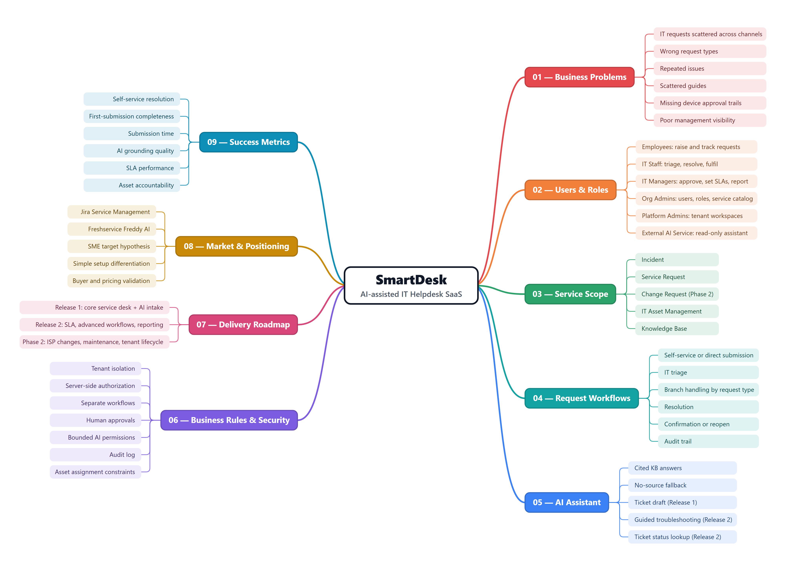

Editable XMind source: [`docs/mindmap/smartdesk.xmind`](docs/mindmap/smartdesk.xmind) (sheet 1: top-down analysis, sheet 2: feature map).

### 1.2 Feature map

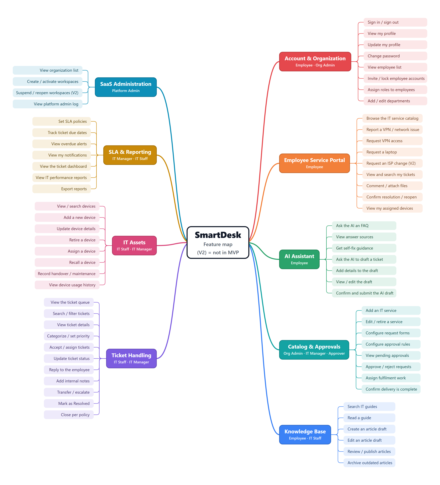

### 1.3 Key findings

| Area | Summary |
|---|---|
| Problem | Requests lost across chat/email; employees cannot pick a request type; repeated incidents; device handover without approval trail; no SLA visibility. |
| Users | Employee, IT Staff, IT Manager, Org Admin, Platform Admin; External AI Service as a secondary actor. |
| Services | Incident (VPN, Wi-Fi, printer), Service Request (VPN access, laptop), Change (office ISP, Phase 2), assets, knowledge base. |
| Market evidence | Jira Service Management and Freshservice Freddy AI show the ITSM feature set and AI self-service are established; willingness to pay is **not yet validated**. |
| Scope | Release 1 = 22 P0 stories (VPN incident + laptop request + KB + AI); Release 2 = 18 P1; Phase 2 = 3 P2. |

Full analysis: [Top-down research](docs/01-top-down-research.md).

## 2. Requirements - Use Cases and INVEST User Stories

### 2.1 Use case diagrams

Three views cover all 43 use cases and all actors.

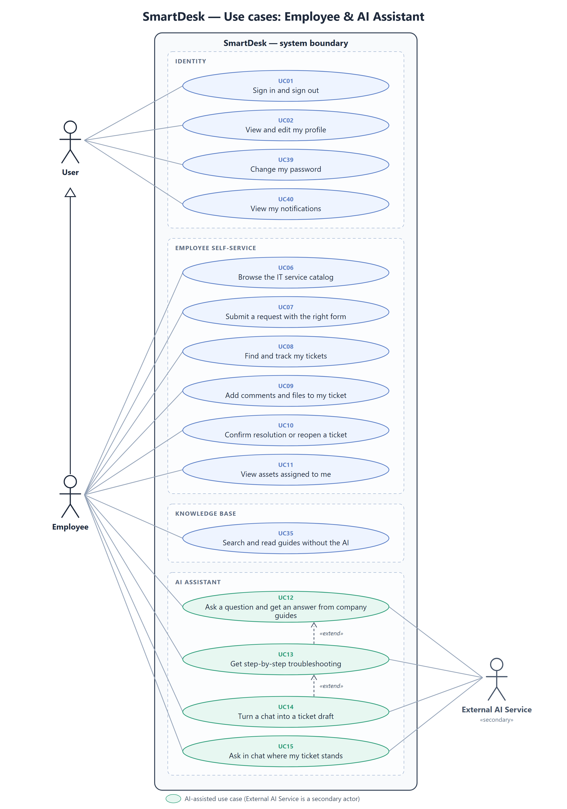

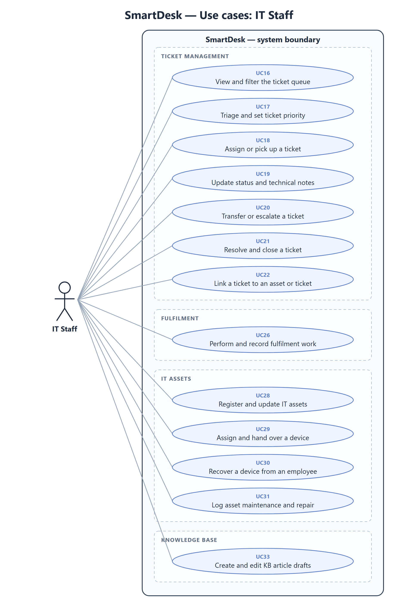

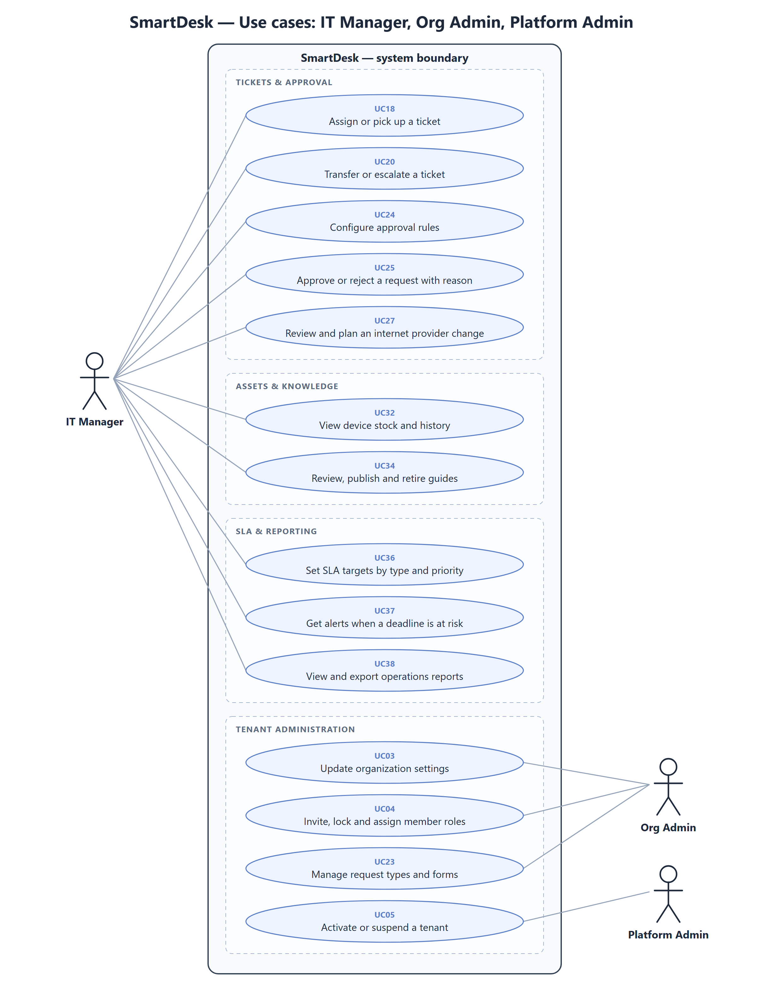

### 2.2 Roles and permissions

| Capability | Employee | IT Staff | IT Manager | Org Admin | Platform Admin |
|---|---|---|---|---|---|
| Catalog, requests, my tickets, AI assistant, KB | ✓ | ✓ | ✓ | ✓ | |
| Queue, triage, update, resolve tickets | | ✓ | ✓ | | |
| Fulfilment, device handover, asset register | | ✓ | read | | |
| KB drafts / publish | | drafts | publish | | |
| Approvals, approval rules, SLA, reports | | | ✓ | | |
| Organization, members, catalog builder | | | | ✓ | |
| Tenant activate / suspend | | | | | ✓ |

The API enforces role, tenant and ownership; hiding controls in the UI is only for usability.

### 2.3 INVEST backlog

The backlog has 43 user stories, one per use case. Each story lists its dependencies, links to an `AC-UCxx` acceptance block and has a per-story INVEST review. Every use case is specified with actor, preconditions, main flow, alternatives, permission and result.

| Criterion | Meaning in SmartDesk |
|---|---|
| **Independent** | Each story can be prioritized, developed, and tested with minimal dependencies on other stories. Unavoidable dependencies are explicitly identified. |
| **Negotiable** | Implementation details, UI design, and technical approaches can be discussed and refined with stakeholders while preserving agreed business requirements. |
| **Valuable** | Each story delivers clear value to its user role or the business by addressing a specific need or problem. |
| **Estimable** | Each story has a sufficiently clear scope, expected behavior, business rules, and dependencies for the development team to estimate its effort. |
| **Small** | Each story is small enough to be completed within one iteration. Large stories, such as the service catalog builder, are split into smaller, independently valuable stories. |
| **Testable** | Each story has clear, observable, and verifiable acceptance criteria covering successful behavior and relevant error or boundary conditions. |

```text
US01–US05   Identity and tenant           US23–US27   Catalog, approval, fulfilment
US06–US11   Employee self-service         US28–US32   IT assets
US12–US15   AI assistant                  US33–US35   Knowledge base
US16–US22   Ticket management             US36–US38   SLA and reporting
```

Details: [Use cases and specifications](docs/02-use-cases.md) · [INVEST requirements](docs/03-invest-requirements.md) · [Acceptance criteria](docs/06-acceptance-criteria.md).

## 3. Information Architecture 

The IA uses this convention: every page is a card listing its **functional sections**. 30 pages in 5 role-based areas; every use case has at least one entry screen.

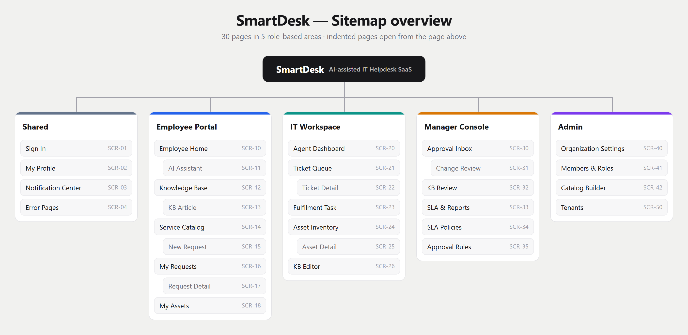

### Employee Portal

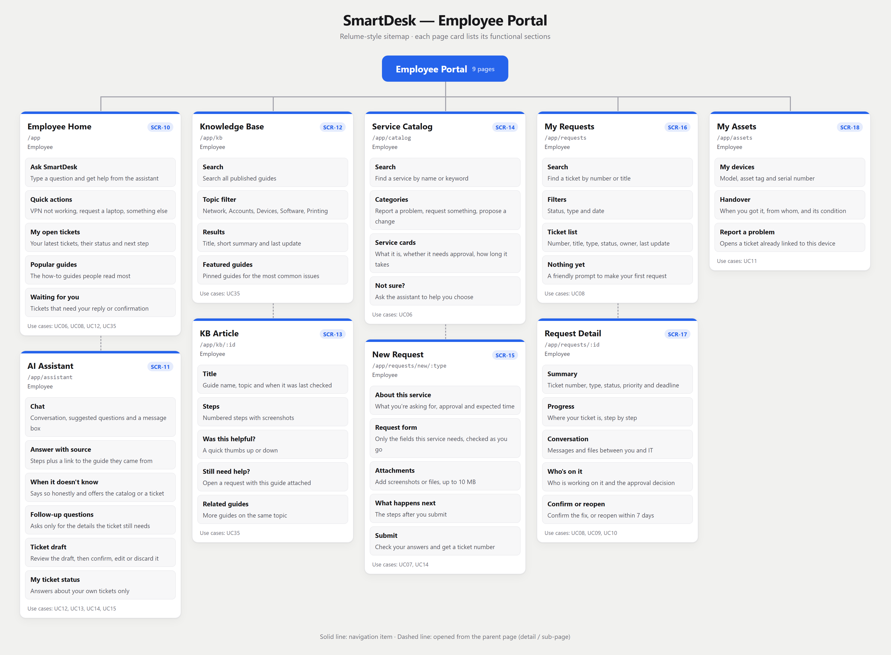

### IT Workspace

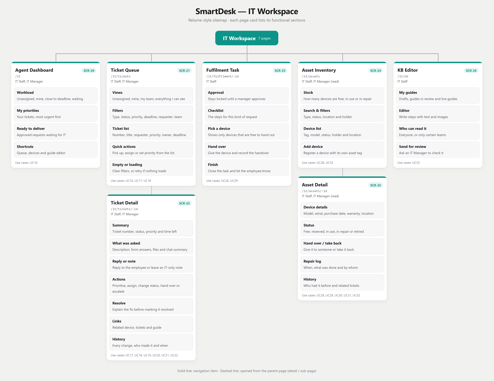

Manager Console, Admin and shared pages, the full screen inventory and the use-case-to-screen mapping are in [Information architecture](docs/04-information-architecture.md).

## 4. UI/UX

Principles, flows, screen states and 40 prototype screenshots grouped by role (`common/`, `employee/`, `it-staff/`, `it-manager/`) are in [UI/UX](docs/05-ui-ux.md). The prototype is a single file: [`prototype/index.html`](prototype/index.html).

### Sign in

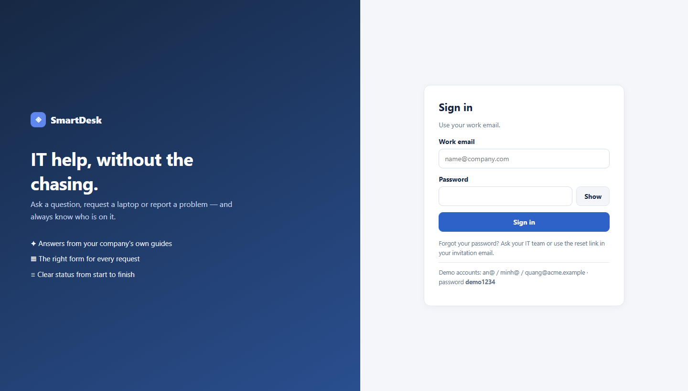

### Employee - AI assistant and ticket draft

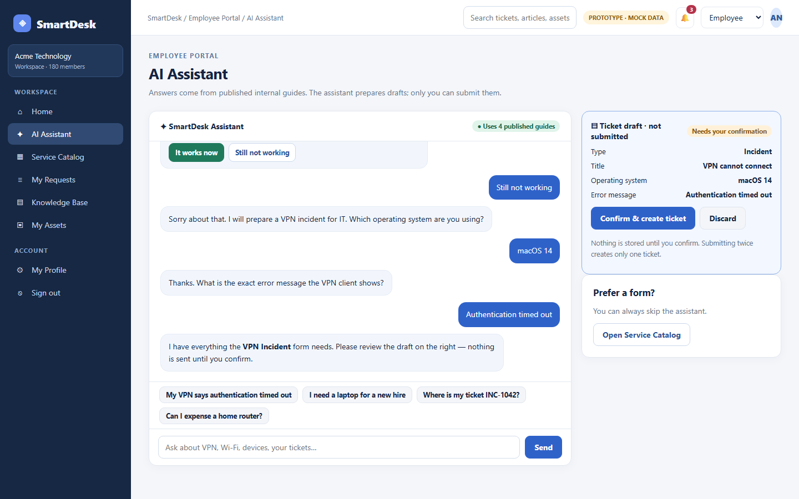

### IT Staff - ticket with an IT-only note

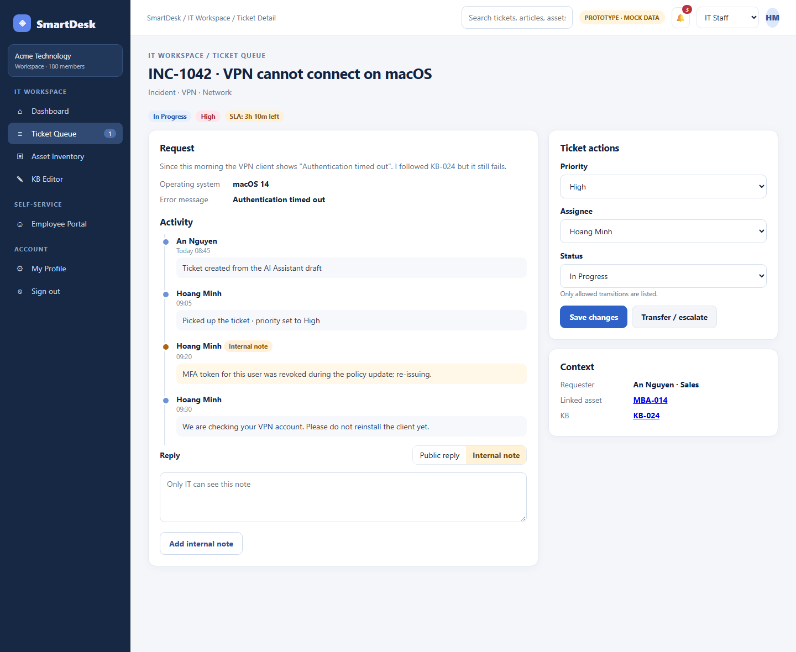

### IT Manager - rejecting needs a reason

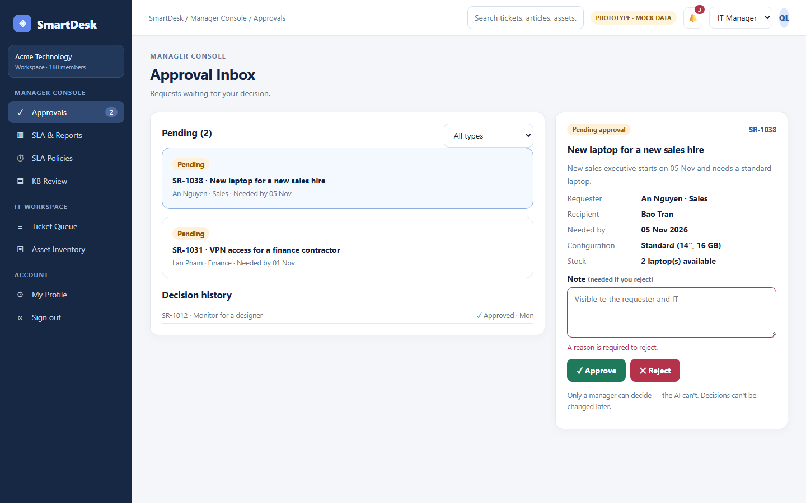

## Repository layout

```text
SmartDesk/
├── docs/
│   ├── 00-draft-audit.md              # Review of the first draft and what changed
│   ├── 01-top-down-research.md
│   ├── 02-use-cases.md
│   ├── 03-invest-requirements.md
│   ├── 04-information-architecture.md
│   ├── 05-ui-ux.md
│   ├── 06-acceptance-criteria.md
│   ├── mindmap/                       # smartdesk.xmind + exported PNGs
│   └── images/                        # use-cases/, relume/, ui/
├── prototype/index.html               # Clickable UX prototype (mock data)
└── tools/                             # Generators for every diagram (python tools/build_*.py)
```

All diagrams are generated from [`tools/model.py`](tools/model.py), so use cases, screens and images stay consistent. Rebuild with:

```bash
python tools/build_mindmap.py && python tools/build_usecases.py && python tools/build_sitemap.py && python tools/capture_ui.py
```

Requirements: Python 3.10+ with Pillow, and Chrome or Edge for headless rendering.

## Project Progress

- [x] Top-down problem analysis and market evidence
- [x] Mind map - top-down analysis and feature map
- [x] Use case diagrams covering 43 use cases and 6 actors
- [x] INVEST backlog with dependencies, acceptance criteria and release plan
- [x] Relume-style information architecture (30 pages with functional sections)
- [x] UX principles, user flows and screen states
- [x] Clickable UX prototype for Employee, IT Staff and IT Manager
- [ ] Usability test with 5–8 participants
- [ ] C4 architecture, data model and API contract
- [ ] Backend and real AI integration
