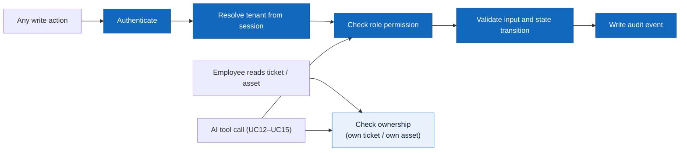
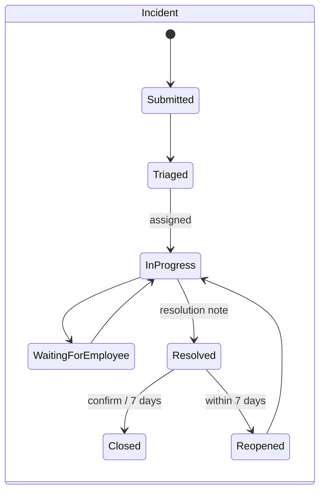
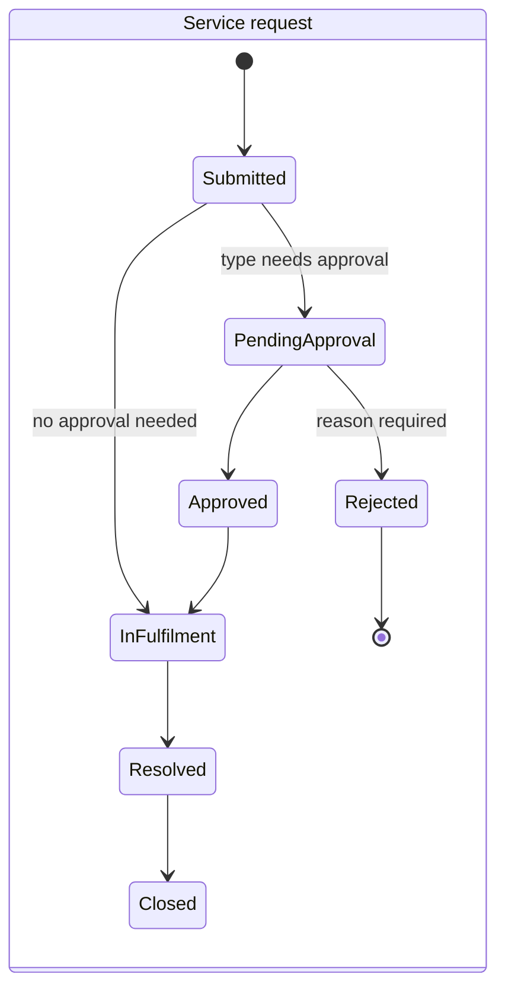
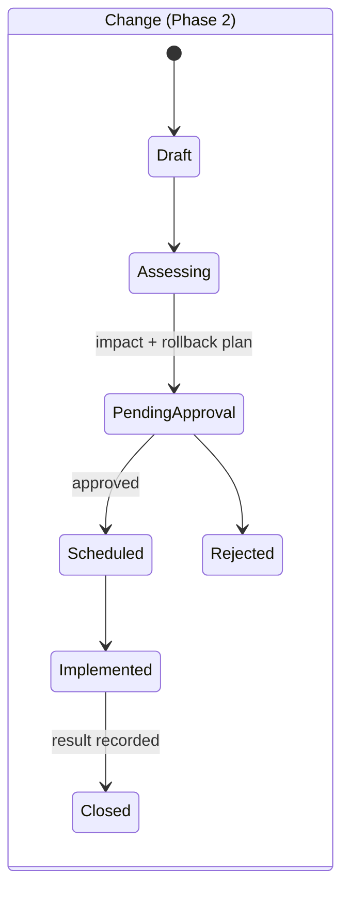

# 02 — Actors, Roles and Use Cases

> Design status: TARGET V1 (43 use cases: 22 P0, 18 P1, 3 P2)
>
> Implementation status: UX prototype only — no backend yet

## Actors / roles

| Role | Code | Scope | Notes |
|---|---|---|---|
| User | — | Abstract actor: anyone who signs in | Generalizes all roles below for UC01, UC02, UC39, UC40 |
| Employee | `EMPLOYEE` | Self-service, AI assistant, own tickets, own devices | IT Staff and IT Manager can also act as Employees for their own requests |
| IT Staff | `IT_STAFF` | Queue, triage, ticket updates, fulfilment, assets, KB drafts | Cannot approve |
| IT Manager | `IT_MANAGER` | Approvals, SLA, reports, escalation, KB publishing, inventory view | Same tenant only; the default **Approver** (an approval rule may name another person or role, UC24) |
| Org Admin | `ORG_ADMIN` | Organization settings, members and roles, service catalog | Tenant configuration only |
| Platform Admin | `PLATFORM_ADMIN` | Organization list, workspace creation and lifecycle, platform admin log | No ticket content by default |
| External AI Service | — | Secondary actor (external LLM) supporting UC12–UC15 | Called by the backend with the user's permissions; never writes data |

## Role × feature matrix

| Capability | Employee | IT Staff | IT Manager | Org Admin | Platform Admin |
|---|---|---|---|---|---|
| Sign in, profile, password, notifications | ✓ | ✓ | ✓ | ✓ | ✓ |
| Catalog, submit request, my tickets | ✓ | ✓ | ✓ | ✓ | |
| AI assistant | ✓ | ✓ | ✓ | ✓ | |
| KB search and read | ✓ | ✓ | ✓ | ✓ | |
| Ticket queue, triage, update, resolve | | ✓ | ✓ | | |
| Assign / transfer / escalate | | ✓ | ✓ | | |
| Fulfilment and device handover | | ✓ | | | |
| Asset register (write) | | ✓ | | | |
| Asset inventory and history (read) | | ✓ | ✓ | | |
| KB drafts | | ✓ | ✓ | | |
| KB publish / retire | | | ✓ | | |
| Approve / reject requests | | | ✓ | | |
| Approval rules, SLA policies, reports | | | ✓ | | |
| Organization settings and departments, members, catalog builder | | | | ✓ | |
| Organization list, create / activate workspace, admin log | | | | | ✓ |
| Suspend / reopen workspace (Phase 2) | | | | | ✓ |

Menus and buttons are **not rendered** when the user lacks permission; the API enforces the same rules and returns `403` (or `404` for records of another tenant, so their existence is not leaked).

## Use case diagrams

The model is split into three views so each stays readable; together they cover all 43 use cases and all actors.

### View 1 — Employee & AI Assistant

`Employee` specializes the abstract `User`. UC13 extends UC12 when the answer needs troubleshooting steps; UC14 extends UC13 when the steps do not fix the issue. The External AI Service is a secondary actor on UC12–UC15 only.

### View 2 — IT Staff

### View 3 — IT Manager, Org Admin, Platform Admin

## Use case catalog

| UC | Package | Use case | Primary actor | Priority |
|---|---|---|---|---|
| UC01 | Identity & Tenant | Sign in and sign out | User | P0 |
| UC02 | Identity & Tenant | View and edit my profile | User | P1 |
| UC03 | Identity & Tenant | Update organization settings and departments | Org Admin | P1 |
| UC04 | Identity & Tenant | Invite, lock and assign member roles | Org Admin | P0 |
| UC05 | Identity & Tenant | Create and activate a tenant workspace | Platform Admin | P1 |
| UC06 | Employee Self-service | Browse the IT service catalog | Employee | P0 |
| UC07 | Employee Self-service | Submit a request with the right form | Employee | P0 |
| UC08 | Employee Self-service | Find and track my tickets | Employee | P0 |
| UC09 | Employee Self-service | Add comments and files to my ticket | Employee | P0 |
| UC10 | Employee Self-service | Confirm resolution or reopen a ticket | Employee | P0 |
| UC11 | Employee Self-service | View assets assigned to me | Employee | P1 |
| UC12 | AI Assistant | Ask a question and get an answer from company guides | Employee (+ External AI Service) | P0 |
| UC13 | AI Assistant | Get step-by-step troubleshooting | Employee (+ External AI Service) | P1 |
| UC14 | AI Assistant | Turn a chat into a ticket draft | Employee (+ External AI Service) | P0 |
| UC15 | AI Assistant | Ask in chat where my ticket stands | Employee (+ External AI Service) | P1 |
| UC16 | Ticket Management | View and filter the ticket queue | IT Staff | P0 |
| UC17 | Ticket Management | Triage and set ticket priority | IT Staff | P0 |
| UC18 | Ticket Management | Assign or pick up a ticket | IT Staff, IT Manager | P0 |
| UC19 | Ticket Management | Update status and technical notes | IT Staff | P0 |
| UC20 | Ticket Management | Transfer or escalate a ticket | IT Staff, IT Manager | P1 |
| UC21 | Ticket Management | Resolve and close a ticket | IT Staff | P0 |
| UC22 | Ticket Management | Link a ticket to a device or another ticket | IT Staff | P1 |
| UC23 | Catalog & Approval | Manage request types and forms | Org Admin | P0 |
| UC24 | Catalog & Approval | Configure approval rules | IT Manager | P1 |
| UC25 | Catalog & Approval | Approve or reject a request with reason | IT Manager | P0 |
| UC26 | Catalog & Approval | Carry out and record the delivery work | IT Staff | P1 |
| UC27 | Catalog & Approval | Review and plan an internet provider change | IT Manager | P2 |
| UC28 | IT Assets | Add and update IT devices | IT Staff | P0 |
| UC29 | IT Assets | Assign and hand over a device | IT Staff | P0 |
| UC30 | IT Assets | Take a device back from an employee | IT Staff | P1 |
| UC31 | IT Assets | Log repairs and maintenance | IT Staff | P2 |
| UC32 | IT Assets | View device stock and history | IT Manager | P1 |
| UC33 | Knowledge Base | Write and edit guide drafts | IT Staff | P0 |
| UC34 | Knowledge Base | Review, publish and retire guides | IT Manager | P0 |
| UC35 | Knowledge Base | Search and read guides without the AI | Employee | P0 |
| UC36 | SLA & Reporting | Set SLA targets by type and priority | IT Manager | P1 |
| UC37 | SLA & Reporting | Get alerts when a deadline is at risk | IT Manager | P1 |
| UC38 | SLA & Reporting | View and export operations reports | IT Manager | P1 |
| UC39 | Identity & Tenant | Change my password | User | P0 |
| UC40 | Identity & Tenant | View my notifications | User | P1 |
| UC41 | Identity & Tenant | Suspend or reopen a tenant workspace | Platform Admin | P2 |
| UC42 | Identity & Tenant | View the organization list | Platform Admin | P1 |
| UC43 | Identity & Tenant | View the platform admin log | Platform Admin | P1 |

## Shared rules applied to every use case

## Ticket lifecycles

Incidents, service requests and changes have separate state machines.

`Cancelled` is allowed from any non-final state by the requester (before work starts) or by IT with a reason.

## Permissions

Each use case is guarded by one permission key. The API checks the key, then the tenant, then ownership where marked *(own)*.

| Permission | Employee | IT Staff | IT Manager | Org Admin | Platform Admin |
|---|---|---|---|---|---|
| `profile.self`, `password.change`, `notification.read` | ✓ | ✓ | ✓ | ✓ | ✓ |
| `catalog.read`, `request.create`, `kb.read` | ✓ | ✓ | ✓ | ✓ | |
| `ticket.readOwn`, `ticket.commentOwn`, `ticket.confirmOwn`, `asset.readOwn` *(own)* | ✓ | ✓ | ✓ | ✓ | |
| `ai.ask`, `ai.draft`, `ai.myTickets` *(own)* | ✓ | ✓ | ✓ | ✓ | |
| `ticket.queue`, `ticket.triage`, `ticket.update`, `ticket.resolve`, `ticket.link` | | ✓ | ✓ | | |
| `ticket.assign`, `ticket.transfer` | | ✓ | ✓ | | |
| `fulfilment.perform`, `asset.write`, `asset.assign`, `asset.recover`, `asset.maintain` | | ✓ | | | |
| `asset.read` | | ✓ | ✓ | | |
| `kb.draft` | | ✓ | ✓ | | |
| `kb.publish`, `approval.decide`, `approval.rules`, `change.manage`, `sla.manage`, `sla.alerts`, `report.read` | | | ✓ | | |
| `org.settings`, `members.manage`, `catalog.manage` | | | | ✓ | |
| `tenant.read`, `tenant.create`, `tenant.lifecycle`, `platform.audit` | | | | | ✓ |

## Use case specifications

Every use case lists actor, preconditions, main flow, alternatives, permission and result. Acceptance criteria are in [06 — Acceptance criteria](06-acceptance-criteria.md) under the same number.

### Identity & Tenant

#### UC01 Sign in and sign out

- **Actor:** User (all roles)
- **Preconditions:** active member account in an active tenant
- **Main flow:** enter work email and password → backend verifies credentials, member status and tenant status → if the email belongs to several tenants, choose one → open the role's home page. Sign out from the avatar menu ends the session.
- **Alternative:** wrong credentials, locked member or suspended tenant → one generic error, stay on Sign In.
- **Permission:** public (sign in); authenticated (sign out)
- **Result:** a session scoped to exactly one tenant

#### UC02 View and edit my profile

- **Actor:** User
- **Preconditions:** signed in
- **Main flow:** open My Profile → edit name, phone, department, location, avatar, notification preferences → save.
- **Alternative:** invalid phone → field error; attempt to change role or email → rejected.
- **Permission:** `profile.self`
- **Result:** updated contact data used for routing and notifications

#### UC03 Update organization settings and departments

- **Actor:** Org Admin
- **Preconditions:** signed in as Org Admin
- **Main flow:** open Organization Settings → edit company profile, timezone and locations → add or rename departments → save.
- **Alternative:** duplicate location or department name, or invalid timezone → field error; a department still used by members or routing is deactivated, not deleted.
- **Permission:** `org.settings`
- **Result:** tenant settings updated; SLA calendars and routing use the new values

#### UC04 Invite, lock and assign member roles

- **Actor:** Org Admin
- **Preconditions:** signed in as Org Admin
- **Main flow:** open Members & Roles → invite by email with a role → member accepts → later change role or lock/unlock.
- **Alternative:** email already a member → error; locking the last Org Admin → refused.
- **Permission:** `members.manage`
- **Result:** access to the tenant matches the member list

#### UC05 Create and activate a tenant workspace

- **Actor:** Platform Admin
- **Preconditions:** signed in as Platform Admin
- **Main flow:** open Tenants → New workspace → enter company name, plan and first Org Admin email → create → activate → the Org Admin receives an invitation.
- **Alternative:** company name or admin email already used → field error, nothing created.
- **Permission:** `tenant.create`
- **Result:** an active, empty workspace that its Org Admin can set up (UC03, UC04, UC23)

#### UC41 Suspend or reopen a tenant workspace *(P2)*

- **Actor:** Platform Admin
- **Preconditions:** tenant exists
- **Main flow:** open Tenants → choose tenant → Suspend (with reason) or Reopen → confirm.
- **Alternative:** empty reason → error.
- **Permission:** `tenant.lifecycle`
- **Result:** suspended tenant becomes read-only; no ticket content is exposed to the Platform Admin

#### UC42 View the organization list

- **Actor:** Platform Admin
- **Preconditions:** signed in as Platform Admin
- **Main flow:** open Tenants → search or filter by status and plan → open a company to see contacts, limits and status.
- **Alternative:** no match → empty state.
- **Permission:** `tenant.read`
- **Result:** an overview of all customer workspaces without any ticket content

#### UC43 View the platform admin log

- **Actor:** Platform Admin
- **Preconditions:** signed in as Platform Admin
- **Main flow:** open Tenants → Admin log → filter by admin, company, action and date → open an entry.
- **Alternative:** no entries for the filters → empty state.
- **Permission:** `platform.audit`
- **Result:** every create, activate, suspend and reopen is traceable to one admin; the log is read-only

#### UC39 Change my password

- **Actor:** User
- **Preconditions:** signed in
- **Main flow:** My Profile → Password → enter current password and new password twice → save → other sessions of this user are signed out.
- **Alternative:** wrong current password, mismatch or weak new password → error, password unchanged.
- **Permission:** `password.change`
- **Result:** only the account owner can change the password; the change is audited

#### UC40 View my notifications

- **Actor:** User
- **Preconditions:** signed in
- **Main flow:** open the bell or Notification Center → filter unread or by type → open a notification → land on the ticket, approval or device → it is marked as read.
- **Alternative:** the linked record is no longer visible → "no longer available", no data shown.
- **Permission:** `notification.read` *(own)*
- **Result:** each user sees only their own notifications and reaches the source in one click

### Employee Self-service

#### UC06 Browse the IT service catalog

- **Actor:** Employee
- **Preconditions:** signed in; at least one published request type
- **Main flow:** open Service Catalog → search or pick a category (*Report a problem / Request something / Propose a change*) → read approval need and SLA → start request.
- **Alternative:** not sure which service → open the AI Assistant.
- **Permission:** `catalog.read`
- **Result:** the employee lands on the right request form

#### UC07 Submit a request with the right form

- **Actor:** Employee
- **Preconditions:** request type is published and the employee may use it
- **Main flow:** form shows the fields of that type, approval need and SLA → fill required fields, attach files → submit → backend validates and creates exactly one ticket (`Submitted`, or `PendingApproval` when approval is needed) → Request Detail with ticket ID.
- **Alternative:** missing/invalid field → inline error, values kept, no ticket; repeated submit → idempotency key returns the same ticket.
- **Permission:** `request.create`
- **Result:** ticket linked to requester, tenant and request-type version

#### UC08 Find and track my tickets

- **Actor:** Employee
- **Preconditions:** signed in
- **Main flow:** open My Requests → search or filter → open a ticket → see status, progress, assignee and SLA.
- **Alternative:** no tickets → empty state with "New request".
- **Permission:** `ticket.readOwn` *(own)*
- **Result:** the employee knows the progress without contacting IT

#### UC09 Add comments and files to my ticket

- **Actor:** Employee
- **Preconditions:** own ticket that is not `Closed` or `Rejected`
- **Main flow:** open Request Detail → write a comment and/or attach a file → send → assignee is notified.
- **Alternative:** file too large or not allowed → error.
- **Permission:** `ticket.commentOwn` *(own)*
- **Result:** public timeline updated

#### UC10 Confirm resolution or reopen a ticket

- **Actor:** Employee (requester)
- **Preconditions:** ticket is `Resolved`
- **Main flow:** read the resolution note → Confirm → `Closed`.
- **Alternative:** still broken → Reopen with reason within 7 days → `Reopened`; no action for 7 days → auto `Closed`.
- **Permission:** `ticket.confirmOwn` *(own)*
- **Result:** tickets close only when the requester agrees or the window expires

#### UC11 View assets assigned to me

- **Actor:** Employee
- **Preconditions:** signed in
- **Main flow:** open My Assets → see devices, tags and handover records → optionally report a problem with a device.
- **Alternative:** no assets → empty state.
- **Permission:** `asset.readOwn` *(own)*
- **Result:** the employee knows which devices they are responsible for

### AI Assistant

#### UC12 Ask a question and get an answer from company guides

- **Actors:** Employee; External AI Service (secondary)
- **Preconditions:** signed in; KB has published articles
- **Main flow:** ask a question → backend retrieves only published articles the employee may read in this tenant → AI composes an answer with citations → citation opens the article.
- **Alternative:** no relevant source → "no documented answer", offer catalog or draft; nothing invented.
- **Permission:** `ai.ask`
- **Result:** cited answer; question and sources logged for quality review

#### UC13 Get step-by-step troubleshooting *(extends UC12)*

- **Actors:** Employee; External AI Service (secondary)
- **Preconditions:** UC12 found a how-to article
- **Main flow:** assistant lists the steps from the cited article → asks "It works now / Still not working".
- **Alternative:** works → end, no ticket; not working → UC14.
- **Permission:** `ai.ask`
- **Result:** issue solved without IT, or a reason to draft a ticket

#### UC14 Turn a chat into a ticket draft *(extends UC13)*

- **Actors:** Employee; External AI Service (secondary)
- **Preconditions:** issue not solved, or no source found
- **Main flow:** assistant proposes a request type → asks only missing required fields → shows the draft → employee edits and confirms → backend runs UC07 validation and creates the ticket.
- **Alternative:** discard → the draft is marked `Discarded` and no ticket is created; request type needs a full form (e.g. laptop) → open the form pre-filled.
- **Permission:** `ai.draft` + `request.create`
- **Result:** a complete ticket created only by the employee's confirmation

#### UC15 Ask in chat where my ticket stands

- **Actors:** Employee; External AI Service (secondary)
- **Preconditions:** signed in
- **Main flow:** ask "where is my ticket?" → read-only tool queries tickets of the current user → assistant answers with status and assignee and links to the ticket.
- **Alternative:** asks about someone else's ticket → "I can only see your own tickets".
- **Permission:** `ai.myTickets` *(own)*
- **Result:** quick status without opening My Requests

### Ticket Management

#### UC16 View and filter the ticket queue

- **Actor:** IT Staff
- **Preconditions:** signed in as IT
- **Main flow:** open Ticket Queue → choose view (Unassigned / My tickets / All permitted) → filter by type, status, priority, SLA → open a ticket.
- **Alternative:** no match → empty state with "clear filters".
- **Permission:** `ticket.queue`
- **Result:** IT chooses the next ticket by priority and SLA

#### UC17 Triage and set ticket priority

- **Actor:** IT Staff
- **Preconditions:** ticket `Submitted` or `Triaged`
- **Main flow:** open ticket → confirm type and category → set priority → save → status `Triaged`.
- **Alternative:** wrong type (e.g. a request filed as incident) → convert type with reason.
- **Permission:** `ticket.triage`
- **Result:** ticket follows the right workflow and SLA

#### UC18 Assign or pick up a ticket

- **Actors:** IT Staff, IT Manager
- **Preconditions:** ticket not `Closed`
- **Main flow:** Pick up (assign to me) or choose an assignee from the IT team → save → assignee notified.
- **Alternative:** someone picked it up first → conflict message, reload.
- **Permission:** `ticket.assign`
- **Result:** one owner per ticket

#### UC19 Update status and technical notes

- **Actor:** IT Staff
- **Preconditions:** assigned ticket
- **Main flow:** reply publicly or add an internal note → move status along allowed transitions (e.g. `In Progress → Waiting for Employee`).
- **Alternative:** invalid transition → refused.
- **Permission:** `ticket.update`
- **Result:** transparent progress; technical detail stays internal

#### UC20 Transfer or escalate a ticket

- **Actors:** IT Staff, IT Manager
- **Preconditions:** ticket not `Closed`
- **Main flow:** choose Transfer (another team) or Escalate (IT Manager) → enter reason → save → new owner notified.
- **Alternative:** empty reason → error.
- **Permission:** `ticket.transfer`
- **Result:** hard or late tickets reach the right people with history intact

#### UC21 Resolve and close a ticket

- **Actor:** IT Staff
- **Preconditions:** ticket `In Progress`, `Waiting for Employee` or `In Fulfilment`
- **Main flow:** choose `Resolved` → enter resolution note → save → requester notified → UC10.
- **Alternative:** no note → error, status unchanged.
- **Permission:** `ticket.resolve`
- **Result:** ticket waits for the requester's confirmation

#### UC22 Link a ticket to a device or another ticket

- **Actor:** IT Staff
- **Preconditions:** ticket open
- **Main flow:** Link → search asset tag or ticket ID → confirm → link shown on both records.
- **Alternative:** record in another tenant or not found → not found.
- **Permission:** `ticket.link`
- **Result:** full context for diagnosis and asset history

### Catalog, Approval and Fulfilment

#### UC23 Manage request types and forms

- **Actor:** Org Admin
- **Preconditions:** signed in as Org Admin
- **Main flow:** Catalog Builder → create or edit a type → define fields (type, required, help text, validation) → set ticket type, routing team, approval flag → preview as employee → publish a new version.
- **Alternative:** missing routing or required field → cannot publish; hide a type → removed from catalog.
- **Permission:** `catalog.manage`
- **Result:** standard intake forms; tickets keep the version they were created with

#### UC24 Configure approval rules

- **Actor:** IT Manager
- **Preconditions:** request type exists
- **Main flow:** Approval Rules → choose request type → approver role or person → conditions → effective date → save.
- **Alternative:** conflicting rules → error showing the overlapping rule.
- **Permission:** `approval.rules`
- **Result:** risky requests need sign-off; past decisions are unchanged

#### UC25 Approve or reject a request with reason

- **Actor:** IT Manager (configured approver)
- **Preconditions:** request `PendingApproval`
- **Main flow:** Approval Inbox → review requester, reason, needed-by date, stock → Approve (optional note) → IT notified.
- **Alternative:** Reject with a required reason → requester notified; already decided → refused.
- **Permission:** `approval.decide`
- **Result:** only approved requests reach fulfilment

#### UC26 Carry out and record the delivery work

- **Actor:** IT Staff
- **Preconditions:** request `Approved`, or a type without approval
- **Main flow:** open Fulfilment Task → work through the checklist → record each step → complete → request `Resolved`.
- **Alternative:** request still pending approval → page locked.
- **Permission:** `fulfilment.perform`
- **Result:** consistent service delivery with an audit trail

#### UC27 Review and plan an internet provider change *(P2)*

- **Actor:** IT Manager (with IT Staff for the assessment)
- **Preconditions:** change proposal submitted from the catalog
- **Main flow:** IT records impact, affected users, downtime and rollback plan → manager reviews in Change Review → approve → schedule maintenance window → IT implements manually → record result → close.
- **Alternative:** reject or request more information.
- **Permission:** `change.manage`
- **Result:** infrastructure changes are planned and approved; never automated by SmartDesk

### IT Assets

#### UC28 Add and update IT devices

- **Actor:** IT Staff
- **Preconditions:** signed in as IT
- **Main flow:** Asset Inventory → Add asset (tag, model, serial, purchase date, location) → save as `AVAILABLE`; later edit details or status.
- **Alternative:** duplicate tag → error.
- **Permission:** `asset.write`
- **Result:** accurate stock and condition

#### UC29 Assign and hand over a device

- **Actor:** IT Staff
- **Preconditions:** request `Approved`; asset `AVAILABLE`
- **Main flow:** Fulfilment Task → asset picker lists matching available assets → choose → hand over, record date and condition → asset `ASSIGNED` and linked to the ticket → request `Resolved`.
- **Alternative:** asset taken by someone else meanwhile → conflict, choose another.
- **Permission:** `asset.assign`
- **Result:** ownership history per device

#### UC30 Take a device back from an employee

- **Actor:** IT Staff
- **Preconditions:** asset `ASSIGNED`
- **Main flow:** Asset Detail → Recover → record date and condition → asset `RETURNED`, then `AVAILABLE` or `MAINTENANCE`.
- **Alternative:** asset not assigned → refused.
- **Permission:** `asset.recover`
- **Result:** stock stays accurate when people leave or swap devices

#### UC31 Log repairs and maintenance *(P2)*

- **Actor:** IT Staff
- **Preconditions:** asset not `RETIRED`
- **Main flow:** Asset Detail → Maintenance log → add date, work done, technician, status before/after → save.
- **Alternative:** —
- **Permission:** `asset.maintain`
- **Result:** repair history per device

#### UC32 View device stock and history

- **Actor:** IT Manager
- **Preconditions:** signed in as IT Manager
- **Main flow:** Asset Inventory → stock summary by status → filter → open an asset → history of holders and tickets.
- **Alternative:** —
- **Permission:** `asset.read`
- **Result:** provisioning decisions based on real stock (read-only)

### Knowledge Base

#### UC33 Write and edit guide drafts

- **Actor:** IT Staff
- **Preconditions:** signed in as IT
- **Main flow:** KB Editor → new draft (title, topic, steps, images, visibility) → save → submit for review.
- **Alternative:** —
- **Permission:** `kb.draft`
- **Result:** draft visible to IT only, never to employees or the AI

#### UC34 Review, publish and retire guides

- **Actor:** IT Manager
- **Preconditions:** article `In review` or `Published`
- **Main flow:** KB Review → view changes → Publish → article searchable and indexed for the AI; or Retire a published article.
- **Alternative:** send back to draft with comments.
- **Permission:** `kb.publish`
- **Result:** employees and the AI use only approved content

#### UC35 Search and read guides without the AI

- **Actor:** Employee
- **Preconditions:** signed in
- **Main flow:** Knowledge Base → search or filter by topic → open article → follow steps → rate helpfulness.
- **Alternative:** still need help → open a request with the article linked.
- **Permission:** `kb.read`
- **Result:** a self-service path that does not depend on AI

### SLA and Reporting

#### UC36 Set SLA targets by type and priority

- **Actor:** IT Manager
- **Preconditions:** organization calendar set (UC03)
- **Main flow:** SLA Policies → business hours and holidays → response/resolve targets per type and priority → warning threshold → pause rules → save.
- **Alternative:** invalid or missing targets → error.
- **Permission:** `sla.manage`
- **Result:** explicit commitments applied to new tickets

#### UC37 Get alerts when a deadline is at risk

- **Actor:** IT Manager (also the assignee)
- **Preconditions:** SLA policy active
- **Main flow:** SLA job detects 80% or 100% of target → one notification per threshold → manager opens Breach watch → reassigns or escalates.
- **Alternative:** job retry → no duplicate alert.
- **Permission:** `sla.alerts`
- **Result:** fewer missed tickets

#### UC38 View and export operations reports

- **Actor:** IT Manager
- **Preconditions:** signed in as IT Manager
- **Main flow:** SLA & Reports → choose date range, team, type, priority → read KPI cards and charts → export CSV or PDF.
- **Alternative:** no data for the filters → empty state.
- **Permission:** `report.read`
- **Result:** measurable support performance

**Related:** [INVEST requirements](03-invest-requirements.md) · [Acceptance criteria](06-acceptance-criteria.md) · [Information architecture](04-information-architecture.md)
