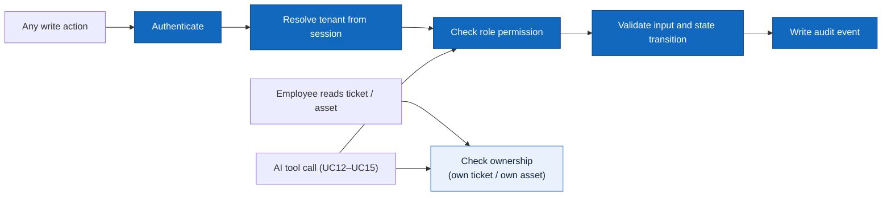
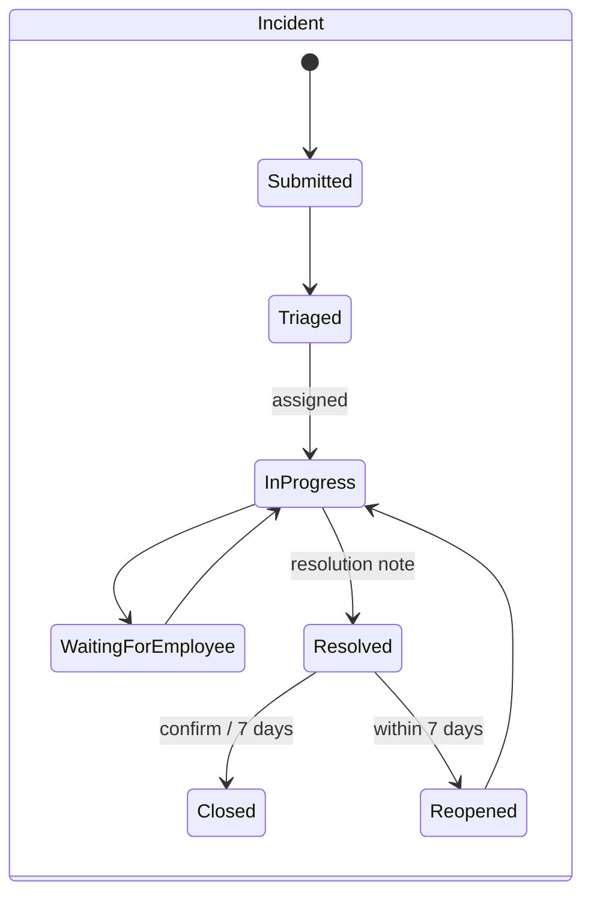
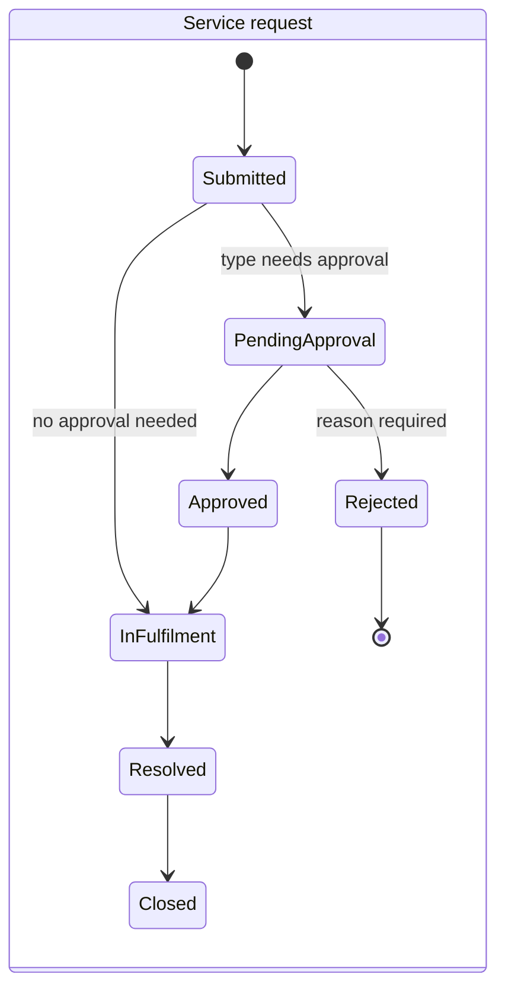
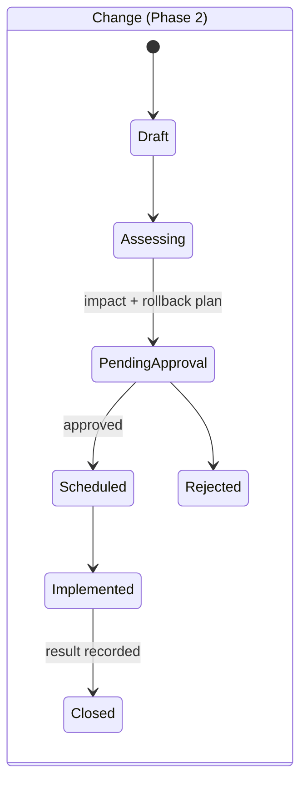

# 02 — Actors, Roles and Use Cases

> Design status: TARGET V1 (38 use cases: 21 P0, 14 P1, 3 P2)
>
> Implementation status: UX prototype only — no backend yet

## Actors / roles

| Role | Code | Scope | Notes |
|---|---|---|---|
| User | — | Abstract actor: anyone who signs in | Generalizes all roles below for UC01, UC02 |
| Employee | `EMPLOYEE` | Self-service, AI assistant, own tickets, own devices | IT Staff and IT Manager can also act as Employees for their own requests |
| IT Staff | `IT_STAFF` | Queue, triage, ticket updates, fulfilment, assets, KB drafts | Cannot approve |
| IT Manager | `IT_MANAGER` | Approvals, SLA, reports, escalation, KB publishing, inventory view | Same tenant only |
| Org Admin | `ORG_ADMIN` | Organization settings, members and roles, service catalog | Tenant configuration only |
| Platform Admin | `PLATFORM_ADMIN` | Tenant lifecycle | No ticket content by default |
| AI Provider | — | Secondary actor (external LLM) supporting UC12–UC15 | Called by the backend with the user's permissions; never writes data |

## Role × feature matrix

| Capability | Employee | IT Staff | IT Manager | Org Admin | Platform Admin |
|---|---|---|---|---|---|
| Sign in, profile, notifications | ✓ | ✓ | ✓ | ✓ | ✓ |
| Catalog, submit request, my tickets | ✓ | ✓ | ✓ | ✓ | |
| AI assistant | ✓ | ✓ | ✓ | ✓ | |
| KB search and read | ✓ | ✓ | ✓ | ✓ | |
| Ticket queue, triage, update, resolve | | ✓ | ✓ | | |
| Assign / transfer / escalate | | ✓ | ✓ | | |
| Fulfilment and device handover | | ✓ | | | |
| Asset register (write) | | ✓ | | | |
| Asset inventory and history (read) | | ✓ | ✓ | | |
| KB drafts | | ✓ | ✓ | | |
| KB publish / retire | | | ✓ | | |
| Approve / reject requests | | | ✓ | | |
| Approval rules, SLA policies, reports | | | ✓ | | |
| Organization settings, members, catalog builder | | | | ✓ | |
| Tenant activate / suspend | | | | | ✓ |

Menus and buttons are **not rendered** when the user lacks permission; the API enforces the same rules and returns `403` (or `404` for records of another tenant, so their existence is not leaked).

## Use case diagrams

The model is split into three views so each stays readable; together they cover all 38 use cases and all actors.

### View 1 — Employee & AI Assistant

`Employee` specializes the abstract `User`. UC13 extends UC12 when the answer needs troubleshooting steps; UC14 extends UC13 when the steps do not fix the issue. The AI provider is a secondary actor on UC12–UC15 only.

### View 2 — IT Staff

### View 3 — IT Manager, Org Admin, Platform Admin

## Use case catalog

| UC | Package | Use case | Primary actor | Priority |
|---|---|---|---|---|
| UC01 | Identity & Tenant | Sign in and sign out | User | P0 |
| UC02 | Identity & Tenant | View and edit my profile | User | P1 |
| UC03 | Identity & Tenant | Update organization settings | Org Admin | P1 |
| UC04 | Identity & Tenant | Invite, lock and assign member roles | Org Admin | P0 |
| UC05 | Identity & Tenant | Activate or suspend a tenant | Platform Admin | P2 |
| UC06 | Employee Self-service | Browse the IT service catalog | Employee | P0 |
| UC07 | Employee Self-service | Submit a request through a typed form | Employee | P0 |
| UC08 | Employee Self-service | Find and track my tickets | Employee | P0 |
| UC09 | Employee Self-service | Add comments and files to my ticket | Employee | P0 |
| UC10 | Employee Self-service | Confirm resolution or reopen a ticket | Employee | P0 |
| UC11 | Employee Self-service | View assets assigned to me | Employee | P1 |
| UC12 | AI Assistant | Ask FAQs answered from internal sources | Employee (+ AI Provider) | P0 |
| UC13 | AI Assistant | Get step-by-step troubleshooting | Employee (+ AI Provider) | P1 |
| UC14 | AI Assistant | Draft a ticket through conversation | Employee (+ AI Provider) | P0 |
| UC15 | AI Assistant | Ask my ticket status in natural language | Employee (+ AI Provider) | P1 |
| UC16 | Ticket Management | View and filter the ticket queue | IT Staff | P0 |
| UC17 | Ticket Management | Triage and set ticket priority | IT Staff | P0 |
| UC18 | Ticket Management | Assign or pick up a ticket | IT Staff, IT Manager | P0 |
| UC19 | Ticket Management | Update status and technical notes | IT Staff | P0 |
| UC20 | Ticket Management | Transfer or escalate a ticket | IT Staff, IT Manager | P1 |
| UC21 | Ticket Management | Resolve and close a ticket | IT Staff | P0 |
| UC22 | Ticket Management | Link a ticket to an asset or ticket | IT Staff | P1 |
| UC23 | Catalog & Approval | Manage request types and forms | Org Admin | P0 |
| UC24 | Catalog & Approval | Configure approval rules | IT Manager | P1 |
| UC25 | Catalog & Approval | Approve or reject a request with reason | IT Manager | P0 |
| UC26 | Catalog & Approval | Perform and record fulfilment work | IT Staff | P1 |
| UC27 | Catalog & Approval | Assess and manage an ISP change | IT Manager | P2 |
| UC28 | IT Assets | Register and update IT assets | IT Staff | P0 |
| UC29 | IT Assets | Assign and hand over a device | IT Staff | P0 |
| UC30 | IT Assets | Recover a device from an employee | IT Staff | P1 |
| UC31 | IT Assets | Log asset maintenance and repair | IT Staff | P2 |
| UC32 | IT Assets | View inventory and asset history | IT Manager | P1 |
| UC33 | Knowledge Base | Create and edit KB article drafts | IT Staff | P0 |
| UC34 | Knowledge Base | Review, publish and retire KB articles | IT Manager | P0 |
| UC35 | Knowledge Base | Search and read KB articles without AI | Employee | P0 |
| UC36 | SLA & Reporting | Configure SLA by type and priority | IT Manager | P1 |
| UC37 | SLA & Reporting | Receive near-breach and breach alerts | IT Manager | P1 |
| UC38 | SLA & Reporting | View and export operations reports | IT Manager | P1 |

## Shared rules applied to every use case

## Ticket lifecycles

Incidents, service requests and changes have separate state machines.

`Cancelled` is allowed from any non-final state by the requester (before work starts) or by IT with a reason.

## Detailed use cases

### UC01 Sign in and sign out

- **Actor:** User (all roles)
- **Preconditions:** active account in an active tenant
- **Main flow:** enter work email and password → backend verifies credentials, account and tenant status → if the email belongs to several tenants, pick one → land on the role's home page.
- **Alternative:** wrong credentials, locked account or suspended tenant → generic error, stay on Sign In.
- **Result:** authenticated session scoped to one tenant; sign-out invalidates the session on this client.

### UC07 Submit a request through a typed form

- **Actor:** Employee
- **Preconditions:** request type is published and the employee may use it
- **Main flow:** open catalog → choose a service → form shows fields of that type, approval need and SLA target → fill required fields, attach files → review → submit → backend validates and creates exactly one ticket (`Submitted`, or `PendingApproval` when the type needs approval) → Request Detail with ticket ID.
- **Alternative:** missing/invalid field → inline error, no ticket; double click or retry → idempotency key returns the same ticket.
- **Result:** ticket linked to requester, tenant and request-type version.

### UC12 Ask FAQs answered from internal sources

- **Actors:** Employee; AI Provider (secondary)
- **Main flow:** employee asks a question → backend retrieves only **published** KB articles the employee may read in the same tenant → AI composes an answer with citations → each citation opens the source article.
- **Alternative:** no relevant source → assistant says it has no documented answer and offers the catalog or a ticket draft; it does not guess.
- **Result:** answer and sources logged for quality review (no private ticket data sent to the model).

### UC14 Draft a ticket through conversation

- **Actors:** Employee; AI Provider (secondary)
- **Main flow:** issue not solved → AI proposes the request type → asks only the missing required fields of that type → shows a draft (type, title, summary, fields, attachments) → employee edits and confirms → backend runs the normal UC07 validation and creates the ticket.
- **Alternative:** employee discards the draft → nothing is stored; AI suggests a Change but data is incomplete → draft cannot be confirmed.
- **Result:** the AI never submits; only the employee's confirmation creates a ticket.

### UC10 Confirm resolution or reopen a ticket

- **Actor:** Employee (requester)
- **Preconditions:** ticket is `Resolved`
- **Main flow:** employee reads the resolution note → Confirm → `Closed`.
- **Alternative:** still broken → Reopen with a reason within 7 days → `Reopened` → back to the assignee; after 7 days without action → auto `Closed`.

### UC17–UC21 Work a ticket (IT Staff)

- **Main flow:** open queue (UC16) → open unassigned ticket → set type and priority (UC17) → pick up or assign (UC18) → reply publicly or add internal notes, move status along the allowed transitions (UC19) → transfer or escalate with a reason if needed (UC20) → enter a resolution note and set `Resolved` (UC21).
- **Rules:** internal notes are never visible to the employee; invalid transitions return `409`; every change is in the audit timeline.

### UC25 Approve or reject a request with reason

- **Actor:** IT Manager (configured approver)
- **Preconditions:** request is `PendingApproval`
- **Main flow:** open Approval Inbox → review requester, reason, needed-by date, stock availability → Approve (optional note) or Reject (reason required) → requester and IT are notified.
- **Alternative:** decision already recorded → `409`, no second decision; non-approver → `403`.

### UC29 Assign and hand over a device

- **Actor:** IT Staff
- **Preconditions:** request `Approved`; asset `AVAILABLE`
- **Main flow:** open fulfilment task → asset picker lists only matching available assets → reserve → hand over, record date and condition → asset `ASSIGNED` to the employee, linked to the ticket → request `Resolved`.
- **Alternative:** another technician assigned the same asset first → `409`, pick another asset.

### UC27 Assess and manage an ISP change (Phase 2)

- **Actor:** IT Manager (with IT Staff for the assessment)
- **Main flow:** change proposal from the catalog → IT records impact, affected users, downtime and rollback plan → manager approves → maintenance window scheduled → IT implements **manually** → result recorded → closed.
- **Rule:** SmartDesk never changes network configuration automatically.

**Related:** [INVEST requirements](03-invest-requirements.md) · [Information architecture](04-information-architecture.md)
