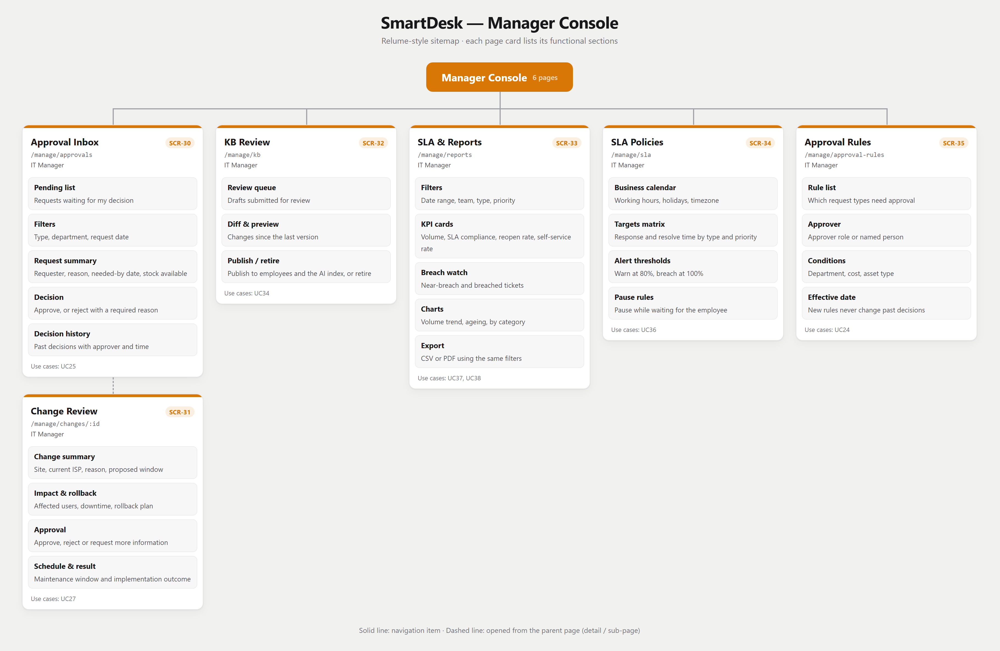
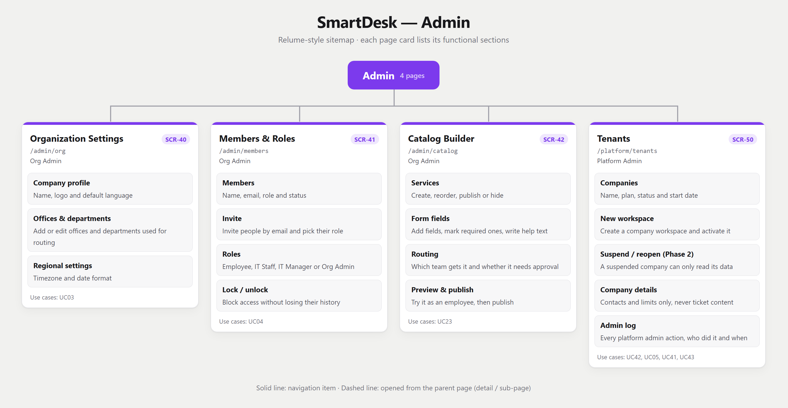
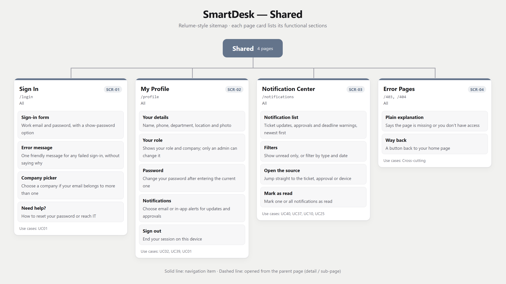
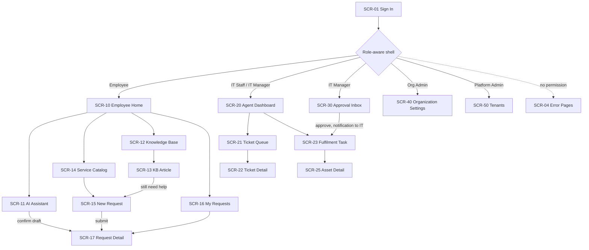

# 04 — Information Architecture (Relume-style sitemap)

> Design status: TARGET V1
>
> 30 pages · 5 role-based areas · 43/43 use cases have an entry screen

The sitemap follows the **Relume** convention: every page is a card, and every card lists the **sections** that make up that page. Because SmartDesk is an internal application, each section is a *functional* block (what the user can see or do), not a marketing block such as "Hero" or "CTA".

## Sitemap overview


```text
SmartDesk
├── Shared
│   ├── SCR-01 Sign In
│   ├── SCR-02 My Profile
│   ├── SCR-03 Notification Center
│   └── SCR-04 Error Pages (403 / 404)
├── Employee Portal
│   ├── SCR-10 Employee Home
│   │   └── SCR-11 AI Assistant
│   ├── SCR-12 Knowledge Base
│   │   └── SCR-13 KB Article
│   ├── SCR-14 Service Catalog
│   │   └── SCR-15 New Request
│   ├── SCR-16 My Requests
│   │   └── SCR-17 Request Detail
│   └── SCR-18 My Assets
├── IT Workspace
│   ├── SCR-20 Agent Dashboard
│   ├── SCR-21 Ticket Queue
│   │   └── SCR-22 Ticket Detail
│   ├── SCR-23 Fulfilment Task
│   ├── SCR-24 Asset Inventory
│   │   └── SCR-25 Asset Detail
│   └── SCR-26 KB Editor
├── Manager Console
│   ├── SCR-30 Approval Inbox
│   │   └── SCR-31 Change Review (Phase 2)
│   ├── SCR-32 KB Review
│   ├── SCR-33 SLA & Reports
│   ├── SCR-34 SLA Policies
│   └── SCR-35 Approval Rules
└── Admin
    ├── SCR-40 Organization Settings
    ├── SCR-41 Members & Roles
    ├── SCR-42 Catalog Builder
    └── SCR-50 Tenants (Platform Admin)
```

## Page cards by area

### Employee Portal


### IT Workspace


### Manager Console



### Admin



### Shared pages



## Screen inventory — what each page contains

| Screen | Page | Route | Roles | Functional sections | Use cases |
|---|---|---|---|---|---|
| `SCR-01` | **Sign In** | `/login` | All | Sign-in form; Error message; Company picker; Need help? | UC01 |
| `SCR-02` | **My Profile** | `/profile` | All | Your details; Your role; Notifications; Sign out | UC02, UC01 |
| `SCR-03` | **Notification Center** | `/notifications` | All | Notification list; Filters; Open the source; Mark as read | UC37, UC10, UC25 |
| `SCR-04` | **Error Pages** | `/403, /404` | All | Plain explanation; Way back | — |
| `SCR-10` | **Employee Home** | `/app` | Employee | Ask SmartDesk; Quick actions; My open tickets; Popular guides; Waiting for you | UC06, UC08, UC12, UC35 |
| `SCR-11` | **AI Assistant** | `/app/assistant` | Employee | Chat; Answer with source; When it doesn't know; Follow-up questions; Ticket draft; My ticket status | UC12, UC13, UC14, UC15 |
| `SCR-12` | **Knowledge Base** | `/app/kb` | Employee | Search; Topic filter; Results; Featured guides | UC35 |
| `SCR-13` | **KB Article** | `/app/kb/:id` | Employee | Title; Steps; Was this helpful?; Still need help?; Related guides | UC35 |
| `SCR-14` | **Service Catalog** | `/app/catalog` | Employee | Search; Categories; Service cards; Not sure? | UC06 |
| `SCR-15` | **New Request** | `/app/requests/new/:type` | Employee | About this service; Request form; Attachments; What happens next; Submit | UC07, UC14 |
| `SCR-16` | **My Requests** | `/app/requests` | Employee | Search; Filters; Ticket list; Nothing yet | UC08 |
| `SCR-17` | **Request Detail** | `/app/requests/:id` | Employee | Summary; Progress; Conversation; Who's on it; Confirm or reopen | UC08, UC09, UC10 |
| `SCR-18` | **My Assets** | `/app/assets` | Employee | My devices; Handover; Report a problem | UC11 |
| `SCR-20` | **Agent Dashboard** | `/it` | IT Staff, IT Manager | Workload; My priorities; Ready to deliver; Shortcuts | UC16 |
| `SCR-21` | **Ticket Queue** | `/it/tickets` | IT Staff, IT Manager | Views; Filters; Ticket list; Quick actions; Empty or loading | UC16, UC17, UC18 |
| `SCR-22` | **Ticket Detail** | `/it/tickets/:id` | IT Staff, IT Manager | Summary; What was asked; Reply or note; Actions; Resolve; Links; History | UC17, UC18, UC19, UC20, UC21, UC22 |
| `SCR-23` | **Fulfilment Task** | `/it/fulfilment/:id` | IT Staff | Approval; Checklist; Pick a device; Hand over; Finish | UC26, UC29 |
| `SCR-24` | **Asset Inventory** | `/it/assets` | IT Staff, IT Manager (read) | Stock; Search & filters; Device list; Add device | UC28, UC32 |
| `SCR-25` | **Asset Detail** | `/it/assets/:id` | IT Staff, IT Manager (read) | Device details; Status; Hand over / take back; Repair log; History | UC28, UC29, UC30, UC31, UC32 |
| `SCR-26` | **KB Editor** | `/it/kb` | IT Staff | My guides; Editor; Who can read it; Send for review | UC33 |
| `SCR-30` | **Approval Inbox** | `/manage/approvals` | IT Manager | Waiting for you; Filters; Request summary; Decision; Past decisions | UC25 |
| `SCR-31` | **Change Review** | `/manage/changes/:id` | IT Manager | The change; Impact & backup plan; Decision; Schedule & result | UC27 |
| `SCR-32` | **KB Review** | `/manage/kb` | IT Manager | To review; Compare & preview; Publish or retire | UC34 |
| `SCR-33` | **SLA & Reports** | `/manage/reports` | IT Manager | Filters; Key numbers; At-risk tickets; Charts; Export | UC37, UC38 |
| `SCR-34` | **SLA Policies** | `/manage/sla` | IT Manager | Working hours; Targets; Alerts; Pause rules | UC36 |
| `SCR-35` | **Approval Rules** | `/manage/approval-rules` | IT Manager | Rules; Approver; When it applies; Start date | UC24 |
| `SCR-40` | **Organization Settings** | `/admin/org` | Org Admin | Company profile; Offices & departments; Regional settings | UC03 |
| `SCR-41` | **Members & Roles** | `/admin/members` | Org Admin | Members; Invite; Roles; Lock / unlock | UC04 |
| `SCR-42` | **Catalog Builder** | `/admin/catalog` | Org Admin | Services; Form fields; Routing; Preview & publish | UC23 |
| `SCR-50` | **Tenants** | `/platform/tenants` | Platform Admin | Companies; New workspace; Suspend / reopen (Phase 2); Company details; Admin log | UC42, UC05, UC41, UC43 |

The one-line description of every section is on the page cards above; the source of truth for both is [`tools/model.py`](../tools/model.py).

## Requirement-to-screen mapping

| Use case | Name | Primary screen(s) |
|---|---|---|
| UC01 | Sign in and sign out | `SCR-01` Sign In, `SCR-02` My Profile |
| UC02 | View and edit my profile | `SCR-02` My Profile |
| UC03 | Update organization settings and departments | `SCR-40` Organization Settings |
| UC04 | Invite, lock and assign member roles | `SCR-41` Members & Roles |
| UC05 | Create and activate a tenant workspace | `SCR-50` Tenants |
| UC06 | Browse the IT service catalog | `SCR-10` Employee Home, `SCR-14` Service Catalog |
| UC07 | Submit a request with the right form | `SCR-15` New Request |
| UC08 | Find and track my tickets | `SCR-10` Employee Home, `SCR-16` My Requests, `SCR-17` Request Detail |
| UC09 | Add comments and files to my ticket | `SCR-17` Request Detail |
| UC10 | Confirm resolution or reopen a ticket | `SCR-03` Notification Center, `SCR-17` Request Detail |
| UC11 | View assets assigned to me | `SCR-18` My Assets |
| UC12 | Ask a question and get an answer from company guides | `SCR-10` Employee Home, `SCR-11` AI Assistant |
| UC13 | Get step-by-step troubleshooting | `SCR-11` AI Assistant |
| UC14 | Turn a chat into a ticket draft | `SCR-11` AI Assistant, `SCR-15` New Request |
| UC15 | Ask in chat where my ticket stands | `SCR-11` AI Assistant |
| UC16 | View and filter the ticket queue | `SCR-20` Agent Dashboard, `SCR-21` Ticket Queue |
| UC17 | Triage and set ticket priority | `SCR-21` Ticket Queue, `SCR-22` Ticket Detail |
| UC18 | Assign or pick up a ticket | `SCR-21` Ticket Queue, `SCR-22` Ticket Detail |
| UC19 | Update status and technical notes | `SCR-22` Ticket Detail |
| UC20 | Transfer or escalate a ticket | `SCR-22` Ticket Detail |
| UC21 | Resolve and close a ticket | `SCR-22` Ticket Detail |
| UC22 | Link a ticket to a device or another ticket | `SCR-22` Ticket Detail |
| UC23 | Manage request types and forms | `SCR-42` Catalog Builder |
| UC24 | Configure approval rules | `SCR-35` Approval Rules |
| UC25 | Approve or reject a request with reason | `SCR-03` Notification Center, `SCR-30` Approval Inbox |
| UC26 | Carry out and record the delivery work | `SCR-23` Fulfilment Task |
| UC27 | Review and plan an internet provider change | `SCR-31` Change Review |
| UC28 | Add and update IT devices | `SCR-24` Asset Inventory, `SCR-25` Asset Detail |
| UC29 | Assign and hand over a device | `SCR-23` Fulfilment Task, `SCR-25` Asset Detail |
| UC30 | Take a device back from an employee | `SCR-25` Asset Detail |
| UC31 | Log repairs and maintenance | `SCR-25` Asset Detail |
| UC32 | View device stock and history | `SCR-24` Asset Inventory, `SCR-25` Asset Detail |
| UC33 | Write and edit guide drafts | `SCR-26` KB Editor |
| UC34 | Review, publish and retire guides | `SCR-32` KB Review |
| UC35 | Search and read guides without the AI | `SCR-10` Employee Home, `SCR-12` Knowledge Base, `SCR-13` KB Article |
| UC36 | Set SLA targets by type and priority | `SCR-34` SLA Policies |
| UC37 | Get alerts when a deadline is at risk | `SCR-03` Notification Center, `SCR-33` SLA & Reports |
| UC38 | View and export operations reports | `SCR-33` SLA & Reports |
| UC39 | Change my password | `SCR-02` My Profile |
| UC40 | View my notifications | `SCR-03` Notification Center |
| UC41 | Suspend or reopen a tenant workspace | `SCR-50` Tenants |
| UC42 | View the organization list | `SCR-50` Tenants |
| UC43 | View the platform admin log | `SCR-50` Tenants |

## Navigation model



**Global shell (every authenticated page):** logo and tenant name, role-aware sidebar, scoped search, notification bell (→ `SCR-03`), avatar menu (→ `SCR-02`, sign out), breadcrumbs.

## Navigation rules and deep links

1. **One detail per record.** A ticket opened from AI, catalog, notification or search always lands on the same detail page for that role (`SCR-17` for the requester, `SCR-22` for IT).
2. **Detail pages are not menu items.** Sidebars contain list/home pages only; details open from a list, a notification or a link.
3. **AI draft lives inside the assistant.** It is a panel on `SCR-11`, not a separate page; confirming it reuses the `SCR-15` validation.
4. **Destructive or irreversible actions use a confirm dialog,** not a page (approve, reject, resolve, recover device, publish).
5. **Hand-offs between roles go through notifications.** Approval in `SCR-30` notifies IT, which opens `SCR-23`; resolve in `SCR-22` notifies the employee, who confirms in `SCR-17`.
6. **Errors:** `403` for a missing permission, `404` for missing records **and** for records in another tenant; both offer a link back to the role's home page.

## Page permissions

| Area | Employee | IT Staff | IT Manager | Org Admin | Platform Admin |
|---|---|---|---|---|---|
| Shared (`SCR-01`–`SCR-04`) | ✓ | ✓ | ✓ | ✓ | ✓ |
| Employee Portal (`SCR-10`–`SCR-18`) | ✓ | ✓ | ✓ | ✓ | |
| IT Workspace (`SCR-20`–`SCR-23`, `SCR-26`) | | ✓ | ✓ | | |
| Asset Inventory / Detail (`SCR-24`, `SCR-25`) | | ✓ (write) | ✓ (read) | | |
| Manager Console (`SCR-30`–`SCR-35`) | | | ✓ | | |
| Admin (`SCR-40`–`SCR-42`) | | | | ✓ | |
| Tenants (`SCR-50`) | | | | | ✓ |

Unauthorized items are not rendered in the sidebar, and direct URL access is refused by the API.

## Reusable components

`AppShell`, `RoleAwareSidebar`, `GlobalSearch`, `NotificationBell`, `DataTable`, `FilterBar`, `StatusBadge`, `PriorityBadge`, `SLAIndicator`, `TicketTimeline`, `AttachmentList`, `CitedAnswer`, `TicketDraftCard`, `DynamicForm`, `AssetPicker`, `ConfirmDialog`, `EmptyState`, `ErrorState`, `Skeleton`.

**Related:** [Use cases](02-use-cases.md) · [INVEST requirements](03-invest-requirements.md) · [UI/UX](05-ui-ux.md)
