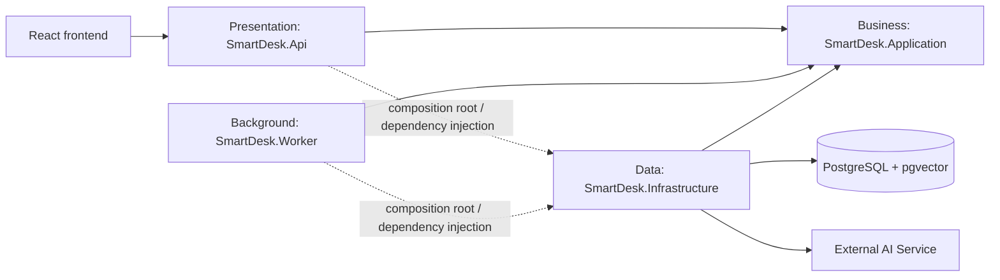

# Target Folder Structure — React and ASP.NET Core

> **Scope:** Code structure for SmartDesk V1 · **Status:** Target structure; no frontend or backend source exists yet
> **Detailed modules:** All 105 operations of the [OpenAPI contract](api/openapi.yaml)

This document defines source-code ownership and dependency directions. The current `prototype/index.html` is a single-file UX prototype backed by JavaScript mock data. The React frontend and the ASP.NET Core backend described below do not exist yet; they are the target for the first implementation.

## 1. General Principles

1. The UI does not contain authoritative authorization, workflow, or SLA rules.
2. Controllers contain neither SQL nor business logic.
3. Services depend on repository and provider interfaces, not directly on PostgreSQL, object storage, or the AI provider.
4. Infrastructure implements interfaces defined by Application.
5. Resource, DTO, and endpoint names must follow the [OpenAPI contract](api/openapi.yaml).
6. Tenant context comes from the session; no layer accepts a tenant id from the client.

## 2. Frontend React

### Frontend Prototype Strategy

The prototype is a design artifact, not the first version of the frontend. It is kept as the visual reference for the [UI/UX](05-ui-ux.md) screens and is not migrated file by file. The React application is generated fresh, with an API client generated from the OpenAPI contract:

```text
UI → feature hook → feature service → generated API client → ASP.NET Core API
```

### 2.1 Current Structure

```text
prototype/
└── index.html        # all screens, mock data, role switcher, and styles in one file
```

### 2.2 Target Structure

```text
frontend/src/
├── app/
│   ├── App.tsx
│   ├── routes.tsx                     # Employee Portal, IT Workspace, Manager Console, Admin, Platform
│   └── providers.tsx                  # query client, session, theme
├── components/                        # shared UI components
│   ├── layout/
│   ├── forms/
│   ├── feedback/
│   └── data-display/
├── features/                          # business feature modules
│   ├── auth/
│   │   ├── components/SignInForm.tsx
│   │   ├── hooks/useSession.ts
│   │   ├── services/authService.ts
│   │   └── auth.contracts.ts
│   ├── tickets/
│   │   ├── components/
│   │   ├── hooks/useTickets.ts
│   │   ├── pages/NewRequestPage.tsx
│   │   ├── services/ticketService.ts
│   │   ├── ticket.contracts.ts
│   │   └── ticket.validation.ts
│   └── assistant/
│       ├── components/
│       ├── hooks/useAssistant.ts
│       ├── pages/AssistantPage.tsx
│       ├── services/assistantService.ts
│       └── assistant.contracts.ts
├── services/
│   ├── generated/                     # client generated from docs/api/openapi.yaml
│   ├── apiClient.ts                   # base URL, access token in memory, refresh + CSRF, ProblemDetails
│   └── endpoints.ts
├── hooks/                             # shared hooks
├── lib/                               # pure functions: dates in tenant timezone, formatting
├── styles/
├── test/
│   ├── setup.ts
│   └── fixtures/
└── main.tsx
```

### 2.3 Frontend Responsibilities

| Directory | Term | Responsibility |
|---|---|---|
| `components/` | Shared components | Reusable UI that does not call APIs directly |
| `features/` | Feature modules | Groups UI, hooks, services, and contracts by business feature |
| `services/` | Infrastructure services | Generated client, token and CSRF handling, normalized Problem Details |
| `*.contracts.ts` | Data contracts | Types re-exported from the generated OpenAPI client |
| `hooks/` | Custom hooks | Coordinates loading, error, and cache state |
| `lib/` | Utilities | Pure functions with no state or HTTP access |

Target frontend flow:

```text
Page/Component → Feature Hook → Feature Service → apiClient → ASP.NET Core API
```

### 2.4 Complete Feature Inventory

Every target feature follows `components/`, `hooks/`, `pages/`, `services/`, `*.contracts.ts`, and `*.validation.ts` where those responsibilities apply.

```text
frontend/src/features/
├── auth/           # Sign in, workspace choice, refresh, sign out, route and role guards
├── profile/        # Profile, password, notification preferences
├── notifications/  # Notification center
├── catalog/        # Service catalog and request-type detail
├── tickets/        # New request, my requests, request detail, IT queue, IT ticket detail, attachments
├── assistant/      # Chat, citations, no-source state, ticket draft card
├── kb/             # Search and read, KB editor, KB review
├── assets/         # My assets, inventory, handover, recovery, history
├── approvals/      # Approval inbox, approval rules
├── sla/            # SLA policies and alerts
├── reports/        # Operations report and export
├── admin/          # Organization settings, members, catalog builder
└── platform/       # Tenant list, tenant lifecycle, platform audit log
```

Shared code is limited to code used by at least two features:

```text
frontend/src/
├── components/
│   ├── layout/          # AppShell, Sidebar, Topbar, RoleArea
│   ├── forms/           # Field, FormError, FilePicker, DynamicForm
│   ├── feedback/        # Alert, EmptyState, ErrorState, ConflictBanner, LoadingSkeleton
│   └── data-display/    # DataTable, Pagination, StatusBadge, SlaBadge
├── services/
│   ├── apiClient.ts     # bearer token in memory, silent refresh, X-CSRF-Token, ProblemDetails
│   ├── endpoints.ts     # OpenAPI path constants
│   └── fileDownload.ts
├── hooks/               # useDebounce, usePagination, useIdempotencyKey
├── lib/                 # dates in tenant timezone, formatting, validation helpers
└── test/
    ├── setup.ts
    ├── fixtures/
    ├── handlers/        # API mocks by operationId
    └── renderWithProviders.tsx
```

Feature code may depend on shared code; shared code must not import a feature. A feature service is the only code in that feature allowed to call `apiClient`. The assistant's draft card submits through `features/tickets` (`createTicket`), never through its own HTTP call.

## 3. Simplified Clean Architecture — Three-Project ASP.NET Core Backend

This is the **Simplified Clean Architecture / Clean Architecture 3-project variant**: `Api` (Presentation), `Application` (Business), and `Infrastructure` (Data), plus a `Worker` host for background jobs that reuses Application and Infrastructure. Framework-independent entities and business rules live in Application; Application does not depend on ASP.NET Core, EF Core, Npgsql, object storage SDKs, or the AI provider SDK.

### 3.1 Target Solution

```text
backend/
├── SmartDesk.sln
├── db/
│   └── migrations/
│       ├── 0001_schema.sql                  # exported from docs/database/smartdesk.dbml
│       └── 0002_constraints.sql             # copy of docs/database/smartdesk-constraints.sql
├── src/
│   ├── SmartDesk.Api/                       # Presentation layer
│   │   ├── Controllers/
│   │   │   ├── AuthController.cs
│   │   │   ├── TicketsController.cs
│   │   │   ├── ItTicketsController.cs
│   │   │   └── AiConversationsController.cs
│   │   ├── Contracts/
│   │   │   ├── Auth/
│   │   │   ├── Tickets/
│   │   │   ├── AiAssistant/
│   │   │   └── Common/
│   │   ├── Middleware/
│   │   │   ├── ProblemDetailsMiddleware.cs
│   │   │   └── TenantContextMiddleware.cs
│   │   ├── Filters/
│   │   │   ├── IdempotencyFilter.cs
│   │   │   └── CsrfValidationFilter.cs
│   │   ├── Authorization/
│   │   ├── Mapping/
│   │   ├── Program.cs
│   │   └── appsettings.json
│   ├── SmartDesk.Application/               # Application/Business layer
│   │   ├── Abstractions/
│   │   │   ├── Persistence/
│   │   │   │   ├── ITicketRepository.cs
│   │   │   │   ├── IAiConversationRepository.cs
│   │   │   │   ├── IIdempotencyStore.cs
│   │   │   │   └── IUnitOfWork.cs
│   │   │   ├── Ai/
│   │   │   │   ├── ILlmClient.cs
│   │   │   │   └── IEmbeddingClient.cs
│   │   │   └── Time/IClock.cs
│   │   ├── Tickets/
│   │   │   ├── Ticket.cs
│   │   │   ├── TicketWorkflow.cs
│   │   │   ├── ITicketService.cs
│   │   │   ├── TicketService.cs
│   │   │   ├── TicketPolicy.cs
│   │   │   ├── TicketQuery.cs
│   │   │   └── IOwnTicketReader.cs
│   │   ├── AiAssistant/
│   │   │   ├── AiConversation.cs
│   │   │   ├── IAssistantService.cs
│   │   │   ├── AssistantService.cs
│   │   │   ├── ConversationPolicy.cs
│   │   │   ├── GroundingPolicy.cs
│   │   │   ├── CitationValidator.cs
│   │   │   ├── PromptBuilder.cs
│   │   │   └── Tools/
│   │   ├── Catalog/
│   │   │   ├── ICatalogFormValidator.cs
│   │   │   └── IPublishedCatalogReader.cs
│   │   ├── KnowledgeBase/
│   │   │   └── IKnowledgeRetriever.cs
│   │   └── Common/
│   │       ├── ActorContext.cs
│   │       ├── PagedResult.cs
│   │       └── ErrorCode.cs
│   ├── SmartDesk.Infrastructure/            # Infrastructure/Data layer
│   │   ├── Persistence/
│   │   │   ├── SmartDeskDbContext.cs
│   │   │   ├── Configurations/
│   │   │   ├── Repositories/
│   │   │   │   ├── TicketRepository.cs
│   │   │   │   └── AiConversationRepository.cs
│   │   │   ├── Queries/PgVectorKnowledgeRetriever.cs
│   │   │   └── Transactions/EfUnitOfWork.cs
│   │   ├── Ai/
│   │   │   ├── HttpLlmClient.cs
│   │   │   └── HttpEmbeddingClient.cs
│   │   └── DependencyInjection.cs
│   └── SmartDesk.Worker/                    # Background host
│       ├── Program.cs
│       ├── OutboxDispatcher.cs
│       └── Jobs/
│           ├── AutoCloseResolvedTicketsJob.cs
│           └── KbIndexingHandler.cs
└── tests/
    ├── SmartDesk.Application.Tests/         # unit tests
    │   ├── Tickets/
    │   └── AiAssistant/
    └── SmartDesk.Api.Tests/                 # integration tests
        ├── Tickets/
        └── AiAssistant/
```

### 3.2 Three-Tier Responsibilities

| Layer | Term | Allowed | Not allowed |
|---|---|---|---|
| `Api` | Presentation layer | HTTP, model binding, session and CSRF checks, idempotency replay, DTO mapping, status codes | SQL, workflow transitions, ownership decisions |
| `Application` | Application/Business layer | Use cases, validation, RBAC, ownership policy, entities, workflows, grounding rules, repository and provider interfaces | ASP.NET HTTP objects, PostgreSQL driver, AI provider SDK |
| `Infrastructure` | Infrastructure/Data layer | EF Core/SQL, pgvector queries, object storage, AI provider HTTP calls, email, transactions | Business decisions or HTTP responses |
| `Worker` | Background host | Outbox dispatch and scheduled jobs that call Application | HTTP endpoints for users |

### 3.3 Dependency Direction



- `Application` does not reference `Api`, `Worker`, or `Infrastructure`.
- `Infrastructure` implements `ITicketRepository`, `IAiConversationRepository`, `IKnowledgeRetriever`, `ILlmClient`, `IEmbeddingClient`, `IIdempotencyStore`, and `IUnitOfWork`.
- `Api/Program.cs` and `Worker/Program.cs` are the composition roots and register implementations through dependency injection.
- Controllers depend on Application service interfaces, never `DbContext` or concrete repositories.

### 3.4 Complete Backend Module Inventory

The three projects remain the three tiers. Folders below are mandatory implementation locations for the V1 OpenAPI operations.

```text
backend/src/
├── SmartDesk.Api/
│   ├── Controllers/
│   │   ├── AuthController.cs
│   │   ├── ProfileController.cs
│   │   ├── NotificationsController.cs
│   │   ├── OrganizationController.cs
│   │   ├── MembersController.cs
│   │   ├── PlatformController.cs
│   │   ├── CatalogController.cs
│   │   ├── RequestTypesAdminController.cs
│   │   ├── ApprovalsController.cs
│   │   ├── AttachmentsController.cs
│   │   ├── TicketsController.cs
│   │   ├── ItTicketsController.cs
│   │   ├── FulfilmentController.cs
│   │   ├── ChangesController.cs
│   │   ├── AssetsController.cs
│   │   ├── KnowledgeBaseController.cs
│   │   ├── KbAuthoringController.cs
│   │   ├── KbReviewController.cs
│   │   ├── AiConversationsController.cs
│   │   ├── SlaController.cs
│   │   └── ReportsController.cs
│   ├── Contracts/{Auth,Profile,Notifications,Organization,Platform,Catalog,Approvals,Tickets,Assets,KnowledgeBase,AiAssistant,Sla,Reports,Common}/
│   ├── Authorization/        # permission policies and ActorContext construction
│   ├── Filters/              # IdempotencyFilter, CsrfValidationFilter
│   ├── Mapping/              # HTTP contract ↔ Application model
│   ├── Middleware/           # ProblemDetails, tenant context, request context
│   └── OpenApi/              # x-permissions and schema configuration
├── SmartDesk.Application/
│   ├── Abstractions/
│   │   ├── Persistence/      # repositories, idempotency store, unit of work
│   │   ├── Files/            # IFileStorage, IMalwareScanner
│   │   ├── Ai/               # ILlmClient, IEmbeddingClient
│   │   ├── Messaging/        # IOutbox, IEmailSender
│   │   └── Time/             # IClock
│   ├── Identity/
│   ├── Organization/
│   ├── Platform/
│   ├── Catalog/
│   ├── Tickets/
│   ├── Approvals/            # approvals, fulfilment steps, change plans
│   ├── Assets/
│   ├── KnowledgeBase/
│   ├── AiAssistant/
│   ├── Sla/
│   ├── Reports/
│   ├── Notifications/
│   ├── Files/
│   └── Common/               # ActorContext, ErrorCode, paging, exceptions, feature flags
├── SmartDesk.Infrastructure/
│   ├── Identity/             # PasswordHasher, SessionTokenIssuer
│   ├── Persistence/
│   │   ├── SmartDeskDbContext.cs
│   │   ├── Configurations/   # one configuration per database table
│   │   ├── Repositories/     # one implementation per repository interface
│   │   ├── Queries/          # pgvector retrieval, queue and report SQL
│   │   └── Transactions/     # EfUnitOfWork, tenant and actor context, outbox writer
│   ├── Files/                # S3FileStorage, ClamAvScanner
│   ├── Ai/                   # HttpLlmClient, HttpEmbeddingClient
│   ├── Email/                # SmtpEmailSender
│   └── DependencyInjection.cs
└── SmartDesk.Worker/
    ├── OutboxDispatcher.cs
    └── Jobs/                 # AutoCloseResolvedTicketsJob, SlaMonitorJob, KbIndexingHandler,
                              # UploadScanJob, RetentionJob
```

```text
backend/tests/
├── SmartDesk.Application.Tests/            # services, policies, workflows, grounding with fakes
├── SmartDesk.Api.Tests/                    # authorization, binding, status codes, ProblemDetails
├── SmartDesk.Infrastructure.Tests/         # real PostgreSQL: constraints, tenant FKs, pgvector retrieval
└── SmartDesk.ArchitectureTests/            # project references, AiAssistant has no write dependency
```

Unit tests isolate Application services with fake abstractions, including a fake `ILlmClient`. API tests use a test host. Infrastructure tests use a real disposable PostgreSQL database with `pgvector`, so enum, constraint, composite-FK, and retrieval behavior is verified.

## 4. C3-to-Folder Mapping

| C3 component | Primary location |
|---|---|
| HTTP API | `SmartDesk.Api/Controllers`, `Contracts`, `Filters`, `Middleware` |
| Identity & Access | `Application/Identity`, `Api/Authorization`, `Infrastructure/Identity` |
| Organization & Platform | `Application/Organization`, `Application/Platform` |
| Service Catalog | `Application/Catalog` |
| Ticketing | `Application/Tickets`, `Infrastructure/Persistence/Repositories/TicketRepository.cs` |
| Approval & Fulfilment | `Application/Approvals` |
| IT Assets | `Application/Assets` |
| Knowledge Base | `Application/KnowledgeBase`, `Infrastructure/Persistence/Queries/PgVectorKnowledgeRetriever.cs`, `Worker/Jobs/KbIndexingHandler.cs` |
| AI Assistant | `Application/AiAssistant`, `Infrastructure/Ai` |
| SLA & Reporting | `Application/Sla`, `Application/Reports`, `Worker/Jobs/SlaMonitorJob.cs` |
| Audit & Outbox | `Infrastructure/Persistence/Transactions`, `Worker/OutboxDispatcher.cs` |
| File Storage Adapter | `Application/Files`, `Infrastructure/Files` |
| Persistence | `Infrastructure/Persistence` |

## 5. Naming Conventions

- Controllers use plural nouns: `TicketsController`, `AssetsController`; IT-only routes use `ItTicketsController`.
- Entities use singular nouns: `Ticket`, `AiConversation`.
- Request/response DTOs use explicit suffixes: `CreateTicketRequest`, `TicketResponse`.
- Repository interfaces start with `I`: `ITicketRepository`.
- Endpoints are versioned as `/v1/...` and defined by the [OpenAPI 3.1 contract](api/openapi.yaml).
- SQL columns use `snake_case`; C# uses `PascalCase`; JSON uses `camelCase`.
- `row_version` in SQL is `RowVersion` in C# and `version` / `expectedVersion` in JSON.

## 6. OpenAPI-to-Folder Ownership

Every OpenAPI operation has exactly one frontend feature owner, one API controller, and one Application module. Shared infrastructure supports the operation but does not own it.

| OpenAPI tag | Operations | React feature | API controller | Application module |
|---|---|---|---|---|
| Authentication | `signIn`, `selectTenant`, `refreshSession`, `signOut` | `features/auth` | `AuthController` | `Identity` |
| Identity | `getMyProfile`, `updateMyProfile`, `changeMyPassword` | `features/profile` | `ProfileController` | `Identity` |
| Notifications | `listMyNotifications`, `markNotificationRead` | `features/notifications` | `NotificationsController` | `Notifications` |
| Organization | `getOrganization`, `updateOrganization`, `listOrgDepartments`, `createOrgDepartment`, `updateOrgDepartment`, `listOrgLocations`, `createOrgLocation`, `updateOrgLocation`, `listOrgTeams`, `createOrgTeam`, `updateOrgTeam` | `features/admin` | `OrganizationController` | `Organization` |
| Members | `listMembers`, `inviteMember`, `acceptInvitation`, `changeMember` | `features/admin` | `MembersController` | `Organization` |
| Platform | `platformSignIn`, `platformRefreshSession`, `platformSignOut`, `listTenants`, `createTenant`, `getTenant`, `suspendTenant`, `reopenTenant`, `listPlatformAudits` | `features/platform` | `PlatformController` | `Platform` |
| Catalog | `browseCatalog`, `getPublishedRequestType` | `features/catalog` | `CatalogController` | `Catalog` |
| Catalog Administration | `listAdminRequestTypes`, `createRequestType`, `editRequestType`, `publishRequestType`, `hideRequestType` | `features/admin` | `RequestTypesAdminController` | `Catalog` |
| Approvals | `listApprovalRules`, `createApprovalRule`, `updateApprovalRule`, `getApprovalInbox`, `decideApproval` | `features/approvals` | `ApprovalsController` | `Approvals` |
| Attachments | `uploadTemporaryFile`, `listTicketAttachments`, `downloadTicketAttachment` | `features/tickets` | `AttachmentsController` | `Files` |
| Tickets | `createTicket`, `listMyTickets`, `getTicket`, `listTicketTimeline`, `addTicketComment`, `confirmResolution`, `reopenTicket`, `cancelTicket` | `features/tickets` | `TicketsController` | `Tickets` |
| IT Tickets | `getITDashboard`, `listTicketQueue`, `triageTicket`, `assignTicket`, `transferTicket`, `updateTicketStatus`, `resolveTicket`, `linkTicketRecord`, `getTicketLinks` | `features/tickets` | `ItTicketsController` | `Tickets` |
| Fulfilment | `listFulfilmentSteps`, `recordFulfilmentStep` | `features/tickets` | `FulfilmentController` | `Approvals` |
| Change Management | `recordChangeAssessment`, `recordChangeResult`, `scheduleChange`, `closeCompletedChange` | `features/tickets` | `ChangesController` | `Approvals` |
| Assets | `listMyAssets`, `getAssetStockSummary`, `listAssets`, `createAsset`, `getAsset`, `updateAsset`, `handOverAsset`, `recoverAsset`, `transitionAssetStatus`, `getAssetLinks`, `listAssetHistory`, `recordAssetMaintenance` | `features/assets` | `AssetsController` | `Assets` |
| Knowledge Base | `searchPublishedArticles`, `getPublishedArticle`, `rateArticle` | `features/kb` | `KnowledgeBaseController` | `KnowledgeBase` |
| Knowledge Authoring | `listDraftArticles`, `createArticleDraft`, `editArticleDraft`, `submitArticleForReview` | `features/kb` | `KbAuthoringController` | `KnowledgeBase` |
| Knowledge Review | `listArticlesForReview`, `getArticleForReview`, `publishArticle`, `returnArticle`, `retireArticle` | `features/kb` | `KbReviewController` | `KnowledgeBase` |
| AI Assistant | `createAIConversation`, `askAI`, `prepareAITicketDraft`, `discardAITicketDraft` | `features/assistant` | `AiConversationsController` | `AiAssistant` |
| SLA | `listSlaPolicies`, `createSlaPolicy`, `editSlaPolicy`, `listSlaAlerts` | `features/sla` | `SlaController` | `Sla` |
| Reporting | `getOperationsReport`, `exportOperationsReport` | `features/reports` | `ReportsController` | `Reports` |

Total: **105 operations**. `uploadTemporaryFile` is owned by the backend `Files` module and called from the ticket and comment forms; attachment UI stays inside `features/tickets`.

## 7. Concrete Feature Templates

### 7.1 React Feature Template

Create only the folders required by a feature. The complete template is:

```text
features/<feature>/
├── components/                 # feature-only presentational components
├── hooks/                      # loading, mutation, and query coordination
├── pages/                      # route entry points
├── services/
│   └── <feature>Service.ts     # calls apiClient; functions use operationId names
├── <feature>.contracts.ts      # types re-exported from the generated client
├── <feature>.validation.ts     # client UX validation, never authoritative
├── <feature>.permissions.ts    # UI visibility rules where applicable
└── index.ts                    # explicit public exports only
```

Example for Tickets:

```text
features/tickets/
├── components/
│   ├── DynamicForm.tsx
│   ├── TicketStatusBadge.tsx
│   ├── Timeline.tsx
│   ├── ResolveDialog.tsx
│   └── ConflictBanner.tsx
├── hooks/
│   ├── useMyTickets.ts
│   ├── useTicketQueue.ts
│   └── useTicketMutation.ts
├── pages/
│   ├── NewRequestPage.tsx
│   ├── MyRequestsPage.tsx
│   ├── RequestDetailPage.tsx
│   ├── TicketQueuePage.tsx
│   └── ItTicketDetailPage.tsx
├── services/
│   └── ticketService.ts
├── ticket.contracts.ts
├── ticket.validation.ts
├── ticket.permissions.ts
└── index.ts
```

Example for the Assistant:

```text
features/assistant/
├── components/
│   ├── ChatThread.tsx
│   ├── AnswerBubble.tsx
│   ├── CitationList.tsx
│   ├── NoSourceCard.tsx
│   ├── TicketDraftCard.tsx       # submits through features/tickets (createTicket)
│   └── AssistantUnavailable.tsx  # 503 AI_UNAVAILABLE → link to the catalog
├── hooks/
│   └── useAssistant.ts
├── pages/
│   └── AssistantPage.tsx
├── services/
│   └── assistantService.ts
├── assistant.contracts.ts
└── index.ts
```

Rules:

- Other features import only from a feature's `index.ts`, never its internal files.
- Feature components do not call `fetch` directly.
- `apiClient` is the only owner of base URL, the in-memory access token, silent refresh with `X-CSRF-Token`, JSON parsing, and `ProblemDetails` normalization.
- Server state is coordinated by feature hooks; components receive data and callbacks through props.
- Client validation improves usability but never replaces API validation.
- OpenAPI `operationId` is used as the feature-service function name.
- Tests are colocated as `*.test.tsx`/`*.test.ts`; cross-feature fixtures and handlers live under `src/test`.

### 7.2 Backend Module Template

Each Application module follows one predictable layout:

```text
SmartDesk.Application/<Module>/
├── Models/                     # entities and value objects, no HTTP attributes
├── Commands/                   # command models and service methods that change state
├── Queries/                    # list/detail query models
├── Validation/                 # business and input rules
├── Policies/                   # RBAC, ownership, and visibility decisions
└── I<Module>Service.cs         # use-case boundary consumed by Api and Worker
```

The API contract for the same module follows:

```text
SmartDesk.Api/
├── Controllers/<Module>Controller.cs
├── Contracts/<Module>/
│   ├── Requests/
│   └── Responses/
└── Mapping/<Module>Mappings.cs
```

Persistence follows:

```text
SmartDesk.Infrastructure/Persistence/
├── Configurations/<Table>Configuration.cs
├── Repositories/<Module>Repository.cs
└── Transactions/EfUnitOfWork.cs
```

The Application project owns repository interfaces under `Abstractions/Persistence`; Infrastructure owns only their implementations.

## 8. Project References and Enforcement

Allowed project references:

```text
SmartDesk.Api             → SmartDesk.Application
SmartDesk.Api             → SmartDesk.Infrastructure
SmartDesk.Worker          → SmartDesk.Application
SmartDesk.Worker          → SmartDesk.Infrastructure
SmartDesk.Infrastructure  → SmartDesk.Application
SmartDesk.Application     → no project in this solution
```

The `Api → Infrastructure` and `Worker → Infrastructure` references are allowed only for composition in `Program.cs`. Controllers and jobs must not instantiate Infrastructure types.

Forbidden dependencies:

- `Application → Api`, `Application → Infrastructure`, `Application → Worker`
- `Infrastructure → Api`
- Controller → `DbContext` or repository implementation
- `Application/AiAssistant` → any write service (`ITicketService`, `IApprovalService`, `IAssetService`)
- React component → raw HTTP client
- Shared React directory → a business feature

These rules are enforced in `SmartDesk.ArchitectureTests` in addition to code review.

## 9. Configuration and Secret Placement

```text
backend/src/SmartDesk.Api/
├── appsettings.json                 # safe defaults only
├── appsettings.Development.json     # local non-secret settings
└── Properties/launchSettings.json

repository root/
├── .env.example                     # documented local variable names
└── compose.yaml                     # PostgreSQL + pgvector, object storage emulator
```

- Passwords, token signing keys, the AI provider key, and production connection strings are never committed.
- ASP.NET Core configuration/environment variables provide secrets at runtime.
- The React bundle contains only public configuration such as the API base URL; it never contains a database credential or an AI provider key.
- Uploaded binaries are stored in private object storage; PostgreSQL stores metadata and generated storage keys.

## 10. Verification Checklist

The folder structure is complete when all of the following are true:

- [x] The current prototype and its mock-data status are documented.
- [x] Target React feature-based structure covers all role areas and screens.
- [x] Shared-versus-feature ownership rules are explicit.
- [x] Frontend dependency flow is defined.
- [x] Three backend projects correspond to Presentation, Application/Business, and Infrastructure/Data tiers; the Worker host is defined.
- [x] All 105 OpenAPI operations have a frontend, controller, and Application owner.
- [x] All C3 components map to folders.
- [x] Project reference directions and forbidden dependencies are explicit, including the AI write boundary.
- [x] Unit, API integration, PostgreSQL infrastructure, and architecture test locations are defined.
- [x] Naming, configuration, secrets, files, audit, and transaction ownership are defined.
- [x] The document clearly distinguishes target structure from implemented source code.

## 11. Future Implementation Scope

This document defines structure and repository placement only. The React application, the .NET solution, and the database migrations do not exist yet. Implementation will create source code according to this structure, the [OpenAPI contract](api/openapi.yaml), the [database design](database/README.md), and the [C4](architecture/c4/README.md) and [UML](architecture/uml/README.md) designs.
