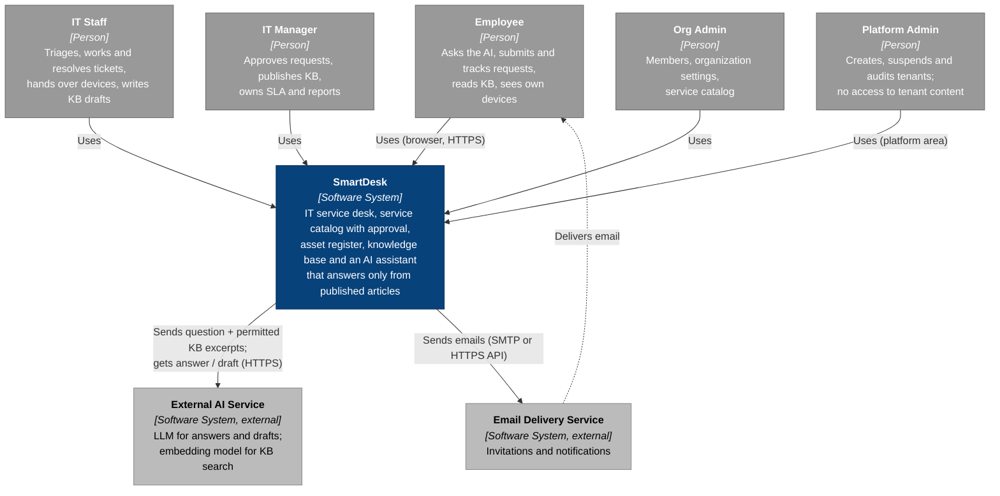

# C1 — System Context

> **Status:** target architecture; no backend exists yet. External providers are not chosen.

SmartDesk is a multi-tenant SaaS: each customer company is a **tenant** with its own employees, IT team, catalog, tickets, assets and knowledge base. A sixth actor, the **Platform Admin**, runs the SaaS itself and must never see tenant content.

## Actors

| Actor | Main use cases | Can never |
|---|---|---|
| Employee | UC01–UC02, UC06–UC15, UC35, UC39–UC40 | See another employee's tickets or assets, internal notes, unpublished articles |
| IT Staff | UC16–UC22, UC26, UC28–UC31, UC33 | Approve requests, publish KB, force a ticket to `CLOSED` |
| IT Manager | UC18, UC20, UC24–UC25, UC27, UC32, UC34, UC36–UC38 | Write assets (read-only register) |
| Org Admin | UC03–UC04, UC23 | Work tickets, approve |
| Platform Admin | UC05, UC41–UC43 | Read tickets, attachments, articles or assets of any tenant |
| External AI Service | Secondary actor on UC12–UC15 | Write data, call SmartDesk APIs, see anything the asking user cannot see |

Every tenant user is an Employee as well (role grants inherit self-service), so IT Staff, IT Managers and Org Admins can also submit their own requests.

## External systems

| System | Data sent | Trust rule |
|---|---|---|
| External AI Service (LLM + embeddings) | The user's question, conversation turns, KB excerpts the user is allowed to read, the published form schema when drafting | Treated as untrusted output: citations are validated, the provider has no tools that write, no database credentials, no tenant IDs beyond what the request needs |
| Email Delivery Service | Recipient address, notification text, invitation link | Contains no internal notes or attachments; links require sign-in |

## Out of scope for the MVP

- Single sign-on with a company identity provider (SmartDesk uses its own email + password, UC01/UC39).
- Device management (MDM) or automatic provisioning — handover is recorded by IT staff, not executed by SmartDesk.
- Chat integrations (Teams, Slack) and inbound email-to-ticket.

---

**Next:** [C2 — Container](02-container.md) · **Up:** [C4 overview](README.md)
