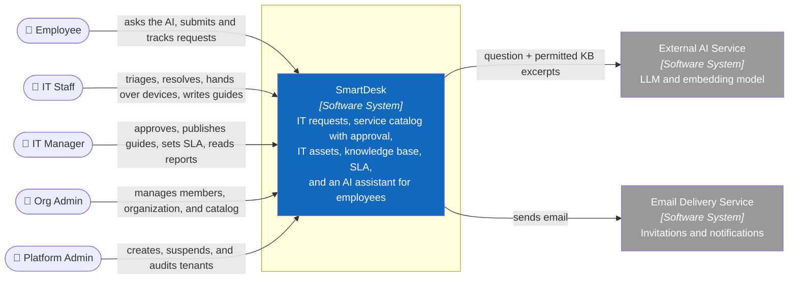

# C1 — System Context

> **Purpose:** show who uses SmartDesk and what the system is responsible for, without implementation technology.

## System Boundary

SmartDesk is a multi-tenant SaaS: each customer company is a tenant with its own members, catalog, tickets, assets, and knowledge base. SmartDesk is responsible for sign-in and tenant selection, the service catalog and request forms, incidents, service requests and changes, approvals and fulfilment, the IT asset register and device handover, the knowledge base, the AI assistant, SLA and reports, notifications, and tenant administration.

The External AI Service only interprets questions and composes answers or drafts from excerpts SmartDesk sends; it never writes data, approves, or sees anything the asking user cannot see. The Email Delivery Service receives no internal notes or attachments.

Outside V1 scope: single sign-on with a company identity provider, device management (MDM) and automatic provisioning, chat integrations (Teams, Slack), and inbound email-to-ticket.

## Users and Primary Permissions

| Person | Primary permissions |
|---|---|
| Employee | Self-service: catalog, own requests and comments, confirm or reopen, AI assistant, knowledge base, own devices |
| IT Staff | Ticket queue, triage, assign, resolve, fulfilment, asset register and handover, KB drafts |
| IT Manager | Approval decisions and rules, KB review and publishing, SLA policies and alerts, reports, read-only asset register |
| Org Admin | Members and roles, organization settings, service catalog builder |
| Platform Admin | Tenant creation, suspension, and the platform audit log; no access to tenant content |

Every tenant role inherits Employee self-service. The API enforces role, tenant, and ownership on every request; hiding controls in the UI is only for usability.

**Next:** zoom into the Software System → [C2 — Container](02-container.md).

**Sources of truth:** `docs/01-top-down-research.md`, `docs/02-use-cases.md`, `docs/api/openapi.yaml`.
