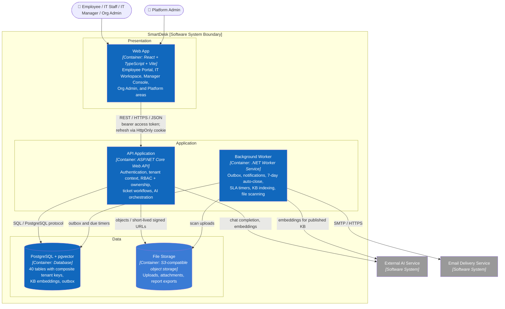
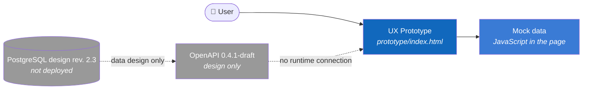

# C2 — Container

> **Purpose:** zoom into SmartDesk and describe runtime and storage units in the target architecture.

## Responsibilities

| Container | Technology | Responsibility | Status |
|---|---|---|---|
| Web App | React, TypeScript, Vite; client generated from OpenAPI | Screens, route guards, forms, Problem Details by `errorCode`, `Idempotency-Key` on submit | Prototype only (`prototype/index.html`) |
| API Application | C#, ASP.NET Core Web API, REST/JSON | Trust boundary for authentication, tenant, RBAC, ownership, workflows, and AI orchestration | Not implemented; [OpenAPI 0.4.1-draft](../../api/openapi.yaml) |
| Background Worker | C#, .NET Worker Service | Outbox dispatch, email, auto-close after 7 days, SLA warnings, KB indexing, upload scanning, retention | Not implemented |
| PostgreSQL + pgvector | PostgreSQL 16+, `pgvector`, `btree_gist` | Source of truth; composite tenant FKs; KB chunk embeddings | [Design revision 2.3](../../database/README.md); verified on PGlite |
| File Storage | Private S3-compatible bucket | Binary files keyed by tenant; PostgreSQL keeps metadata only | Not chosen |

## Architecture Rules

1. The browser never accesses PostgreSQL, file storage, or the AI provider directly.
2. Hiding frontend controls is UX only; the API Application authorizes every request by permission, tenant, ownership, and state.
3. The tenant comes only from the verified session, never from a client header, path, or body.
4. One command is one transaction: business rows, `ticket_events` / `audit_logs`, and `outbox_messages` commit together; the worker reads the outbox, so no notification is sent for a rolled-back change.
5. The AI provider receives only KB excerpts already filtered by tenant, `PUBLISHED` status, and the caller's visibility; it has no tools that write.
6. The access token lives in SPA memory; the refresh token is only the `sd_refresh` HttpOnly cookie (`SameSite=Strict`), rotated on every refresh and checked with a double-submit `X-CSRF-Token`.
7. Platform Admin sessions are accepted only by `/platform/**` and never by tenant endpoints.

## Current State

**Previous:** [C1 — System Context](01-system-context.md) · **Next:** zoom into the API Application → [C3 — Component](03-component.md).
