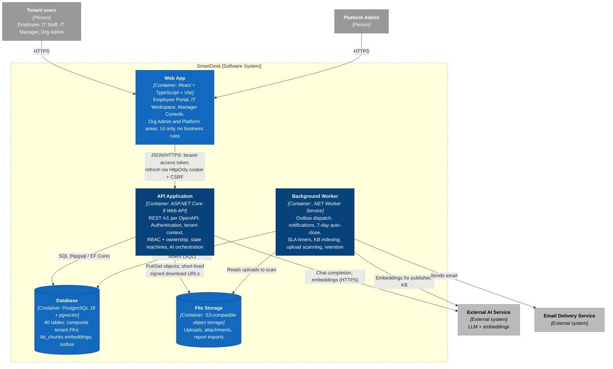
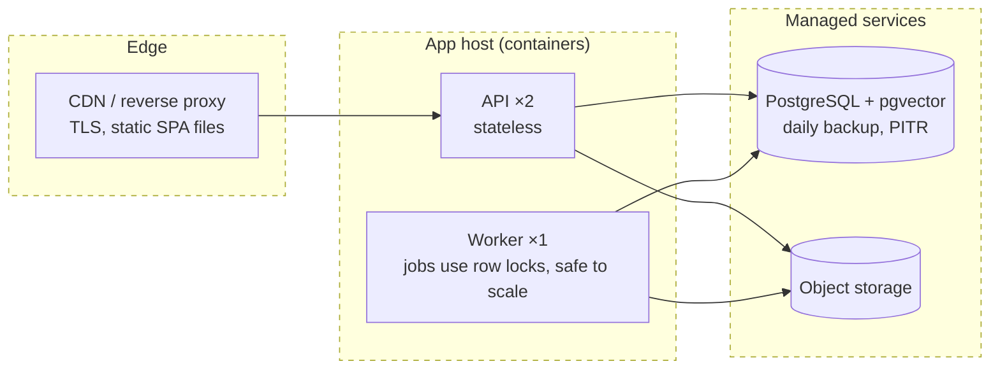

# C2 — Container

> **Status:** target architecture. Nothing in this diagram is deployed. Technologies are the working assumption from the [overview](README.md#technology-choices-proposed).

## Responsibilities

| Container | Technology | Responsibility | Does not |
|---|---|---|---|
| Web App | React 18, TypeScript, Vite, React Router, TanStack Query; API client generated from `openapi.yaml` | Screens from the [IA](../../04-information-architecture.md); hides controls the user cannot use; shows Problem Details by `errorCode`; sends `Idempotency-Key` on ticket submit | Decide permissions, compute SLA, call the AI provider, hold tokens in `localStorage` |
| API Application | ASP.NET Core 8, EF Core + Npgsql, FluentValidation | All 105 operations; resolves tenant from the session; enforces permission + ownership + state on every call; writes business change, audit row and outbox message in one transaction | Run long jobs or timers; send email directly |
| Background Worker | .NET 8 Worker Service, same domain assemblies as the API | Dispatches outbox messages (notifications, KB indexing); runs scheduled jobs: auto-close after 7 days (UC10), SLA warning/breach (UC37, P1), expired uploads and idempotency records, AI retention | Accept HTTP requests from users |
| Database | PostgreSQL 16+ with `pgvector` | Source of truth; composite FKs `(tenant_id, id)` reject cross-tenant references; CHECKs for status-per-kind, reasons and notes; HNSW index on `kb_chunks.embedding` | Hold file contents |
| File Storage | S3-compatible bucket, private | Upload staging (`uploads/{tenantId}/…`), attachments, exports; objects keyed by tenant | Serve public URLs; downloads always go through an authorized API call that issues a short-lived URL |

## Key runtime rules

1. **Tenant from the session only.** The API reads tenant and membership from the validated session; no header, path or body carries a tenant for authorization.
2. **One transaction per command.** A business change, its `ticket_events` / `audit_logs` row and its outbox message commit together, so the worker never sends a notification for a change that rolled back.
3. **API ↔ Worker communicate through the database.** A transactional outbox table (`outbox_messages`, database revision 2.2) instead of a message broker keeps the MVP to two processes and one data store.
4. **The AI provider sees only permitted data.** The API retrieves KB chunks already filtered by tenant, `PUBLISHED` status and the caller's visibility before it builds a prompt.
5. **Refresh token only in an HttpOnly cookie (D15).** The access token lives in SPA memory; the refresh token is the `sd_refresh` cookie (`SameSite=Strict`, path `/v1/auth`), rotated on every refresh and checked with a double-submit `X-CSRF-Token`.
6. **Platform area is a separate security context.** Platform sessions (review R08) are accepted only by `/platform/**` endpoints and are rejected by every tenant endpoint.

## Deployment (MVP)

The API is stateless (sessions are rows in `user_sessions`), so it scales horizontally. Worker jobs claim work with `SELECT … FOR UPDATE SKIP LOCKED`, so a second worker instance does not duplicate a close event or an SLA alert (test T13, T24).

---

**Previous:** [C1 — System Context](01-system-context.md) · **Next:** [C3 — Component](03-component.md)
