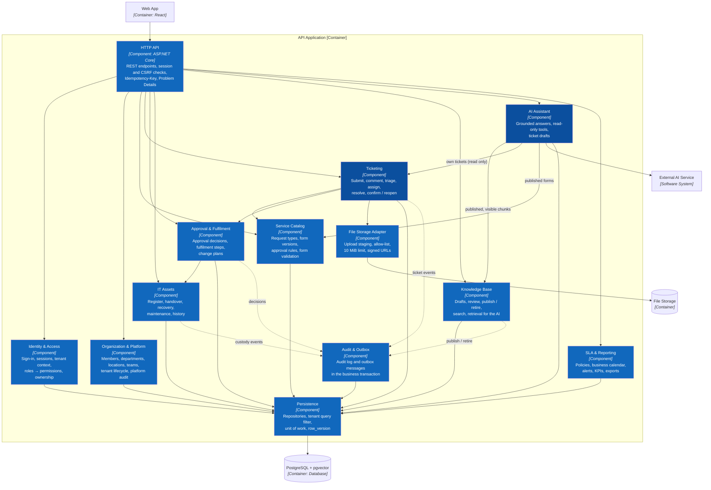

# C3 — Component — API Application

> **Status:** target architecture. The components below do not yet have C#/.NET source code in the repository.

The two darker components, **Ticketing** and **AI Assistant**, are the core features zoomed into at [C4 — Code](04-code.md).

## Component catalog

| Component | Owns | Does not own |
|---|---|---|
| HTTP API | Transport, session and CSRF checks, idempotency replay, error contract | SQL and business decisions |
| Identity & Access | Sign-in, sessions and refresh rotation, tenant context, permissions, ownership rule | UI visibility |
| Organization & Platform | Members and invitations, departments, locations, teams, tenant lifecycle, platform audit | Tenant content (tickets, articles, files) |
| Service Catalog | Request types, immutable form versions, approval rules, answer validation | Tickets |
| Ticketing | Ticket lifecycle per kind, comments, attachments, timeline, links | Approval decisions and asset state |
| Approval & Fulfilment | Approval inbox and decisions, fulfilment steps, change plans | Approval rules (Service Catalog) |
| IT Assets | Asset register, single active assignment, handover and recovery, maintenance | Ticket status (asks Ticketing to resolve) |
| Knowledge Base | Article versions, independent review, publishing, search, retrieval of published chunks | Embedding at request time (worker) |
| AI Assistant | Conversations, grounding and citation checks, read-only tools, ticket drafts | Creating tickets — the employee calls `POST /tickets` |
| SLA & Reporting | SLA policies, business calendar, alerts, KPIs, exports | Ticket transitions |
| Audit & Outbox | `audit_logs`, `outbox_messages`, `idempotency_records` | Primary operational data |
| File Storage Adapter | File validation, generated keys, binary persistence | Who may see an attachment (Ticketing) |
| Persistence | Repositories, SQL, transactions, optimistic locking | HTTP and UI authorization |

## Dependency Flow

`HTTP API → Identity & Access → business component → Persistence → PostgreSQL`.

Ticketing calls the Service Catalog to validate answers and resolve the approval rule. The AI Assistant reads through Knowledge Base, Ticketing, and Service Catalog interfaces only. No business component opens its own PostgreSQL connection or reads another component's tables.

The **Background Worker** reuses Application and Persistence: an Outbox Dispatcher sends email and triggers KB indexing; scheduled jobs auto-close resolved tickets after seven days, raise SLA warnings, scan uploads, and purge expired idempotency records and uploads. Every job is idempotent and claims rows with `FOR UPDATE SKIP LOCKED`.

## AI Assistant Write Boundary

**Status:** ACCEPTED

### Confirmed requirement

The assistant never submits a ticket, approves a request, or changes an asset (UC12–UC15, `docs/01-top-down-research.md` §5).

The AI Assistant depends only on read interfaces: `IKnowledgeRetriever`, `IOwnTicketReader`, and `IPublishedCatalogReader`. A draft becomes a ticket only through the employee's own `POST /tickets`, which runs the same Ticketing validation as a manual submission. Architecture tests fail the build if the AI Assistant references a write service; integration test T15 checks that no ticket exists before the employee submits.

**Previous:** [C2 — Container](02-container.md) · **Next:** [C4 — Code for Ticketing and the AI Assistant](04-code.md) · **Related:** [Folder structure](../../07-folder-structure.md).

**Sources of truth:** `docs/02-use-cases.md`, `docs/api/openapi.yaml`, `docs/database/smartdesk.dbml`.
