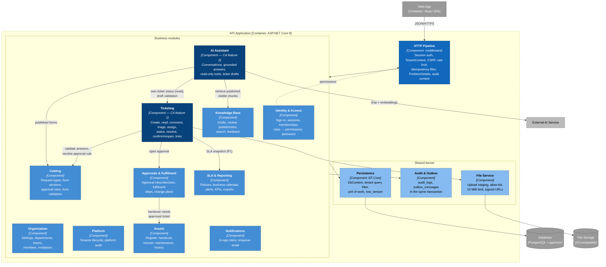
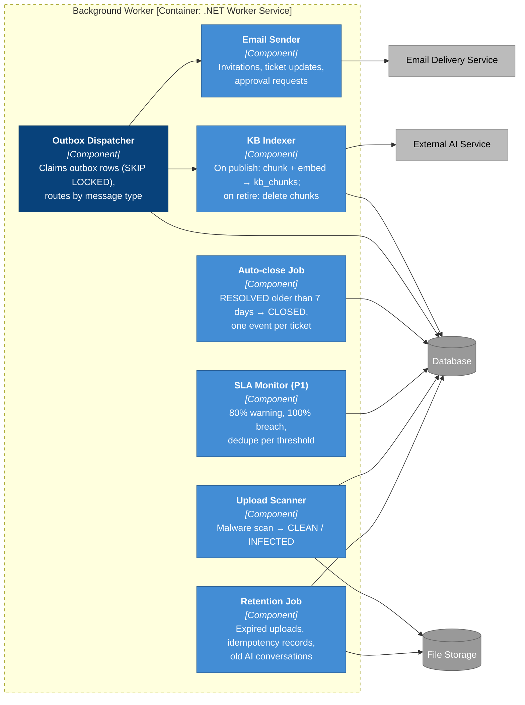

# C3 — Component — API Application and Background Worker

> **Status:** target architecture; no C#/.NET source exists yet. The API is a **modular monolith**: one deployable, one database, modules that talk only through each other's public interfaces.

## API Application

## Component catalog

| Component | OpenAPI tags / paths | Owns (DB tables) | Does not own |
|---|---|---|---|
| HTTP Pipeline | all | — | Business rules; it only builds `ICurrentPrincipal` and rejects bad requests early |
| Identity & Access | Authentication, Identity · `/auth/*`, `/me`, `/me/password` | `users`, `user_sessions`, `memberships`, `membership_roles` | Org structure, invitations UI |
| Organization | Organization, Members · `/organization/**`, `/invitations/accept` | `departments`, `locations`, `it_teams`, `it_team_members`, invite columns of `memberships` | Platform tenants |
| Platform | Platform · `/platform/**` | `tenants`, `tenant_counters` (create), `audit_logs` where scope = PLATFORM | Any tenant content |
| Catalog | Catalog, Catalog Administration · `/catalog/**`, `/admin/request-types/**`, `/approval-rules/**` | `catalog_items`, `catalog_versions`, `approval_rules` | Tickets |
| **Ticketing** | Tickets, IT Tickets, Attachments · `/tickets/**`, `/it/dashboard`, `/it/tickets/**` (except fulfilment and change) | `tickets`, `ticket_comments`, `ticket_attachments`, `ticket_events`, `ticket_links`, `ticket_assets` | Approval decisions, asset state |
| Approvals & Fulfilment | Approvals, Fulfilment, Change Management · `/approvals/**`, `/it/tickets/{ticketId}/fulfilment-steps`, `/it/tickets/{ticketId}/change-*` | `ticket_approvals`, `fulfilment_steps`, `change_plans` | Approval rules (Catalog) |
| Assets | Assets · `/assets/**` | `assets`, `asset_assignments`, `asset_maintenance` | Ticket status (asks Ticketing to resolve) |
| Knowledge Base | Knowledge Base, Knowledge Authoring, Knowledge Review · `/kb/**`, `/it/kb/**`, `/manager/kb/**` | `kb_articles`, `kb_article_versions`, `kb_chunks` (written by the worker), `kb_feedback` | Embedding calls at request time |
| **AI Assistant** | AI Assistant · `/ai/**` | `ai_conversations`, `ai_messages`, `ai_message_sources`, `ai_ticket_drafts` | Creating tickets — the employee calls `POST /tickets` |
| SLA & Reporting | SLA, Reporting · `/sla/**`, `/reports/**` | `sla_policies`, `ticket_sla`, `tenant_holidays`, calendar columns of `tenants` | Ticket transitions |
| Notifications | Notifications · `/me/notifications/**` | `notifications` | Email delivery (worker) |
| File Service | `/uploads`, attachment download | Objects in File Storage; staging metadata | Deciding who may see an attachment (Ticketing) |
| Audit & Outbox | — | `audit_logs`, `outbox_messages`, `idempotency_records` | — |

## Dependency rules

1. **Modules call each other only through a public interface** in their `*.Contracts` namespace (for example Ticketing calls `ICatalogFormValidator`, never `CatalogDbContext`).
2. **No module reads another module's tables.** Reporting is the one exception and does so through read-only SQL views.
3. **The AI Assistant has no write path into other modules.** Its tools are the read-only interfaces `IOwnTicketReader`, `IKnowledgeRetriever` and `IPublishedCatalogReader`; a ticket is created only by the employee's own `POST /tickets` (UC14, test T15).
4. **Every module command runs inside the unit of work** that sets `app.tenant_id` / `app.actor_id` for the connection and commits audit + outbox rows together.
5. **Authorization is three checks, always in this order:** permission from `x-permissions` → tenant (implicit in every query) → ownership and state in the module. A resource that fails the tenant or ownership check returns `404`, never `403` (tests T01, T03, T20).

## Background Worker

Every job is **idempotent**: it re-reads state under a row lock and does nothing if the change already happened, so a retry or a second worker instance cannot send a duplicate alert or write a second close event (tests T13, T24).

## Cross-cutting decisions

| Concern | Decision |
|---|---|
| Tenant isolation | `ICurrentPrincipal.TenantId` from the session; EF Core global query filter on `tenant_id`; composite FKs in the DB as the last line of defence. PostgreSQL RLS can be added later as defence in depth. |
| Concurrency | Every command takes `expectedVersion`; EF Core concurrency token on `row_version`; stale → `409 CONCURRENT_MODIFICATION` (tests T06, T07, T18). |
| Idempotency | `IdempotencyFilter` on `POST /tickets`; `idempotency_records` keyed by tenant + member + method + path + key with a request hash (review R05). |
| Errors | One `ProblemDetailsFactory`; `errorCode` from a single enum (review R06); `traceId` = `Activity.TraceId`. |
| Feature gating | `IFeatureGate` per use case and release (P0 / P1 / P2), because several P0 routes also serve P1 use cases (README §2, review guide D14). |
| Observability | OpenTelemetry traces and metrics; AI calls record model, token counts and latency in `ai_messages`. Prompts and KB excerpts are never written to logs. |

---

**Previous:** [C2 — Container](02-container.md) · **Next:** [C4 — Code](04-code.md)
