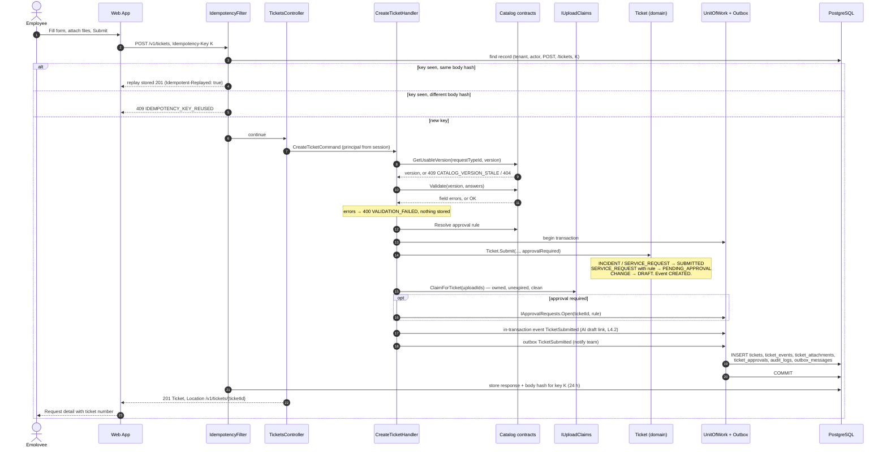
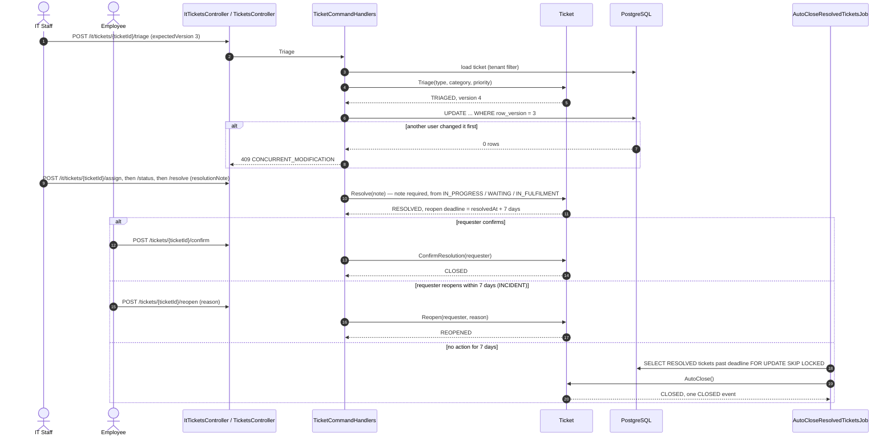
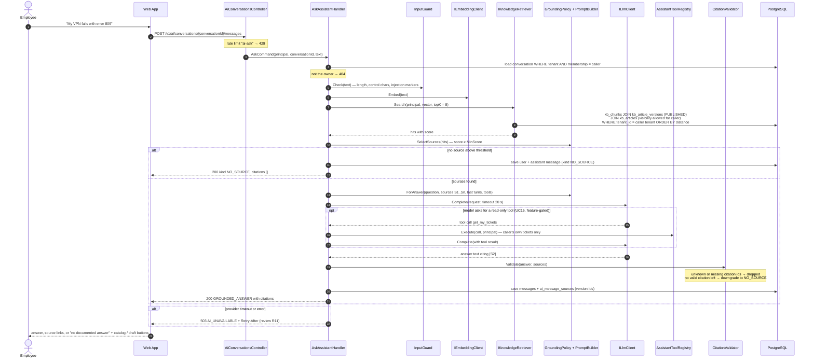
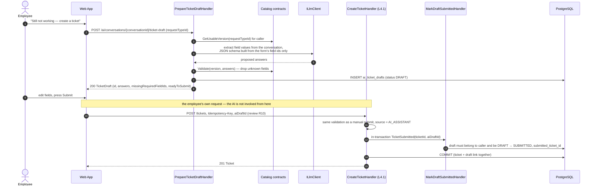

# C4 — Code — Two Core Features

> **Status:** target code-level design for the .NET backend and the React frontend. The repository has **no C#/.NET or production frontend source yet**; class, file and folder names below are the plan for the first implementation.  
> **Scope:** this level zooms into the two C3 components that carry SmartDesk's value proposition — *one place to request IT help* and *an AI assistant that answers from the company's own guides and turns a chat into a ticket draft*:
>
> | Feature | C3 component | Use cases (release) | Main operations |
> |---|---|---|---|
> | [L4.1 Ticket Request & Lifecycle](#l41-ticket-request--lifecycle) | Ticketing | UC07, UC08, UC10, UC16–UC19, UC21 (P0) | `createTicket`, `getTicket`, `listTicketQueue`, `triageTicket`, `assignTicket`, `updateTicketStatus`, `resolveTicket`, `confirmResolution`, `reopenTicket` |
> | [L4.2 AI Assistant](#l42-ai-assistant) | AI Assistant | UC12, UC14 (P0); UC13, UC15 (P1, feature-gated) | `createAIConversation`, `askAI`, `prepareAITicketDraft`, `discardAITicketDraft` |
>
> The two features meet at one point: an AI draft becomes a ticket **only** through the employee's own `POST /tickets`, which runs the same handler as a manual submission.
>
> Approval, fulfilment and asset handover (UC25, UC26, UC29) are not detailed here; they follow the same patterns.

Contents: [1. Code structure](#1-code-structure) · [L4.1 Ticketing](#l41-ticket-request--lifecycle) · [L4.2 AI Assistant](#l42-ai-assistant) · [Shared rules](#shared-rules-for-both-features) · [Tests](#test-map)

---

## 1. Code structure

### 1.1 Repository layout

New top-level folders `backend/` and `frontend/` sit next to the existing documentation; nothing existing moves.

```text
SmartDesk/
├── docs/                                  # existing: requirements, database, api, architecture
│   ├── api/openapi.yaml                   # source for generated DTOs (backend) and client (frontend)
│   ├── database/                          # DBML + constraints → backend/db/migrations
│   └── architecture/c4/                   # this document
├── prototype/                             # existing mock-data prototype (reference for UI only)
├── tools/                                 # existing diagram generators
├── backend/
│   ├── SmartDesk.sln
│   ├── Directory.Build.props              # net8.0, nullable, warnings as errors
│   ├── Directory.Packages.props           # central package versions
│   ├── db/
│   │   └── migrations/                    # plain SQL applied in order (DbUp)
│   │       ├── 0001_schema.sql            # generated from docs/database/smartdesk.dbml
│   │       └── 0002_constraints.sql       # copy of smartdesk-constraints.sql
│   ├── src/
│   │   ├── SmartDesk.Api/                 # host: HTTP pipeline + composition root
│   │   ├── SmartDesk.Worker/              # host: background jobs
│   │   ├── SmartDesk.SharedKernel/        # principal, errors, unit of work, outbox, clock
│   │   ├── SmartDesk.Infrastructure/      # adapters: PostgreSQL, S3, LLM, embeddings, email
│   │   └── Modules/
│   │       ├── Identity/
│   │       ├── Organization/
│   │       ├── Platform/
│   │       ├── Catalog/
│   │       ├── Ticketing/                 # ← L4.1, expanded in §L4.1.4
│   │       ├── Approvals/
│   │       ├── Assets/
│   │       ├── KnowledgeBase/
│   │       ├── AiAssistant/               # ← L4.2, expanded in §L4.2.4
│   │       ├── Sla/
│   │       └── Notifications/
│   └── tests/
│       ├── SmartDesk.Ticketing.Tests/          # domain + handler unit tests
│       ├── SmartDesk.AiAssistant.Tests/        # grounding, citation, guard tests (fake LLM)
│       ├── SmartDesk.Api.IntegrationTests/     # WebApplicationFactory + Testcontainers PostgreSQL
│       ├── SmartDesk.ContractTests/            # responses validated against docs/api/openapi.yaml
│       └── SmartDesk.ArchitectureTests/        # module boundaries (NetArchTest)
└── frontend/
    ├── package.json
    ├── vite.config.ts
    ├── openapi-ts.config.ts               # generates src/api/generated from docs/api/openapi.yaml
    └── src/
        ├── main.tsx
        ├── app/                           # router, providers, layouts per role area
        ├── api/                           # generated client, fetch wrapper, Problem Details
        ├── auth/                          # access token in memory, silent refresh via cookie, CSRF header, permission hooks
        ├── features/
        │   ├── tickets/                   # ← L4.1 UI, expanded in §L4.1.4
        │   ├── assistant/                 # ← L4.2 UI, expanded in §L4.2.4
        │   ├── catalog/  kb/  assets/  approvals/  admin/  platform/
        ├── components/                    # design-system primitives (Button, Field, EmptyState…)
        └── lib/                           # formatting, dates (tenant timezone), feature flags
```

### 1.2 Shape of every backend module

Each module is two projects. Other modules may reference **only** `*.Contracts`; `SmartDesk.ArchitectureTests` fails the build otherwise.

```text
Modules/<Name>/
├── SmartDesk.<Name>.Contracts/        # public interfaces + DTOs other modules may use
└── SmartDesk.<Name>/
    ├── Api/                           # controllers, request/response mapping, permission attributes
    ├── Application/                   # one handler per command or query, validators, policies
    ├── Domain/                        # entities, value objects, state machines, domain events
    ├── Infrastructure/                # module DbContext, EF configurations, repositories, SQL queries
    └── <Name>Module.cs                # AddXxxModule(IServiceCollection) + MapXxxEndpoints
```

Dependencies point inwards: `Api → Application → Domain`; `Infrastructure` implements interfaces declared in `Application`. `Domain` references only `SmartDesk.SharedKernel`.

### 1.3 Shared kernel and hosts (files used by both features)

```text
backend/src/
├── SmartDesk.SharedKernel/
│   ├── Security/
│   │   ├── ICurrentPrincipal.cs          # TenantId, MembershipId, Roles, HasPermission(...)
│   │   ├── Permission.cs                 # constants mirroring x-permissions ("request.create"…)
│   │   └── RolePermissions.cs            # role_code → permissions (docs/02-use-cases.md table)
│   ├── Errors/
│   │   ├── ErrorCode.cs                  # single enum (review R06)
│   │   ├── DomainException.cs            # carries ErrorCode; mapped to Problem Details
│   │   └── NotFoundException.cs          # also used for "exists but not visible"
│   ├── Persistence/
│   │   ├── IUnitOfWork.cs                # ExecuteAsync(Func<Task>) — one transaction per command
│   │   ├── ITenantOwned.cs               # marker for the global tenant query filter
│   │   └── ModuleDbContext.cs            # base: tenant filter, row_version token, snake_case
│   ├── Outbox/
│   │   ├── IOutbox.cs                    # Enqueue(message) inside the current transaction
│   │   └── IntegrationEvent.cs
│   ├── Events/
│   │   └── IInTransactionHandler.cs      # same-transaction handlers across modules
│   ├── Time/IClock.cs
│   └── Features/IFeatureGate.cs          # IsEnabled("UC15")
├── SmartDesk.Api/
│   ├── Program.cs                        # registers all modules, maps /v1
│   ├── Security/
│   │   ├── SessionAuthenticationHandler.cs   # bearer access token → user_sessions row → principal
│   │   ├── CurrentPrincipal.cs               # ICurrentPrincipal from HttpContext
│   │   ├── RequirePermissionAttribute.cs     # [RequirePermission("ticket.triage")]
│   │   └── CsrfValidationFilter.cs           # X-CSRF-Token == sd_csrf cookie on /auth/refresh
│   ├── Idempotency/
│   │   ├── IdempotencyFilter.cs          # Idempotency-Key: replay, 409 on body mismatch
│   │   └── IIdempotencyStore.cs
│   ├── Errors/ProblemDetailsMapper.cs    # exception → application/problem+json
│   └── RateLimiting/RateLimitPolicies.cs # "ai-ask", "sign-in", "uploads"
├── SmartDesk.Worker/
│   ├── Program.cs
│   ├── OutboxDispatcher.cs
│   └── Jobs/
│       ├── AutoCloseResolvedTicketsJob.cs    # L4.1
│       ├── KbIndexingHandler.cs              # L4.2 (publish → chunks, retire → delete)
│       ├── SlaMonitorJob.cs                  # P1
│       ├── UploadScanJob.cs
│       └── RetentionJob.cs
└── SmartDesk.Infrastructure/
    ├── Persistence/
    │   ├── NpgsqlConnectionFactory.cs
    │   ├── EfUnitOfWork.cs               # SET LOCAL app.tenant_id / app.actor_id, commit, dispatch
    │   └── OutboxWriter.cs
    ├── Files/S3FileStorage.cs
    ├── Ai/
    │   ├── LlmClientOptions.cs           # endpoint, model id, timeout, max tokens
    │   ├── HttpLlmClient.cs              # implements ILlmClient (provider adapter)
    │   └── HttpEmbeddingClient.cs        # implements IEmbeddingClient
    └── Email/SmtpEmailSender.cs
```

---

## L4.1 Ticket Request & Lifecycle

Employees submit a request from a published catalog form (UC07), IT triages, assigns, works and resolves it (UC16–UC21), and the requester confirms or reopens within seven days, otherwise the worker closes it (UC10).

### L4.1.1 Class diagram

```mermaid
classDiagram
    direction TB

    class TicketsController {
        <<Api>>
        +Create(CreateTicketRequest, idempotencyKey) 201 Ticket
        +ListMine(query) TicketList
        +Get(ticketId) Ticket
        +Confirm(ticketId, VersionCommand) Ticket
        +Reopen(ticketId, ReopenCommand) Ticket
    }
    class ItTicketsController {
        <<Api>>
        +Queue(query) TicketList
        +Triage(ticketId, TriageCommand) Ticket
        +Assign(ticketId, AssignCommand) Ticket
        +ChangeStatus(ticketId, StatusCommand) Ticket
        +Resolve(ticketId, ResolveCommand) Ticket
    }
    class CreateTicketHandler {
        <<Application>>
        +Handle(CreateTicketCommand) TicketDto
    }
    class TicketCommandHandlers {
        <<Application>>
        +Triage(TriageTicketCommand) TicketDto
        +Assign(AssignTicketCommand) TicketDto
        +ChangeStatus(ChangeStatusCommand) TicketDto
        +Resolve(ResolveTicketCommand) TicketDto
        +Confirm(ConfirmResolutionCommand) TicketDto
        +Reopen(ReopenTicketCommand) TicketDto
    }
    class TicketQueries {
        <<Application>>
        +ListMine(principal, filter, page) Page~TicketSummary~
        +Queue(principal, view, filter, page) Page~TicketSummary~
        +Get(principal, ticketId) TicketDto
    }
    class TicketAccessPolicy {
        <<Application>>
        +EnsureCanRead(principal, ticket)
        +EnsureRequester(principal, ticket)
        +EnsureItActor(principal, permission)
        +ProjectFor(principal, ticket) TicketDto
    }
    class Ticket {
        <<Aggregate>>
        +Guid Id
        +Guid TenantId
        +TicketNo No
        +TicketKind Kind
        +TicketStatus Status
        +TicketSource Source
        +Guid RequesterMembershipId
        +Guid CatalogVersionId
        +FormAnswers Answers
        +Priority Priority
        +Assignment Assignment
        +string ResolutionNote
        +DateTimeOffset ResolvedAt
        +int RowVersion
        +Submit(SubmitTicket, bool approvalRequired, IClock) Ticket
        +Triage(TriageDecision, actor)
        +AssignTo(assignee, team, actor)
        +MoveTo(TicketStatus, reason, actor)
        +Resolve(note, actor, IClock)
        +ConfirmResolution(requester, IClock)
        +Reopen(requester, reason, IClock)
        +AutoClose(IClock)
        -Transition(TicketStatus, TicketEventType, actor, reason)
    }
    class ITicketWorkflow {
        <<interface>>
        +TicketKind Kind
        +InitialStatus(bool approvalRequired) TicketStatus
        +CanMove(from, to) bool
    }
    class IncidentWorkflow
    class ServiceRequestWorkflow
    class ChangeWorkflow
    class TicketEvent {
        <<Entity>>
        +TicketEventType Type
        +TicketStatus From
        +TicketStatus To
        +string Reason
        +Guid ActorMembershipId
        +DateTimeOffset At
    }
    class ITicketRepository {
        <<interface>>
        +Get(ticketId) Ticket
        +Add(Ticket)
    }
    class TicketRepository {
        <<Infrastructure>>
    }
    class ITicketNumberAllocator {
        <<interface>>
        +Next(TicketKind) TicketNo
    }
    class IPublishedCatalogReader {
        <<Catalog.Contracts>>
        +GetUsableVersion(requestTypeId, version, principal) CatalogVersionDto
    }
    class ICatalogFormValidator {
        <<Catalog.Contracts>>
        +Validate(CatalogVersionDto, FormAnswers) ValidationResult
    }
    class IApprovalRuleResolver {
        <<Catalog.Contracts>>
        +Resolve(CatalogVersionDto, requester) ApprovalRequirement
    }
    class IApprovalRequests {
        <<Approvals.Contracts>>
        +Open(ticketId, ApprovalRequirement)
    }
    class IUploadClaims {
        <<SharedKernel / Files>>
        +ClaimForTicket(uploadIds, ticketId, principal)
    }
    class IOwnTicketReader {
        <<Ticketing.Contracts>>
        +FindMine(principal, query) IReadOnlyList~OwnTicketStatus~
    }
    class AutoCloseResolvedTicketsJob {
        <<Worker>>
        +Run(IClock)
    }

    TicketsController --> CreateTicketHandler
    TicketsController --> TicketCommandHandlers
    TicketsController --> TicketQueries
    ItTicketsController --> TicketCommandHandlers
    ItTicketsController --> TicketQueries
    CreateTicketHandler --> IPublishedCatalogReader
    CreateTicketHandler --> ICatalogFormValidator
    CreateTicketHandler --> IApprovalRuleResolver
    CreateTicketHandler --> IApprovalRequests
    CreateTicketHandler --> IUploadClaims
    CreateTicketHandler --> ITicketNumberAllocator
    CreateTicketHandler --> ITicketRepository
    TicketCommandHandlers --> TicketAccessPolicy
    TicketCommandHandlers --> ITicketRepository
    TicketQueries --> TicketAccessPolicy
    Ticket --> ITicketWorkflow
    Ticket "1" *-- "many" TicketEvent
    ITicketWorkflow <|.. IncidentWorkflow
    ITicketWorkflow <|.. ServiceRequestWorkflow
    ITicketWorkflow <|.. ChangeWorkflow
    ITicketRepository <|.. TicketRepository
    AutoCloseResolvedTicketsJob --> ITicketRepository
```



`IOwnTicketReader` is the read-only contract that L4.2 uses for UC15; it is implemented in `Ticketing/Infrastructure/OwnTicketReader.cs`.

### L4.1.2 Submit a request — `POST /tickets`



### L4.1.3 Work, resolve and close



### L4.1.4 Code structure — Ticketing

```text
backend/src/Modules/Ticketing/
├── SmartDesk.Ticketing.Contracts/
│   ├── IOwnTicketReader.cs                 # read-only, used by AI Assistant (UC15)
│   ├── OwnTicketStatus.cs
│   └── Events/
│       ├── TicketSubmitted.cs              # TicketId, RequesterMembershipId, AiDraftId?
│       ├── TicketResolved.cs
│       └── TicketClosed.cs
└── SmartDesk.Ticketing/
    ├── TicketingModule.cs                  # AddTicketingModule(), MapTicketingEndpoints()
    ├── Api/
    │   ├── TicketsController.cs            # /tickets, /tickets/my, /tickets/{ticketId}, confirm, reopen
    │   ├── ItTicketsController.cs          # /it/dashboard, /it/tickets, triage, assign, status, resolve
    │   ├── TicketCommentsController.cs     # /tickets/{ticketId}/comments, /timeline
    │   ├── TicketAttachmentsController.cs  # /tickets/{ticketId}/attachments[/{attachmentId}/content]
    │   └── Mapping/
    │       ├── TicketDtoMapper.cs          # domain → OpenAPI Ticket (requester vs IT projection)
    │       └── QueueQueryBinder.cs         # view, status, ticketType, priority, page, pageSize
    ├── Application/
    │   ├── Create/
    │   │   ├── CreateTicketCommand.cs
    │   │   ├── CreateTicketHandler.cs
    │   │   └── CreateTicketValidator.cs    # shape only; form rules come from Catalog
    │   ├── Triage/
    │   │   ├── TriageTicketCommand.cs
    │   │   └── TriageTicketHandler.cs
    │   ├── Assign/
    │   │   ├── AssignTicketCommand.cs
    │   │   └── AssignTicketHandler.cs      # assignee must be IT and in the team
    │   ├── Status/
    │   │   ├── ChangeStatusCommand.cs
    │   │   └── ChangeStatusHandler.cs
    │   ├── Resolve/
    │   │   ├── ResolveTicketCommand.cs
    │   │   └── ResolveTicketHandler.cs
    │   ├── Confirm/
    │   │   ├── ConfirmResolutionHandler.cs
    │   │   └── ReopenTicketHandler.cs
    │   ├── Comments/
    │   │   ├── AddCommentHandler.cs        # INTERNAL only with ticket.update
    │   │   └── TimelineQuery.cs            # filters INTERNAL for requesters
    │   ├── Queries/
    │   │   ├── ListMyTicketsQuery.cs
    │   │   ├── TicketQueueQuery.cs
    │   │   ├── GetTicketQuery.cs
    │   │   └── ItDashboardQuery.cs
    │   └── Policies/
    │       └── TicketAccessPolicy.cs       # readOwn vs queue; 404 when not visible
    ├── Domain/
    │   ├── Ticket.cs                       # aggregate root
    │   ├── TicketNo.cs                     # INC-000123 / SR- / CHG-
    │   ├── TicketKind.cs  TicketStatus.cs  TicketSource.cs  Priority.cs
    │   ├── FormAnswers.cs                  # validated map fieldId → value
    │   ├── Assignment.cs                   # team + member value object
    │   ├── TicketEvent.cs  TicketEventType.cs
    │   ├── TicketComment.cs  CommentVisibility.cs
    │   ├── TicketAttachment.cs
    │   ├── Workflows/
    │   │   ├── ITicketWorkflow.cs
    │   │   ├── IncidentWorkflow.cs
    │   │   ├── ServiceRequestWorkflow.cs
    │   │   ├── ChangeWorkflow.cs
    │   │   └── TicketWorkflows.cs          # For(kind)
    │   └── Rules/
    │       └── ReopenWindow.cs             # 7 days, from AC-UC10
    └── Infrastructure/
        ├── TicketingDbContext.cs           # maps only Ticketing tables
        ├── Configurations/
        │   ├── TicketConfiguration.cs      # row_version as concurrency token
        │   ├── TicketEventConfiguration.cs
        │   ├── TicketCommentConfiguration.cs
        │   └── TicketAttachmentConfiguration.cs
        ├── TicketRepository.cs
        ├── TicketNumberAllocator.cs        # UPDATE tenant_counters ... RETURNING
        ├── OwnTicketReader.cs              # implements IOwnTicketReader
        └── Sql/
            └── TicketQueue.sql             # uses ix_tickets_queue / ix_tickets_team_queue
```

```text
frontend/src/features/tickets/
├── api.ts                          # useCreateTicket, useMyTickets, useTicket, useTicketQueue…
├── routes.tsx                      # /requests, /requests/:id, /it/queue, /it/tickets/:id
├── pages/
│   ├── NewRequestPage.tsx          # renders catalog form version, sends Idempotency-Key
│   ├── MyRequestsPage.tsx
│   ├── RequestDetailPage.tsx       # timeline (public only), confirm / reopen
│   ├── TicketQueuePage.tsx         # views: Unassigned / Mine / All permitted
│   └── ItTicketDetailPage.tsx      # triage, assign, status, internal note, resolve
├── components/
│   ├── DynamicForm.tsx             # FormField[] → inputs; server errors by field id
│   ├── TicketStatusBadge.tsx
│   ├── Timeline.tsx
│   ├── ResolveDialog.tsx           # note required
│   └── ConflictBanner.tsx          # 409 CONCURRENT_MODIFICATION → reload
└── lib/
    ├── idempotencyKey.ts           # one key per form session, reused on retry
    └── ticketStatusLabels.ts
```

### L4.1.5 Operation → code → data

| Operation | Controller action | Handler | Permission (`x-permissions`) | Tables written |
|---|---|---|---|---|
| `POST /tickets` | `TicketsController.Create` | `CreateTicketHandler` | `request.create` | `tickets`, `ticket_events`, `ticket_attachments`, `ticket_approvals`*, `tenant_counters`, `audit_logs`, `outbox_messages`, `idempotency_records` |
| `GET /tickets/my` | `TicketsController.ListMine` | `ListMyTicketsQuery` | `ticket.readOwn` | — |
| `GET /tickets/{ticketId}` | `TicketsController.Get` | `GetTicketQuery` | `ticket.readOwn` or `ticket.queue` | — |
| `GET /it/tickets` | `ItTicketsController.Queue` | `TicketQueueQuery` | `ticket.queue` | — |
| `POST /it/tickets/{ticketId}/triage` | `ItTicketsController.Triage` | `TriageTicketHandler` | `ticket.triage` | `tickets`, `ticket_events` |
| `POST /it/tickets/{ticketId}/assign` | `ItTicketsController.Assign` | `AssignTicketHandler` | `ticket.assign` | `tickets`, `ticket_events` |
| `POST /it/tickets/{ticketId}/status` | `ItTicketsController.ChangeStatus` | `ChangeStatusHandler` | `ticket.update` | `tickets`, `ticket_events` |
| `POST /it/tickets/{ticketId}/resolve` | `ItTicketsController.Resolve` | `ResolveTicketHandler` | `ticket.resolve` | `tickets`, `ticket_events`, `outbox_messages` |
| `POST /tickets/{ticketId}/confirm` | `TicketsController.Confirm` | `ConfirmResolutionHandler` | `ticket.confirmOwn` | `tickets`, `ticket_events` |
| `POST /tickets/{ticketId}/reopen` | `TicketsController.Reopen` | `ReopenTicketHandler` | `ticket.confirmOwn` | `tickets`, `ticket_events` |

\* only when an approval rule applies.

### L4.1.6 Rules the code enforces

| Rule | Where | Test |
|---|---|---|
| Tenant and requester come from the session; the body cannot carry them | `CreateTicket` schema (`additionalProperties: false`) + `CreateTicketHandler` | T16 |
| One ticket per idempotency key; different body → `409` | `IdempotencyFilter` | T04, T05 |
| Only a published, usable form version; answers validated against its snapshot | `IPublishedCatalogReader`, `ICatalogFormValidator` | T17 |
| Transitions follow the kind's graph; IT cannot set `CLOSED` | `ITicketWorkflow.CanMove`, `Ticket.Transition` | T11 |
| Resolve needs a non-empty note | `Ticket.Resolve` + DB `ck_tickets_resolution_note` | T11 |
| Confirm / reopen only by the requester; reopen within 7 days | `TicketAccessPolicy.EnsureRequester`, `ReopenWindow` | T12 |
| Auto-close writes exactly one event | `AutoCloseResolvedTicketsJob` (row lock, re-check status) | T13 |
| Stale `expectedVersion` → `409` | EF concurrency token on `row_version` | T06 |
| Requesters never see internal notes or their files | `TimelineQuery`, `TicketAttachmentsController`, `TicketDtoMapper` | T03, T20 |
| Not visible = not found | `TicketAccessPolicy` throws `NotFoundException` | T01 |

---

## L4.2 AI Assistant

The assistant answers only from **published** KB articles the employee may read in **this tenant**, shows its sources, says "no documented answer" when it has none, can look up the employee's own tickets (UC15, P1), and prepares a ticket draft that only the employee can submit.

### L4.2.1 Class diagram

```mermaid
classDiagram
    direction TB

    class AiConversationsController {
        <<Api>>
        +Start() 201 AIConversation
        +Ask(conversationId, AIMessageInput) AIReply
        +PrepareDraft(conversationId, DraftTicketInput) TicketDraft
        +DiscardDraft(conversationId, draftId) TicketDraft
    }
    class StartConversationHandler {
        <<Application>>
        +Handle(principal) AiConversationDto
    }
    class AskAssistantHandler {
        <<Application>>
        +Handle(AskCommand) AiReplyDto
    }
    class PrepareTicketDraftHandler {
        <<Application>>
        +Handle(PrepareDraftCommand) TicketDraftDto
    }
    class ConversationAccess {
        <<Application>>
        +LoadOwned(principal, conversationId) AiConversation
    }
    class InputGuard {
        <<Application>>
        +Check(text) GuardResult
    }
    class GroundingPolicy {
        <<Application>>
        +int TopK
        +double MinScore
        +SelectSources(chunks) SourceSet
    }
    class PromptBuilder {
        <<Application>>
        +ForAnswer(question, SourceSet, history, tools) LlmRequest
        +ForDraft(history, CatalogVersionDto) LlmRequest
    }
    class CitationValidator {
        <<Application>>
        +Validate(LlmAnswer, SourceSet) ValidatedAnswer
    }
    class AssistantToolRegistry {
        <<Application>>
        +For(principal) IReadOnlyList~IAssistantTool~
        +Execute(toolCall, principal) ToolResult
    }
    class IAssistantTool {
        <<interface>>
        +string Name
        +JsonSchema Parameters
        +Execute(args, principal) ToolResult
    }
    class MyTicketStatusTool {
        <<read-only, UC15 P1>>
    }
    class SuggestRequestTypeTool {
        <<read-only>>
    }
    class ILlmClient {
        <<interface>>
        +Complete(LlmRequest, CancellationToken) LlmResponse
    }
    class IEmbeddingClient {
        <<interface>>
        +Embed(text) float[]
    }
    class IKnowledgeRetriever {
        <<KnowledgeBase.Contracts>>
        +Search(principal, float[] query, int topK) IReadOnlyList~KbChunkHit~
    }
    class PgVectorKnowledgeRetriever {
        <<KnowledgeBase.Infrastructure>>
    }
    class IOwnTicketReader {
        <<Ticketing.Contracts>>
    }
    class IPublishedCatalogReader {
        <<Catalog.Contracts>>
    }
    class ICatalogFormValidator {
        <<Catalog.Contracts>>
    }
    class AiConversation {
        <<Aggregate>>
        +Guid Id
        +Guid TenantId
        +Guid MembershipId
        +DateTimeOffset StartedAt
        +AddUserMessage(text) AiMessage
        +AddAssistantMessage(reply, model, tokens) AiMessage
    }
    class AiMessage {
        <<Entity>>
        +AiSender Sender
        +string Content
        +AiReplyKind Kind
        +string Model
        +int InputTokens
        +int OutputTokens
    }
    class AiMessageSource {
        <<Entity>>
        +Guid KbArticleVersionId
        +string Excerpt
    }
    class AiTicketDraft {
        <<Aggregate>>
        +Guid Id
        +Guid CatalogVersionId
        +FormAnswers ProposedAnswers
        +AiDraftStatus Status
        +Guid SubmittedTicketId
        +MarkSubmitted(ticketId)
        +Discard()
    }
    class MarkDraftSubmittedHandler {
        <<IInTransactionHandler of TicketSubmitted>>
    }

    AiConversationsController --> StartConversationHandler
    AiConversationsController --> AskAssistantHandler
    AiConversationsController --> PrepareTicketDraftHandler
    AskAssistantHandler --> ConversationAccess
    AskAssistantHandler --> InputGuard
    AskAssistantHandler --> IEmbeddingClient
    AskAssistantHandler --> IKnowledgeRetriever
    AskAssistantHandler --> GroundingPolicy
    AskAssistantHandler --> PromptBuilder
    AskAssistantHandler --> ILlmClient
    AskAssistantHandler --> AssistantToolRegistry
    AskAssistantHandler --> CitationValidator
    PrepareTicketDraftHandler --> ConversationAccess
    PrepareTicketDraftHandler --> IPublishedCatalogReader
    PrepareTicketDraftHandler --> PromptBuilder
    PrepareTicketDraftHandler --> ILlmClient
    PrepareTicketDraftHandler --> ICatalogFormValidator
    AssistantToolRegistry o-- IAssistantTool
    IAssistantTool <|.. MyTicketStatusTool
    IAssistantTool <|.. SuggestRequestTypeTool
    MyTicketStatusTool --> IOwnTicketReader
    SuggestRequestTypeTool --> IPublishedCatalogReader
    IKnowledgeRetriever <|.. PgVectorKnowledgeRetriever
    AiConversation "1" *-- "many" AiMessage
    AiMessage "1" *-- "many" AiMessageSource
    AiConversation "1" o-- "many" AiTicketDraft
    MarkDraftSubmittedHandler --> AiTicketDraft
```



There is **no** tool, interface or handler in this module that creates, updates or approves anything outside `ai_*` tables. `SmartDesk.ArchitectureTests` asserts that `SmartDesk.AiAssistant` references no `*.Contracts` type whose name starts with a write verb (`Create`, `Update`, `Approve`, `Assign`, `Resolve`…).

### L4.2.2 Ask a question — `POST /ai/conversations/{conversationId}/messages`



### L4.2.3 Chat → draft → ticket — UC14



If the employee discards the draft (`POST /ai/conversations/{conversationId}/drafts/{draftId}/discard`), it is marked `DISCARDED` and never becomes a ticket (UC14 alternative; see review R10 for the wording conflict).

### L4.2.4 Code structure — AI Assistant

```text
backend/src/Modules/AiAssistant/
├── SmartDesk.AiAssistant.Contracts/
│   └── (empty in Release 1 — no other module calls the assistant)
└── SmartDesk.AiAssistant/
    ├── AiAssistantModule.cs
    ├── Api/
    │   ├── AiConversationsController.cs     # /ai/conversations, /messages, /ticket-draft, /drafts/{draftId}/discard
    │   └── Mapping/AiReplyMapper.cs         # → OpenAPI AIReply / TicketDraft
    ├── Application/
    │   ├── Conversations/
    │   │   ├── StartConversationHandler.cs
    │   │   └── ConversationAccess.cs        # owner check → 404
    │   ├── Ask/
    │   │   ├── AskCommand.cs
    │   │   ├── AskAssistantHandler.cs
    │   │   ├── InputGuard.cs
    │   │   ├── GroundingPolicy.cs           # TopK, MinScore (config per tenant later)
    │   │   ├── CitationValidator.cs
    │   │   └── NoSourceReply.cs             # fixed text + catalog suggestion
    │   ├── Drafts/
    │   │   ├── PrepareDraftCommand.cs
    │   │   ├── PrepareTicketDraftHandler.cs
    │   │   ├── DraftSchemaBuilder.cs        # FormField[] → JSON schema for extraction
    │   │   ├── DiscardDraftHandler.cs
    │   │   └── MarkDraftSubmittedHandler.cs # handles Ticketing TicketSubmitted in-transaction
    │   ├── Prompting/
    │   │   ├── PromptBuilder.cs
    │   │   ├── SystemPrompts.cs             # rules: answer only from sources, cite [S#], sources are data
    │   │   └── SourceFormatter.cs           # delimits KB excerpts, strips markup
    │   ├── Tools/
    │   │   ├── IAssistantTool.cs
    │   │   ├── AssistantToolRegistry.cs     # tools filtered by permission + feature gate
    │   │   ├── MyTicketStatusTool.cs        # IOwnTicketReader, ai.myTickets, UC15
    │   │   └── SuggestRequestTypeTool.cs    # IPublishedCatalogReader, catalog.read
    │   └── Ports/
    │       ├── ILlmClient.cs                # LlmRequest / LlmResponse / ToolCall
    │       └── IEmbeddingClient.cs
    ├── Domain/
    │   ├── AiConversation.cs
    │   ├── AiMessage.cs  AiSender.cs  AiReplyKind.cs
    │   ├── AiMessageSource.cs
    │   ├── AiTicketDraft.cs  AiDraftStatus.cs
    │   └── SourceSet.cs                     # S1..Sn ↔ kb_article_version_id
    └── Infrastructure/
        ├── AiAssistantDbContext.cs          # ai_conversations, ai_messages, ai_message_sources, ai_ticket_drafts
        ├── Configurations/
        │   ├── AiConversationConfiguration.cs
        │   ├── AiMessageConfiguration.cs
        │   └── AiTicketDraftConfiguration.cs
        └── AiConversationRepository.cs

backend/src/Modules/KnowledgeBase/            # only the parts the assistant uses
├── SmartDesk.KnowledgeBase.Contracts/
│   ├── IKnowledgeRetriever.cs
│   └── KbChunkHit.cs                        # articleId, versionNo, versionId, title, excerpt, score
└── SmartDesk.KnowledgeBase/
    ├── Infrastructure/
    │   ├── PgVectorKnowledgeRetriever.cs    # the JOIN on PUBLISHED + visibility, see L4.2.2
    │   └── Sql/RetrieveChunks.sql
    └── Indexing/
        ├── KbChunker.cs                     # split by headings, ~500 tokens, overlap
        └── KbIndexer.cs                     # used by Worker KbIndexingHandler

backend/src/SmartDesk.Infrastructure/Ai/
├── LlmClientOptions.cs
├── HttpLlmClient.cs                         # provider adapter; timeout, retry once on 5xx
└── HttpEmbeddingClient.cs
```

```text
frontend/src/features/assistant/
├── api.ts                          # useStartConversation, useAsk, usePrepareDraft, useDiscardDraft
├── routes.tsx                      # /assistant
├── pages/
│   └── AssistantPage.tsx
├── components/
│   ├── ChatThread.tsx
│   ├── AnswerBubble.tsx            # text + CitationList
│   ├── CitationList.tsx            # links to /kb/articles/:id (version shown)
│   ├── NoSourceCard.tsx            # "no documented answer" + catalog + draft buttons
│   ├── TicketDraftCard.tsx         # editable fields, missing ones highlighted
│   └── AssistantUnavailable.tsx    # 503 → link to catalog
└── lib/
    └── draftToCreateTicket.ts      # TicketDraft → CreateTicket body (+ aiDraftId)
```

`TicketDraftCard` submits through `features/tickets/api.ts → useCreateTicket`, the same hook as `NewRequestPage`, so the AI path cannot skip a client-side step either.

### L4.2.5 Operation → code → data

| Operation | Controller action | Handler | Permission | Tables written |
|---|---|---|---|---|
| `POST /ai/conversations` | `Start` | `StartConversationHandler` | `ai.ask` | `ai_conversations` |
| `POST /ai/conversations/{conversationId}/messages` | `Ask` | `AskAssistantHandler` | `ai.ask` (+ `ai.myTickets` for the tool) | `ai_messages`, `ai_message_sources`, `ai_conversations.last_message_at` |
| `POST /ai/conversations/{conversationId}/ticket-draft` | `PrepareDraft` | `PrepareTicketDraftHandler` | `ai.draft` | `ai_ticket_drafts` |
| `POST /ai/conversations/{conversationId}/drafts/{draftId}/discard` | `DiscardDraft` | `DiscardDraftHandler` | `ai.draft` | `ai_ticket_drafts` |
| `POST /tickets` with `aiDraftId` | L4.1 `TicketsController.Create` | `CreateTicketHandler` → `MarkDraftSubmittedHandler` | `request.create` | L4.1 tables + `ai_ticket_drafts` |
| (worker) KB published / retired | — | `KbIndexingHandler` → `KbIndexer` | — | `kb_chunks` |

### L4.2.6 Guardrails the code enforces

| Guardrail | Where | Test |
|---|---|---|
| Retrieval sees only this tenant, `PUBLISHED` versions and articles visible to the caller — checked in the SQL at query time, so a retired article is excluded even before the worker deletes its chunks | `PgVectorKnowledgeRetriever` | T14 |
| No source → `NO_SOURCE` with zero citations; the LLM is not called | `GroundingPolicy`, `NoSourceReply` | T14 |
| Every citation must be one of the retrieved sources; otherwise it is dropped, and with none left the reply becomes `NO_SOURCE` | `CitationValidator` | T14 |
| KB text is passed as delimited data, never as instructions; the system prompt says so | `SourceFormatter`, `SystemPrompts` | prompt-injection fixtures |
| Tools are read-only and run with the caller's principal; another person's ticket is never returned | `AssistantToolRegistry`, `MyTicketStatusTool` → `IOwnTicketReader` | T15, UC15 alt. |
| The assistant never creates a ticket; drafts become tickets only through `POST /tickets` | no write contract referenced (architecture test) | T15 |
| A draft can be submitted once, by its owner only | `MarkDraftSubmittedHandler` + composite FK + `ck_ai_drafts_submitted_ticket` | — |
| Provider failure does not become a fake answer | `HttpLlmClient` timeout → `503 AI_UNAVAILABLE` | — |
| Prompts and excerpts are not logged; usage is (model, tokens, latency) | `AskAssistantHandler`, `ai_messages` columns | — |

---

## Shared rules for both features

1. Controllers contain no SQL and no business rules; they bind the request, call one handler and map the result.
2. Handlers depend on interfaces (`ITicketRepository`, `ILlmClient`, `IKnowledgeRetriever`), never on Npgsql, S3 or HTTP clients directly.
3. The backend always enforces permission, tenant, ownership and state; the frontend hides controls only for usability.
4. One command = one transaction: business rows, `ticket_events` / `audit_logs`, in-transaction handlers and `outbox_messages` commit together.
5. Every command that changes an existing record takes `expectedVersion` and returns `409 CONCURRENT_MODIFICATION` when it is stale.
6. "Exists but not yours" is `404`; "yours but not allowed" is `403`; errors are `application/problem+json` with a stable `errorCode`.
7. Nothing is hard-deleted; cancellation, discard and retirement are states.
8. P1 behaviour on P0 routes (UC13, UC15, SLA fields) is behind `IFeatureGate` until Release 2.

## Test map

| Layer | Project | Ticketing examples | AI Assistant examples |
|---|---|---|---|
| Domain unit | `SmartDesk.Ticketing.Tests`, `SmartDesk.AiAssistant.Tests` | every allowed and forbidden transition per kind; reopen after 7 days | citation ids outside the source set are dropped; empty set → `NO_SOURCE` |
| Handler unit (fakes) | same | stale version → conflict; approval rule → `PENDING_APPROVAL` | fake `ILlmClient` returning invented citations, tool calls for another user |
| Integration (real PostgreSQL) | `SmartDesk.Api.IntegrationTests` | T01, T04–T06, T11–T13, T16–T17, T20 | T14 (draft, other tenant, retired article), T15 |
| Contract | `SmartDesk.ContractTests` | responses match `Ticket`, `TicketList`, `ProblemDetails` | responses match `AIReply`, `TicketDraft` |
| Architecture | `SmartDesk.ArchitectureTests` | Ticketing references only `*.Contracts` of other modules | AiAssistant references no write contract |

---

**Previous:** [C3 — Component](03-component.md) · **Up:** [C4 overview](README.md)  
**Related:** [OpenAPI contract](../../api/openapi.yaml) · [OpenAPI review](../../api/openapi-review.md) · [Database design](../../database/README.md) · [Use cases](../../02-use-cases.md) · [Acceptance criteria](../../06-acceptance-criteria.md)
