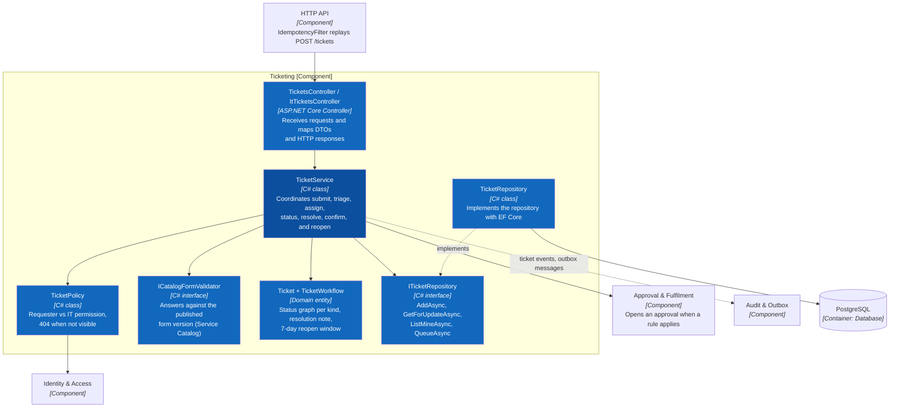
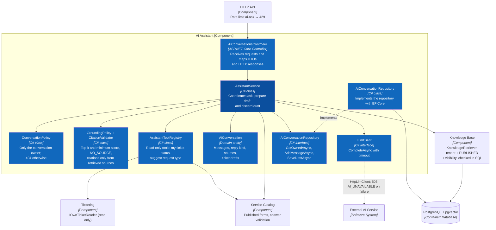

# C4 Level 4 — Code — Two Core Features

> **Status:** target code-level design for the API Application; the repository currently has no C#/.NET source code.

Level 4 zooms into the **Ticketing** and **AI Assistant** components from [C3](03-component.md): one place to request IT help, and an assistant that answers from the company's own guides and turns a chat into a ticket draft. The two features meet at one point — an assistant draft becomes a ticket only through the employee's own `POST /tickets`. The diagrams define intended responsibilities and dependency directions; they follow the three-project layout in the [folder structure](../../07-folder-structure.md).

| Feature | Use cases | Main OpenAPI operations |
|---|---|---|
| L4.1 Ticket Request & Lifecycle | UC07, UC08, UC10, UC16–UC19, UC21 (P0) | `createTicket`, `getTicket`, `listTicketQueue`, `triageTicket`, `assignTicket`, `updateTicketStatus`, `resolveTicket`, `confirmResolution`, `reopenTicket` |
| L4.2 AI Assistant | UC12, UC14 (P0); UC13, UC15 (P1) | `createAIConversation`, `askAI`, `prepareAITicketDraft`, `discardAITicketDraft` |

## L4.1 Ticket Request & Lifecycle



Primary flow: `TicketsController → TicketService → TicketPolicy / ICatalogFormValidator / Ticket → ITicketRepository`. `IdempotencyFilter` replays a repeated `POST /tickets` before the controller runs. The Unit of Work sets `app.tenant_id` and `app.actor_id` with `SET LOCAL`, and writes the ticket, its `ticket_events`, `audit_logs`, `outbox_messages`, and `idempotency_records` in one transaction. Every command carries `expectedVersion`; a stale `row_version` returns `409 CONCURRENT_MODIFICATION`. The Background Worker closes `RESOLVED` tickets after seven days through the same `Ticket.AutoClose()` rule.

Code location:

```text
SmartDesk.Api/Controllers/            TicketsController.cs, ItTicketsController.cs
SmartDesk.Api/Contracts/Tickets/      CreateTicketRequest.cs, TriageTicketRequest.cs, TicketResponse.cs …
SmartDesk.Application/Tickets/        Ticket.cs, TicketWorkflow.cs, ITicketService.cs, TicketService.cs,
                                      TicketPolicy.cs, TicketQuery.cs, IOwnTicketReader.cs
SmartDesk.Application/Catalog/        ICatalogFormValidator.cs, CatalogFormValidator.cs
SmartDesk.Infrastructure/Persistence/ Repositories/TicketRepository.cs, Configurations/TicketConfiguration.cs
SmartDesk.Worker/Jobs/                AutoCloseResolvedTicketsJob.cs
```

## L4.2 AI Assistant



Primary flow: `AiConversationsController → AssistantService → ConversationPolicy → IKnowledgeRetriever → GroundingPolicy → ILlmClient → CitationValidator → IAiConversationRepository`. With no source above the score threshold the service returns `NO_SOURCE` with zero citations and does not call the LLM. Citations that are not among the retrieved sources are dropped; with none left the reply becomes `NO_SOURCE`. Tools run with the caller's principal and never write. `PrepareDraftAsync` extracts answers for the published form, validates them, and stores an `ai_ticket_drafts` row; the employee then submits `POST /tickets` with `aiDraftId`, and Ticketing marks the draft `SUBMITTED` in the same transaction.

Code location:

```text
SmartDesk.Api/Controllers/             AiConversationsController.cs
SmartDesk.Api/Contracts/AiAssistant/   AskRequest.cs, AiReplyResponse.cs, PrepareDraftRequest.cs, TicketDraftResponse.cs
SmartDesk.Application/AiAssistant/     AiConversation.cs, IAssistantService.cs, AssistantService.cs, ConversationPolicy.cs,
                                       GroundingPolicy.cs, CitationValidator.cs, PromptBuilder.cs,
                                       Tools/AssistantToolRegistry.cs, Tools/MyTicketStatusTool.cs, Tools/SuggestRequestTypeTool.cs
SmartDesk.Application/Abstractions/Ai/ ILlmClient.cs, IEmbeddingClient.cs
SmartDesk.Application/KnowledgeBase/   IKnowledgeRetriever.cs
SmartDesk.Infrastructure/Ai/           HttpLlmClient.cs, HttpEmbeddingClient.cs
SmartDesk.Infrastructure/Persistence/  Repositories/AiConversationRepository.cs, Queries/PgVectorKnowledgeRetriever.cs
SmartDesk.Worker/Jobs/                 KbIndexingHandler.cs
```

## Shared Rules for Both Features

1. Controllers contain neither SQL nor business rules.
2. Services depend on repository and provider interfaces, not directly on Npgsql, S3, or HTTP clients.
3. Policies are always enforced by the backend; frontend control visibility serves UX only. A resource that exists but is not visible returns `404`.
4. The same `ICatalogFormValidator` validates a manual form and an assistant draft.
5. One command is one transaction: business rows, events, audit, outbox, and idempotency records commit together.
6. Nothing is hard-deleted; cancellation, discard, and retirement are states.
7. P1 behaviour on P0 routes (UC13, UC15, SLA fields) stays behind a feature flag until Release 2.

**Previous:** [C3 — Component](03-component.md) · **Detailed UML:** [Ticketing and AI Assistant class and sequence diagrams](../uml/README.md) · **Folder structure:** [Frontend and three-tier backend](../../07-folder-structure.md) · **Related:** [Use cases](../../02-use-cases.md).
