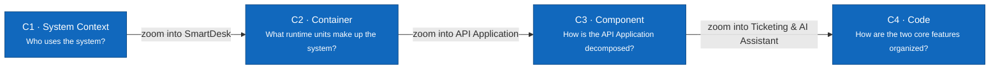

# C4 Model — SmartDesk

> **Status:** Architecture baseline · **Audience:** developers, reviewers, and maintainers

The documentation proceeds from the outside in. Every node has a **name**, **type** (`Person`, `Software System`, `Container`, `Component`), technology where relevant, and a short description.

| Level | Document | Scope |
|---|---|---|
| C1 | [System Context](01-system-context.md) | Five roles, the SmartDesk boundary, the External AI Service and email delivery |
| C2 | [Container](02-container.md) | Web App, API Application, Background Worker, PostgreSQL + pgvector, file storage |
| C3 | [Component](03-component.md) | Components inside the API Application and the Background Worker |
| C4 | [Code — two core features](04-code.md) | C# classes/interfaces for Ticket Request & Lifecycle and the AI Assistant |

## Implementation Status

| Unit | Actual status |
|---|---|
| UX prototype | Single file `prototype/index.html` with mock data |
| Web App (React) | Not started |
| API Application / Background Worker | Not started; [OpenAPI 0.4.1-draft](../../api/openapi.yaml) defines 105 proposed operations |
| PostgreSQL | [Database design revision 2.3](../../database/README.md): DBML + constraints, applied to PGlite (38/38 scenarios), not deployed |
| File storage, AI provider, email | Not chosen |

The diagrams describe the **target architecture**. Technologies (React, ASP.NET Core, PostgreSQL) are the working assumption for the first implementation and can change without changing C1–C3.

## Color Conventions

- Dark blue: the primary unit being described.
- Light blue: a neighboring element in the same system.
- Gray: a user or element outside the boundary being zoomed.
- Dashed line: a Software System or Container boundary.

See also: [Use cases](../../02-use-cases.md#use-case-catalog) · [Detailed UML](../uml/README.md) · [Folder structure](../../07-folder-structure.md).
