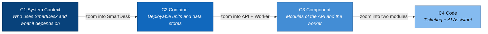

# C4 Model — SmartDesk

> **Status:** target architecture. SmartDesk has requirements, a database design, a proposed OpenAPI contract and a mock-data prototype. There is **no backend or production frontend code yet**; every container, component and class below is a design for the first implementation.  
> **Audience:** developers and reviewers who will build the MVP (Release 1, all P0 use cases).

| Level | Document | Scope |
|---|---|---|
| C1 | [System Context](01-system-context.md) | SmartDesk, its five user roles and the external systems it depends on |
| C2 | [Container](02-container.md) | Web app, API, worker, database, file storage and how they talk |
| C3 | [Component](03-component.md) | Modules inside the API and the worker |
| C4 | [Code](04-code.md) | **Two core features only:** ticket request & lifecycle, and the AI assistant. Classes, sequences and the folder/file hierarchy |

## Sources of truth

| Topic | Source |
|---|---|
| Behaviour, roles, permissions | [Use cases](../../02-use-cases.md), [acceptance criteria](../../06-acceptance-criteria.md) |
| HTTP interface | [OpenAPI contract](../../api/openapi.yaml) and its [review](../../api/openapi-review.md) |
| Data model | [Database design](../../database/README.md) |
| Screens | [Information architecture](../../04-information-architecture.md), [prototype](../../../prototype/index.html) |

When these disagree, the C4 documents follow the **review recommendations** (for example a `roles` array instead of a single `role`, see review R03) and say so where it matters.

## Technology choices (proposed)

The repository does not fix a stack yet. These choices are the working assumption of this design; they can change without changing the C1–C3 structure.

| Concern | Choice | Why |
|---|---|---|
| Frontend | React 18 + TypeScript + Vite SPA | One app with role-based areas, as the 30-page IA describes |
| Backend | ASP.NET Core 8 Web API, modular monolith | One deployable for the MVP; modules keep boundaries so they can be split later |
| Background jobs | .NET Worker Service (same solution) | Timers (auto-close, SLA), KB indexing, notifications, file scanning |
| Database | PostgreSQL 16+ with `pgvector` | Matches the [database design](../../database/README.md); composite FKs enforce tenant isolation; vectors stay next to the data they protect |
| Files | S3-compatible object storage | Attachments and report exports outside the database |
| AI | External LLM + embedding API behind `ILlmClient` / `IEmbeddingClient` | Provider-agnostic; the provider never gets database credentials |

## Implementation status

| Unit | Status |
|---|---|
| Prototype (`prototype/index.html`) | Mock data only, single file |
| Web SPA | Not started |
| API + Worker | Not started; contract is PROPOSED |
| PostgreSQL schema | Designed (DBML + constraints), verified on PGlite, not deployed |
| Object storage, AI provider, email | Not chosen |

## Color conventions

- **Dark blue** — the element being described at this level.
- **Blue** — elements inside the same boundary.
- **Grey** — people and systems outside the boundary.
- **Dashed border** — a boundary (software system or container).
