# Class Diagrams — Ticketing and AI Assistant

> Design status: TARGET V1
>
> Implementation status: TARGET DESIGN; no backend source exists yet

The class diagrams use the intended class names across the three tiers. DTOs belong to the API tier; entities, services, policies, validators, and repository interfaces belong to Application; repository and provider implementations belong to Infrastructure.

The diagrams use a top-to-bottom layout (`direction TB`) to avoid excessive horizontal width. Read them as **Presentation → Application → Infrastructure**; dashed realization arrows indicate interface implementations.

## 1. Ticketing

```mermaid
classDiagram
    direction TB

    class TicketsController {
        +CreateAsync(CreateTicketRequest, string idempotencyKey, CancellationToken) Task
        +ListMineAsync(TicketListQuery, CancellationToken) Task
        +GetAsync(Guid ticketId, CancellationToken) Task
        +ConfirmAsync(Guid ticketId, VersionRequest, CancellationToken) Task
        +ReopenAsync(Guid ticketId, ReopenTicketRequest, CancellationToken) Task
    }

    class ItTicketsController {
        +QueueAsync(TicketQueueQuery, CancellationToken) Task
        +TriageAsync(Guid ticketId, TriageTicketRequest, CancellationToken) Task
        +AssignAsync(Guid ticketId, AssignTicketRequest, CancellationToken) Task
        +ChangeStatusAsync(Guid ticketId, ChangeStatusRequest, CancellationToken) Task
        +ResolveAsync(Guid ticketId, ResolveTicketRequest, CancellationToken) Task
    }

    class CreateTicketRequest {
        +Guid RequestTypeId
        +int RequestTypeVersion
        +string Title
        +string? Description
        +Dictionary~string, JsonElement~ Answers
        +Guid[] UploadIds
        +Guid? AiDraftId
    }

    class TriageTicketRequest {
        +int ExpectedVersion
        +string Category
        +TicketPriority Priority
        +Guid? TargetRequestTypeId
        +int? TargetRequestTypeVersion
        +string? Reason
    }

    class ResolveTicketRequest {
        +int ExpectedVersion
        +string ResolutionNote
    }

    class TicketResponse {
        +Guid Id
        +string DisplayId
        +TicketKind TicketType
        +TicketStatus Status
        +string Title
        +ActorResponse Requester
        +ActorResponse? Assignee
        +TicketPriority Priority
        +DateTimeOffset? ReopenDeadlineAt
        +int Version
    }

    class IdempotencyFilter {
        +OnActionExecutionAsync(ActionExecutingContext, ActionExecutionDelegate) Task
    }

    class ITicketService {
        <<interface>>
        +SubmitAsync(ActorContext, SubmitTicketCommand, CancellationToken) Task
        +TriageAsync(ActorContext, TriageCommand, CancellationToken) Task
        +AssignAsync(ActorContext, AssignCommand, CancellationToken) Task
        +ChangeStatusAsync(ActorContext, StatusCommand, CancellationToken) Task
        +ResolveAsync(ActorContext, ResolveCommand, CancellationToken) Task
        +ConfirmAsync(ActorContext, Guid, int, CancellationToken) Task
        +ReopenAsync(ActorContext, Guid, int, string, CancellationToken) Task
    }

    class TicketService {
        +SubmitAsync(ActorContext, SubmitTicketCommand, CancellationToken) Task
        +TriageAsync(ActorContext, TriageCommand, CancellationToken) Task
        +ResolveAsync(ActorContext, ResolveCommand, CancellationToken) Task
        +ConfirmAsync(ActorContext, Guid, int, CancellationToken) Task
        +ReopenAsync(ActorContext, Guid, int, string, CancellationToken) Task
    }

    class TicketPolicy {
        +EnsureCanRead(ActorContext, Ticket) void
        +EnsureRequester(ActorContext, Ticket) void
        +EnsureItPermission(ActorContext, string permission) void
    }

    class ICatalogFormValidator {
        <<interface>>
        +ValidateAsync(Guid requestTypeId, int version, Answers, ActorContext, CancellationToken) Task
    }

    class IApprovalRuleResolver {
        <<interface>>
        +ResolveAsync(Guid catalogVersionId, ActorContext, CancellationToken) Task
    }

    class Ticket {
        +Guid Id
        +Guid TenantId
        +string TicketNo
        +TicketKind Kind
        +TicketStatus Status
        +TicketSource Source
        +Guid RequesterMembershipId
        +Guid CatalogVersionId
        +Answers FormAnswers
        +TicketPriority Priority
        +string? Category
        +Guid? AssignedMembershipId
        +string? ResolutionNote
        +DateTimeOffset? ResolvedAt
        +int RowVersion
        +Submit(SubmitTicketCommand, bool approvalRequired, DateTimeOffset) Ticket
        +Triage(string category, TicketPriority, Guid actor) void
        +ConvertTo(Guid catalogVersionId, TicketKind, Answers, string reason) void
        +AssignTo(Guid assignee, Guid actor) void
        +MoveTo(TicketStatus, string? reason, Guid actor) void
        +Resolve(string note, Guid actor, DateTimeOffset) void
        +ConfirmResolution(Guid requester, DateTimeOffset) void
        +Reopen(Guid requester, string reason, DateTimeOffset) void
        +AutoClose(DateTimeOffset) void
    }

    class TicketWorkflow {
        +InitialStatus(TicketKind, bool approvalRequired) TicketStatus
        +CanMove(TicketKind, TicketStatus from, TicketStatus to) bool
    }

    class TicketEvent {
        +TicketEventType EventType
        +TicketStatus? OldStatus
        +TicketStatus? NewStatus
        +string? Reason
        +Guid? ActorMembershipId
        +DateTimeOffset CreatedAt
    }

    class ITicketRepository {
        <<interface>>
        +AddAsync(Ticket, CancellationToken) Task
        +GetForUpdateAsync(Guid, CancellationToken) Task
        +ListMineAsync(Guid membershipId, TicketQuery, CancellationToken) Task
        +QueueAsync(TicketQuery, CancellationToken) Task
        +ListResolvedBeforeAsync(DateTimeOffset, int, CancellationToken) Task
    }

    class IIdempotencyStore {
        <<interface>>
        +FindAsync(IdempotencyScope, CancellationToken) Task
        +SaveAsync(IdempotencyScope, string requestHash, int status, string body, CancellationToken) Task
    }

    class IUnitOfWork {
        <<interface>>
        +ExecuteAsync(ActorContext, Func~Task~, CancellationToken) Task
    }

    class TicketRepository {
        +AddAsync(Ticket, CancellationToken) Task
        +GetForUpdateAsync(Guid, CancellationToken) Task
        +ListMineAsync(Guid membershipId, TicketQuery, CancellationToken) Task
        +QueueAsync(TicketQuery, CancellationToken) Task
        +ListResolvedBeforeAsync(DateTimeOffset, int, CancellationToken) Task
    }

    class IdempotencyStore
    class EfUnitOfWork
    class AutoCloseResolvedTicketsJob {
        +RunAsync(CancellationToken) Task
    }

    TicketsController ..> CreateTicketRequest
    TicketsController ..> TicketResponse
    ItTicketsController ..> TriageTicketRequest
    ItTicketsController ..> ResolveTicketRequest
    TicketsController --> ITicketService
    ItTicketsController --> ITicketService
    IdempotencyFilter --> IIdempotencyStore
    ITicketService <|.. TicketService
    TicketService --> TicketPolicy
    TicketService --> ICatalogFormValidator
    TicketService --> IApprovalRuleResolver
    TicketService --> ITicketRepository
    TicketService --> IUnitOfWork
    TicketService ..> Ticket
    Ticket --> TicketWorkflow
    Ticket "1" *-- "many" TicketEvent
    ITicketRepository <|.. TicketRepository
    IIdempotencyStore <|.. IdempotencyStore
    IUnitOfWork <|.. EfUnitOfWork
    AutoCloseResolvedTicketsJob --> ITicketRepository
```

## 2. AI Assistant

```mermaid
classDiagram
    direction TB

    class AiConversationsController {
        +StartAsync(CancellationToken) Task
        +AskAsync(Guid conversationId, AskRequest, CancellationToken) Task
        +PrepareDraftAsync(Guid conversationId, PrepareDraftRequest, CancellationToken) Task
        +DiscardDraftAsync(Guid conversationId, Guid draftId, CancellationToken) Task
    }

    class AskRequest {
        +string Text
    }

    class AiReplyResponse {
        +Guid Id
        +AiReplyKind Kind
        +string Text
        +CitationResponse[] Citations
        +OwnTicketStatusResponse? Ticket
        +Guid? SuggestedRequestTypeId
    }

    class PrepareDraftRequest {
        +Guid RequestTypeId
        +Dictionary~string, JsonElement~? Facts
        +string? TitleHint
    }

    class TicketDraftResponse {
        +Guid Id
        +AiDraftStatus Status
        +Guid RequestTypeId
        +int RequestTypeVersion
        +string Title
        +Dictionary~string, JsonElement~ Answers
        +string[] MissingRequiredFieldIds
        +bool ReadyToSubmit
    }

    class IAssistantService {
        <<interface>>
        +StartAsync(ActorContext, CancellationToken) Task
        +AskAsync(ActorContext, Guid, string, CancellationToken) Task
        +PrepareDraftAsync(ActorContext, Guid, PrepareDraftCommand, CancellationToken) Task
        +DiscardDraftAsync(ActorContext, Guid, Guid, CancellationToken) Task
    }

    class AssistantService {
        +AskAsync(ActorContext, Guid, string, CancellationToken) Task
        +PrepareDraftAsync(ActorContext, Guid, PrepareDraftCommand, CancellationToken) Task
        +DiscardDraftAsync(ActorContext, Guid, Guid, CancellationToken) Task
    }

    class ConversationPolicy {
        +EnsureOwner(ActorContext, AiConversation) void
    }

    class GroundingPolicy {
        +int TopK
        +double MinScore
        +SelectSources(IReadOnlyList~KbChunkHit~) SourceSet
    }

    class PromptBuilder {
        +ForAnswer(string question, SourceSet, IReadOnlyList~AiMessage~) LlmRequest
        +ForDraft(IReadOnlyList~AiMessage~, PublishedForm) LlmRequest
    }

    class CitationValidator {
        +Validate(LlmResponse, SourceSet) ValidatedAnswer
    }

    class AssistantToolRegistry {
        +For(ActorContext) IReadOnlyList~IAssistantTool~
        +ExecuteAsync(ToolCall, ActorContext, CancellationToken) Task
    }

    class IAssistantTool {
        <<interface>>
        +string Name
        +ExecuteAsync(JsonElement args, ActorContext, CancellationToken) Task
    }

    class MyTicketStatusTool
    class SuggestRequestTypeTool

    class AiConversation {
        +Guid Id
        +Guid TenantId
        +Guid MembershipId
        +DateTimeOffset StartedAt
        +AddUserMessage(string) AiMessage
        +AddAssistantMessage(ValidatedAnswer, string model, int inputTokens, int outputTokens) AiMessage
        +AddDraft(PublishedForm, Answers, string title) AiTicketDraft
    }

    class AiMessage {
        +AiSender Sender
        +string Content
        +AiReplyKind? ReplyKind
        +string? Model
    }

    class AiMessageSource {
        +Guid KbArticleVersionId
        +string? Excerpt
    }

    class AiTicketDraft {
        +Guid Id
        +Guid CatalogVersionId
        +Answers ProposedAnswers
        +AiDraftStatus Status
        +Guid? SubmittedTicketId
        +MarkSubmitted(Guid ticketId) void
        +Discard() void
    }

    class ILlmClient {
        <<interface>>
        +CompleteAsync(LlmRequest, CancellationToken) Task
    }

    class IEmbeddingClient {
        <<interface>>
        +EmbedAsync(string, CancellationToken) Task
    }

    class IKnowledgeRetriever {
        <<interface>>
        +SearchAsync(ActorContext, float[] embedding, int topK, CancellationToken) Task
    }

    class IOwnTicketReader {
        <<interface>>
        +FindMineAsync(ActorContext, string query, CancellationToken) Task
    }

    class IPublishedCatalogReader {
        <<interface>>
        +GetUsableFormAsync(ActorContext, Guid requestTypeId, CancellationToken) Task
    }

    class IAiConversationRepository {
        <<interface>>
        +GetOwnedAsync(Guid id, Guid membershipId, CancellationToken) Task
        +SaveAsync(AiConversation, CancellationToken) Task
    }

    class HttpLlmClient
    class HttpEmbeddingClient
    class PgVectorKnowledgeRetriever
    class AiConversationRepository

    AiConversationsController ..> AskRequest
    AiConversationsController ..> AiReplyResponse
    AiConversationsController ..> PrepareDraftRequest
    AiConversationsController ..> TicketDraftResponse
    AiConversationsController --> IAssistantService
    IAssistantService <|.. AssistantService
    AssistantService --> ConversationPolicy
    AssistantService --> IEmbeddingClient
    AssistantService --> IKnowledgeRetriever
    AssistantService --> GroundingPolicy
    AssistantService --> PromptBuilder
    AssistantService --> ILlmClient
    AssistantService --> AssistantToolRegistry
    AssistantService --> CitationValidator
    AssistantService --> IPublishedCatalogReader
    AssistantService --> IAiConversationRepository
    AssistantService ..> AiConversation
    AssistantToolRegistry o-- IAssistantTool
    IAssistantTool <|.. MyTicketStatusTool
    IAssistantTool <|.. SuggestRequestTypeTool
    MyTicketStatusTool --> IOwnTicketReader
    SuggestRequestTypeTool --> IPublishedCatalogReader
    AiConversation "1" *-- "many" AiMessage
    AiMessage "1" *-- "many" AiMessageSource
    AiConversation "1" *-- "many" AiTicketDraft
    ILlmClient <|.. HttpLlmClient
    IEmbeddingClient <|.. HttpEmbeddingClient
    IKnowledgeRetriever <|.. PgVectorKnowledgeRetriever
    IAiConversationRepository <|.. AiConversationRepository
```

No class in the AI Assistant module depends on `ITicketService` or any other write service. `TicketService.SubmitAsync` marks an `AiTicketDraft` as `SUBMITTED` when `AiDraftId` is set, inside the same transaction as the new ticket.

## 3. Shared Enums

| Enum | Values | Database enum |
|---|---|---|
| `TicketKind` | INCIDENT, SERVICE_REQUEST, CHANGE | `ticket_kind` |
| `TicketStatus` | SUBMITTED, TRIAGED, IN_PROGRESS, WAITING_FOR_EMPLOYEE, PENDING_APPROVAL, APPROVED, REJECTED, IN_FULFILMENT, DRAFT, ASSESSING, SCHEDULED, IMPLEMENTED, RESOLVED, REOPENED, CLOSED, CANCELLED | `ticket_status` (valid subset per kind: `ck_tickets_status_per_kind`) |
| `TicketPriority` | LOW, MEDIUM, HIGH, CRITICAL | `ticket_priority` |
| `TicketSource` | PORTAL, AI_ASSISTANT | `ticket_source` |
| `TicketEventType` | CREATED, STATUS_CHANGED, ASSIGNED, TRANSFERRED, ESCALATED, PRIORITY_CHANGED, LINKED, UNLINKED, APPROVAL_REQUESTED, APPROVAL_DECIDED, SLA_WARNING, SLA_BREACHED, TYPE_CHANGED | `ticket_event_type` |
| `AiSender` | USER, ASSISTANT, TOOL | `ai_sender` |
| `AiReplyKind` | GROUNDED_ANSWER, NO_SOURCE, FOLLOW_UP, MY_TICKET_STATUS | `ai_reply_kind` |
| `AiDraftStatus` | DRAFT, SUBMITTED, DISCARDED | `ai_draft_status` |

## 4. Mapping Boundaries

- Controllers map HTTP DTOs to Application commands; Application types never carry HTTP attributes.
- `ActorContext` (tenant, membership, roles, permissions) is built by the API tier from the session; request bodies never carry tenant, requester, or role.
- Repositories map entities to `snake_case` tables; `row_version` is the EF Core concurrency token behind every `ExpectedVersion`.
- `PgVectorKnowledgeRetriever` joins `kb_chunks` to `kb_article_versions` (`PUBLISHED`) and `kb_articles` (visibility) in SQL, so a retired article is never returned even before its chunks are deleted.

## 5. DTO Naming Convention

- Requests end with `Request` (`CreateTicketRequest`, `AskRequest`); responses end with `Response` (`TicketResponse`, `AiReplyResponse`).
- Application inputs end with `Command` (`SubmitTicketCommand`, `PrepareDraftCommand`).
- JSON uses `camelCase`, C# uses `PascalCase`, SQL uses `snake_case`; names follow the OpenAPI schemas.
