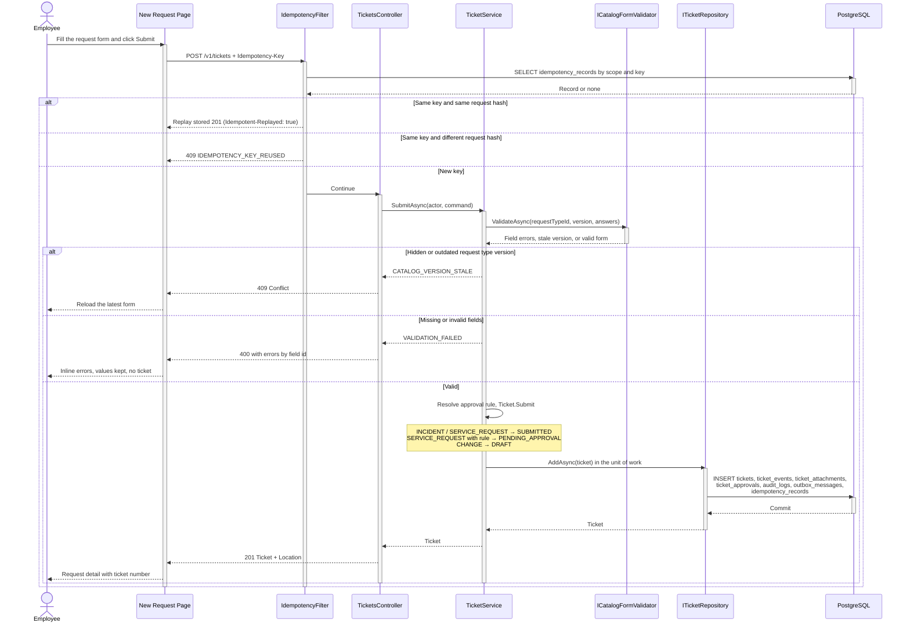
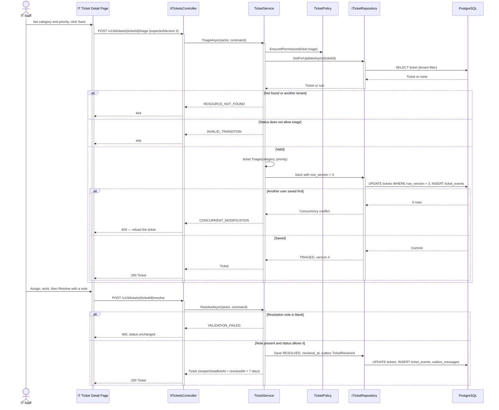
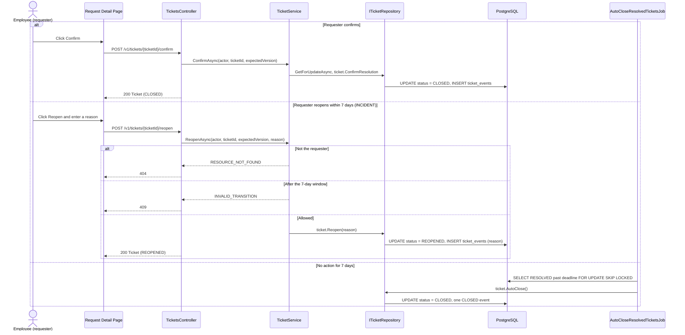
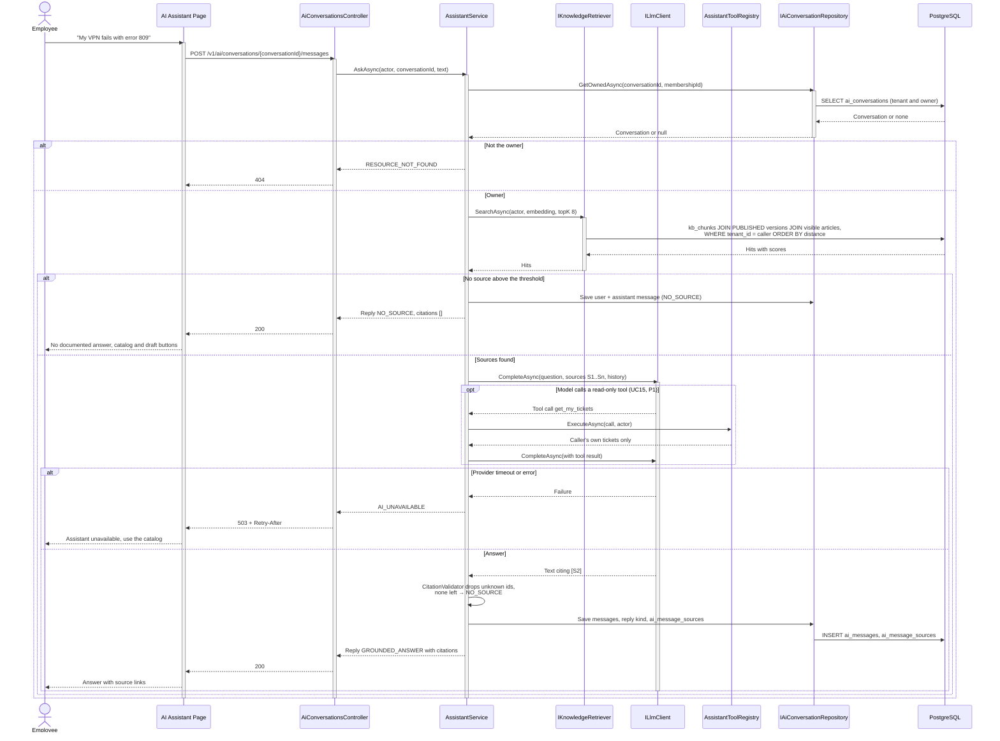
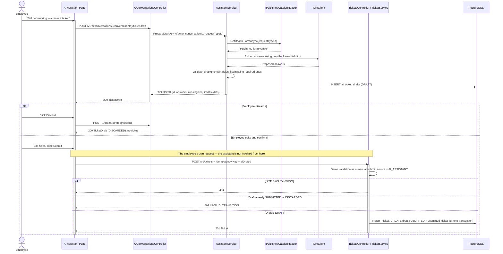

# Sequence Diagrams — Ticketing and AI Assistant

> **Scope:** Ticket Request & Lifecycle and the AI Assistant · **Status:** Target design; no backend implemented  
> The `/v1/...` endpoints follow [OpenAPI 3.1](../../api/openapi.yaml).

The diagrams share one presentation pattern: **Actor → Page → Controller → Application Service → Repository → PostgreSQL**. Requests use solid arrows, responses use dashed arrows; `alt` describes mutually exclusive outcomes and `opt` describes optional processing.

## 1. Submit a request — `POST /v1/tickets`

The tenant and requester come from the session. A body that carries `tenantId`, `requesterId`, or a role fails schema validation with `400` (test T16).

## 2. IT triages and resolves — `POST /v1/it/tickets/{ticketId}/triage`, `/resolve`

## 3. Confirm, reopen, or auto-close — `POST /v1/tickets/{ticketId}/confirm`, `/reopen`

The job re-checks the status under the row lock, so a retry or a second worker instance writes no second close event (test T13).

## 4. Ask the assistant — `POST /v1/ai/conversations/{conversationId}/messages`

## 5. Turn a chat into a ticket — `POST .../ticket-draft`, then `POST /v1/tickets`

Until the employee's `POST /tickets` succeeds, the database holds no new ticket (test T15).

## 6. Common error conventions

| Status | `errorCode` | Used in these flows when |
|---|---|---|
| 400 | `VALIDATION_FAILED` | Missing or invalid form fields, blank resolution note |
| 401 | `AUTHENTICATION_FAILED` | No valid tenant session |
| 403 | `ACCESS_DENIED` | The caller lacks the permission (for example an employee calling `/it/tickets/...`) |
| 404 | `RESOURCE_NOT_FOUND` | The ticket, conversation, or draft does not exist or is not visible to the caller |
| 409 | `INVALID_TRANSITION`, `CONCURRENT_MODIFICATION`, `IDEMPOTENCY_KEY_REUSED`, `CATALOG_VERSION_STALE` | Illegal status change, stale `expectedVersion`, reused key with a different body, outdated form |
| 429 | `RATE_LIMIT_EXCEEDED` | Too many submissions or assistant questions |
| 503 | `AI_UNAVAILABLE` | The AI provider failed or exceeded the time budget |

All errors use `application/problem+json`. A resource that exists but belongs to another tenant or person returns the same `404` as an unknown id, so ids cannot be probed.
